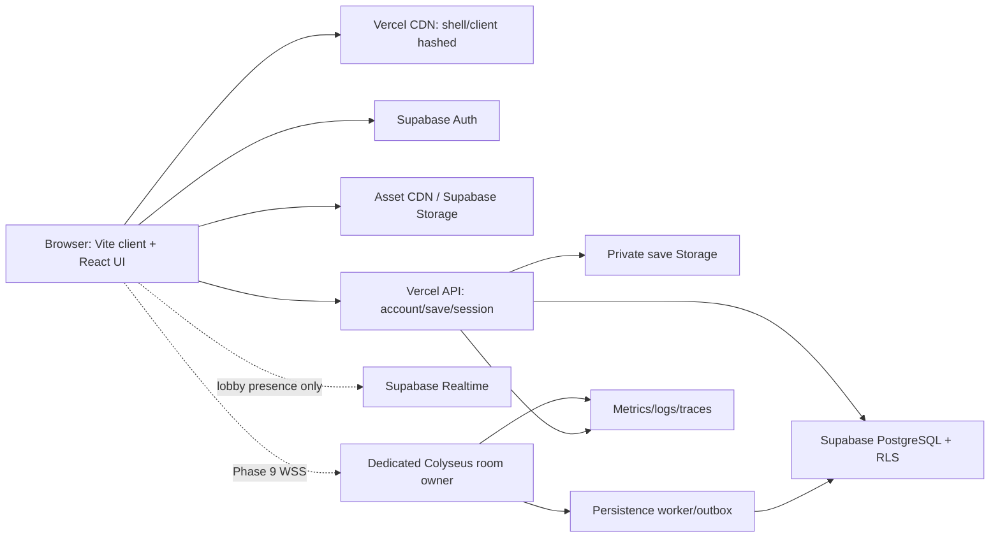
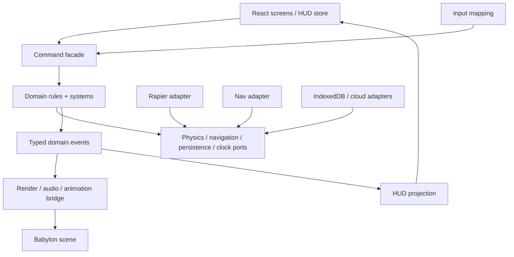
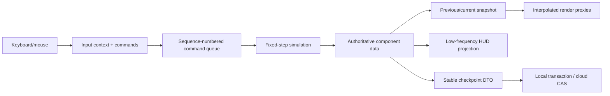
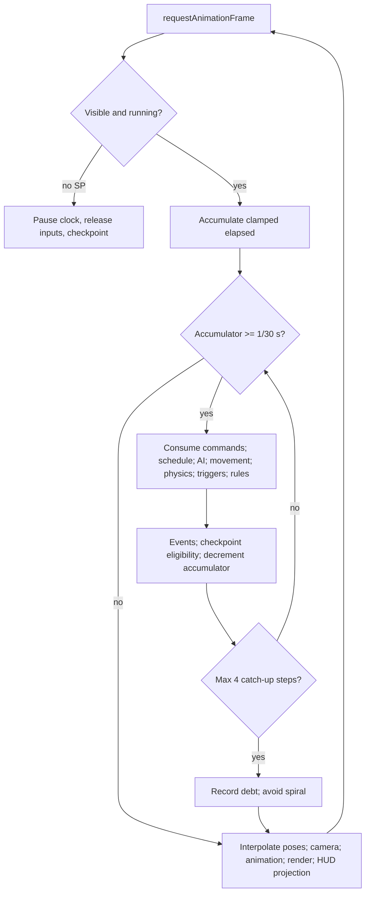
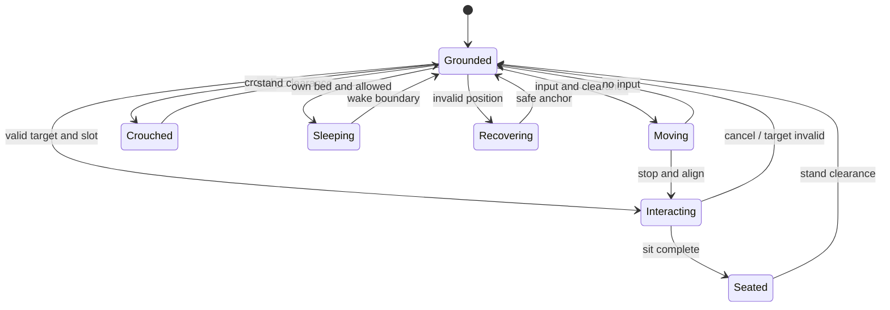
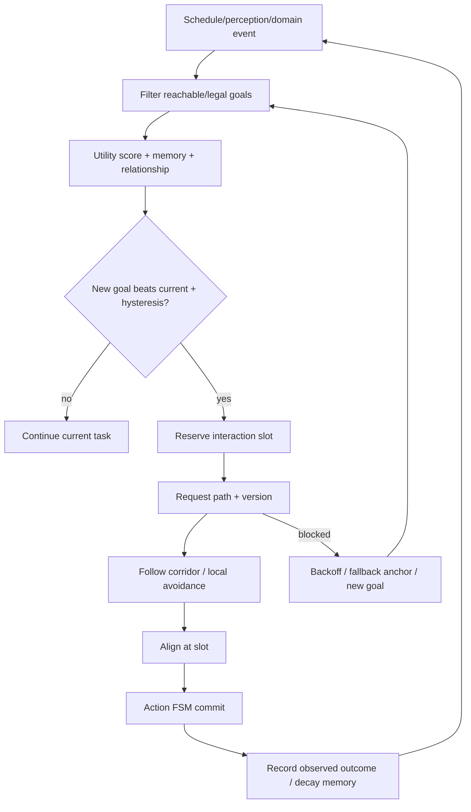

# 02 — Technical Design Document

**CR-VN-01 / thiết kế 1.2:** Authority theo actor, custody boundaries, saga và kế hoạch save v3 tại [16](16-custody-contracts.md); đây là thiết kế chưa triển khai.

**Tích hợp1.1:** [11 — Full Life contracts](11-prison-life-contracts.md) bổ sung custody/services/economy/casework/support/programs/contact/transitions vào chính runtime này, cùng clock/authority/events. Các luồng đời sống [F33–60](10-prison-life-systems.md) không được triển khai thành game state/ledger/calendar thứ hai. PERF budgets giữ nguyên cho tổng workload, phải qua QA24 phần12.

Mọi tần số và giới hạn dưới đây là **đề xuất**, cần xác nhận bằng Phase 0. Cơ sở công nghệ: S01–S26 ở [sổ nghiên cứu](01-research.md). Mục tiêu là nâng cấp authority mà giữ domain và dữ liệu nội dung; không cam kết multiplayer là thao tác bật cờ.

## High-level System Architecture



Website/admin: content, auth và dashboard, không có frame loop. Client: input, render, local simulation ở SP; prediction/presentation ở MP. API: giao dịch ngắn, quyền truy cập, save validation, session ticket. Room: simulation state có một owner, tick và NPC AI. DB: durable state, không ghi transforms mỗi frame. Storage/CDN: asset immutable; private save riêng. Realtime: presence/invitation, không dùng để gửi physics poses.

## Component Diagram và quy tắc phụ thuộc



Mũi tên adapter → port nghĩa là implements interface; domain không import engine, DOM, React hoặc Supabase SDK. Composition root cấp dependency rõ, không service locator toàn cục. Commands là ý định; events là kết quả đã được authority chấp nhận. Events có ID, tick, entity ID, schema version; không gửi object engine hoặc closure. Queue bounded và priority: interaction/save không được bỏ; cosmetic có thể coalesce. Không dùng event bus thay lời gọi nội bộ cho mọi phép tính.

## Game runtime, ownership và data flow



Simulation sở hữu position/collider, needs, inventory, quest và relationships. Renderer sở hữu mesh/material/light/camera và cosmetic particles. React store chỉ giữ modal/tab/focus cùng HUD projection; HUD needs 4 Hz, đồng hồ 1 Hz, quest/interaction theo event. Không nhân đôi inventory mutable giữa React và game. Shared typed schema kiểm tra dữ liệu ở runtime; TypeScript không đủ chống payload không hợp lệ.

### Module và cấu trúc dự án đề xuất

Đây là sơ đồ thư mục dự kiến, chưa tạo source game:

```text
apps/
  client/                 Vite entry, composition root, lifecycle
    src/app/              routes, boot/error boundaries
    src/ui/               screens, accessibility, HUD projections
    src/presentation/     Babylon scene, audio, cameras, animation
    src/workers/          decode/path jobs, versioned messages
  web/                    optional Next marketing/admin, server auth
  api/                    HTTP adapters, auth, validators, orchestration
  game-server/            Phase 9 Colyseus room, tick, lifecycle
packages/
  domain/                 entity IDs, inventory/quest/needs rules, events
  simulation/             system order, clock, RNG, state checkpoints
  contracts/              API/message/save schemas, protocol versions
  content/                validated item/mission/dialogue/schedule data
  physics-rapier/         PhysicsPort, controller, collision masks
  navigation/             NavPort, baked graph, reservations
  persistence/            save DTO, migration, local/cloud ports
  telemetry/              redaction, metric names, sampling
  design-system/          tokens + React components, no engine dependency
assets-src/               Blender sources, licensed originals, audio masters
assets-build/             generated GLB/KTX2/manifest, immutable outputs
infra/                    deployment templates and runbooks when implemented
supabase/                 migrations, policy tests and seeds when implemented
tests/                    fixtures, golden traces, benchmark scenes, browser matrix
docs/                     ADR, GDD/TDD, operations, benchmark reports
```

Shared contracts được version hóa; domain không phụ thuộc app. Asset source dùng Git LFS/object source repository phù hợp license; build outputs phát hành artifact thay commit file khổng lồ. Enforce boundary bằng lint và dependency graph; package exports ngăn import nội bộ chéo. Content schema failure chặn build, không đợi runtime.

## Game loop và thời gian



Authority physics/simulation **30 Hz** ban đầu; render độc lập 30/60 Hz theo thiết bị. Đây là thỏa hiệp cần kiểm controller; tăng 60 Hz nếu stair/collision test không đạt và CPU đủ. `dt` cố định; không truyền delta biến thiên vào simulation. Giới hạn elapsed 250 ms và 4 bước catch-up ở client; nếu thiếu thời gian, SP chậm clock simulation thay vì nhảy mất needs/events. Server không bỏ tick âm thầm: đo tick debt, giảm cosmetic/AI xa, từ chối room mới và cảnh báo overload. Physical time khác game clock: mặc định ngày 48 phút thật (30× game minutes), có chế độ 72 phút; physics không tăng tốc cùng clock. Sleep dùng fast-forward domain theo scheduled boundaries, không step physics hàng nghìn lần.

SP background tab/pause/modal quan trọng dừng domain. MP background hoặc menu không dừng room; client báo rõ và thả input. Mọi timestamp gameplay dùng tick/world minute, không dùng local wall clock để cấp reward. Server time dùng expiry/ticket; timezone chỉ để hiển thị.

## Character controller và camera

Thông số khởi điểm: 1 unit = 1 m, capsule cao 1,75 m bán kính 0,30 m; crouch 1,15 m. Đi 1,6 m/s, chạy 3,4 m/s, crouch 0,9 m/s; acceleration 10 m/s². Slope tối đa 40°, step 0,25 m, skin 0,03 m; kiểm chứng scale/collision thực tế, không coi số này là cấu hình tối ưu Rapier. Không jump ở MVP, giảm tổ hợp collision và animation. Kinematic sweep + slide; collider props nhẹ không được đẩy người chơi ra ngoài thế giới. Nav capsule và physics clearance phải cùng kích thước.

WASD theo camera yaw; diagonal normalized. Mouse delta cập nhật camera, không cấp tốc độ movement; rebind input semantic, tách Gameplay/UI/Dialogue contexts. Blur/pointer-lock loss xóa held keys và mở pause SP; click có chủ ý mới lấy lại pointer lock/audio. Crouch→stand phải shape cast kiểm tra trần; không stand xuyên vật thể. Interact range 1,8 m và line-of-sight; aim ưu tiên target trong tâm nhìn rồi khoảng cách, hysteresis 150 ms tránh flicker. Trigger enter/exit dùng entity ID, dedupe cùng tick.

Camera thứ ba: pivot vai ~1,5 m, boom 2,8 m, shoulder switch tùy chọn; sphere sweep pivot→desired để tránh xuyên tường, co nhanh và giãn mềm. Tối thiểu 0,35 m, fade mesh đầu/vai khi quá gần; không thay collider gameplay. Pitch giới hạn -65°..70°, sensitivity và invert Y; không head bob/motion blur mặc định. Góc nhìn thứ nhất P2 chỉ sau animation/camera review, không thêm camera mode chưa có asset phù hợp.



Character state là quyền hành động; animation state là biểu diễn. Animation không tự cấp item/reward khi clip callback chạy. Interaction có start/commit/end ticks và cancellation window do domain quyết định. Animation marker chỉ căn âm thanh/pose, domain commit idempotent theo action ID.

### Animation production contract

| Nhóm | MVP | Nâng cao / hạn chế |
|---|---|---|
| Locomotion | Idle/walk/run/crouch; blend 1D speed + turn, in-place | Strafe 2D, turn-in-place, slope adjustment |
| Context | Sit/stand, sleep/wake, reach/pick/drop, talk gesture | Partner animation, multi-object alignment |
| Blend | 0,12–0,25 s; upper-body talk; lock incompatible states | Additive emotion, aim/hand IK |
| Foot placement | Correct floor sampling, artist foot contact; optional near-player two-bone IK | Full procedural terrain IK; disable xa |
| Face | 3 expression presets, blink; subtitles | Blendshape lipsync/visemes, không full face simulation MVP |
| Ragdoll | Không MVP | Cosmetic bounded 1–2 nearby, no authoritative progress change |
| Customization | Shared skeleton, 3 body silhouettes tested, hair/outfit variants | Continuous sliders chỉ khi skin/clipping validated |
| Equipment | Defined hand/head/body sockets, 1 outfit + held prop | Layered apparel cần clipping/LOD QA |

Animation FSM: locomotion base → transition clip → contextual loop → exit → locomotion. Interrupt rules ưu tiên recover > world transition > cancel > action > locomotion. Root motion chỉ cinematic/context alignment có authority trajectory; locomotion capsule dẫn pose. Clip import không đổi unit/up-axis. LOD: near update 30/60 Hz, mid 15 Hz, far 5 Hz; simulation/arrival không bị giảm theo animation. Shared clips/skeleton mappings nhưng mỗi NPC có state riêng; dispose mixers/proxies khi unload.

Network gửi movement mode, speed quantized, action ID/start tick, expression enum; không stream bones/face mỗi frame. Client căn phase animation bằng server tick; correction không khởi động lại clip reward. Missing clip fallback idle + diagnostic, action vẫn hoàn tất theo domain nếu an toàn.

## Graphics & rendering architecture

Pipeline baseline: linear lighting; base color/emissive được khai báo sRGB, normal/ORM là dữ liệu tuyến tính; HDR render target nếu supported → exposure/tone mapping nhất quán → output color space. Chốt tone mapper qua art review và reference captures, không double gamma. PBR metallic-roughness; tường/bê tông không metallic. Normal map tangents validated.

Ánh sáng: baked indirect/static occlusion + environment probes, một sun directional shadow ngoài trời, đèn trong phòng chủ yếu baked/emissive với ít local dynamic. Day/night chuyển sky, intensity và màu; baked variants theo khu/time nếu cần, không trộn bake ban ngày với đêm quá rõ. Khi đổi phase bake, crossfade bounded textures, không giữ toàn bộ mọi khu. Không hứa realtime GI. Contact shadow/AO chỉ medium trở lên; SSR optional high, reflection probes fallback; bloom nhẹ từ emissive, DOF chỉ menu/cinematic. Fog baseline analytic; volumetric P2 phải chứng minh budget.

Shadow atlas và cascades theo tier; người/props gần có shadow, xa dùng blob/baked. LOD theo screen-space size + hysteresis; frustum/room portal visibility; occlusion culling chỉ bật nếu overhead thấp hơn lợi ích. Static mesh merge theo cell/material, không merge cả khu làm mất culling. Instances cho giường/song/tủ lặp, không ép skinned NPC thành static instances.

AssetManager có refcount handles; zone load lấy lease, unload trả lease; GPU/physics/nav/audio cùng lifecycle nhưng không dispose shared material khi cell khác còn dùng. Manifest gồm content hash, dependencies, byte size, compression, fallback và min version. Decode ở worker nếu có lợi; GPU upload chia budget 2 ms/frame đề xuất. Prefetch khu kế tiếp, ưu tiên player-critical collider/nav trước cosmetic. Cache hashed assets immutable; manifest có version và rollback, không trộn content revision trong cùng save session. Context/device lost: pause SP, checkpoint nếu state còn hợp lệ, recreate renderer/resources; MP reconnect/resync, không tự nhận state cũ là đúng.

Shader compilation: warm material variants đường camera sắp tới ở loading, tránh compile toàn game. Giới hạn light/material permutation; precompile có đo và cancel. GPU timer query chỉ nơi được hỗ trợ; không đọc sync GPU stalls trong production loop. Metric draw count/triangles chỉ là proxy, fill rate/overdraw/skinning/texture bandwidth cũng phải đo.

## Physics architecture

| Hệ thống | Đặc tả |
|---|---|
| Layers | WorldStatic, Character, InteractableDynamic, Trigger, CameraBlocker; collision matrix versioned, trigger không response force |
| Shapes | Static concave chỉ môi trường không di chuyển; dynamic convex/cuboid; capsule character; collider source tách render mesh |
| Rigid bodies | Sleep bật; dynamic props giới hạn theo zone; props ngoài gameplay có thể kinematic/cosmetic; CCD chỉ vật nhỏ nhanh |
| Queries | Character sweep mỗi tick, interaction ray theo input/10 Hz; camera sweep render phase; masks ngăn pick collider vô hình |
| Doors | State closed/opening/open/closing/blocked; collider và nav link commit cùng tick; doorway occupancy chặn đóng xuyên người |
| Triggers | Server/local authority phát entered/exited once; restore snapshot xây occupancy trước emit để không phát reward lặp |
| Fixed step | 30 Hz và test 60 Hz đối chứng; render interpolation prev/current; không physics bằng delta frame |
| Determinism | S10 có điều kiện chặt; RNG seed, ordering và content hash phải giống. Không hứa cross-version replay; MP dùng authority thay lockstep |
| Recovery | Invalid pose/NaN/out-of-bounds → safe anchor cuối, log trace, không làm mất inventory; không teleport reward |
| Optimization | Broadphase spatial locality, collider budget, sleeping, no per-frame allocate; debug draw chỉ dev |

Rapier vs Havok: Rapier thuận adapter headless chung nhưng cần nối engine; Havok có integration Babylon trực tiếp, phải đánh giá headless, WASM/SIMD và parity controller. Cannon/Ammo/Jolt có thể làm phương án khác, **chưa nghiên cứu sâu ở đây**; không chọn chỉ vì tên quen. Gate T00-03 phải thử 100 lượt door, step, crouch, corridor crowd, moving prop, spawn overlap và reset memory.

## NPC AI architecture

| Mô hình | Ưu điểm | Nhược điểm | Vai trò đề xuất |
|---|---|---|---|
| FSM | Dễ trace, invariant rõ | Bùng nổ transition khi quá nhiều mục tiêu | Locomotion/action và lifecycle |
| Behavior Tree | Task tái sử dụng, interrupt rõ | Branch lớn, tick mọi node tốn CPU nếu làm sai | Chuỗi execute goal: đi→reserve→align→act |
| Utility | Chọn giữa nhu cầu cạnh tranh linh hoạt | Oscillation và khó tune/debug | Chọn goal trong constraint lịch, thêm hysteresis |
| Schedule | Dễ thiết kế nhịp ngày, reproducible | Cứng nếu không có fallback | Ràng buộc mềm/cứng theo phase |

Không chạy ba hệ thống cạnh tranh quyền điều khiển. Schedule cung cấp eligibility, utility chọn goal, task tree thi hành, action FSM giữ quyền animation/controller. Cảm xúc (valence/arousal 0..1 theo schema bounded) và relationship là đầu vào, không quyền vượt safety/path constraint. Perception dùng spatial grid, field of view + occlusion query có budget; tiếng động là domain event radius/zone, không NPC nào cũng biết toàn thế giới.



Utility mẫu [D]: weight_need×normalized_deficit + schedule_priority + social_interest + remembered_value − path_cost − congestion_cost. Không dùng số score như xác suất. Goal change yêu cầu chênh >0,15 trong 1 s game-runtime trừ urgent event; interaction committed không hủy vì một thay đổi mood nhỏ. NPC sample lệch pha theo ID, không all tick đúng giây.

Daily schedule mẫu: 06:00 thức/vệ sinh, 07:00 ăn, 08:00 lao động, 11:30 ăn, 13:00 thư viện/lựa chọn, 15:00 sân, 18:00 ăn, 20:00 sinh hoạt nhẹ, 22:00 ngủ. Arrival window ±15 phút game, queue reservation có timeout. NPC bị chặn đường: repath sau 0,5–2 s stagger, thử wait/yield, sau 10 s chọn slot khác; không teleport trước mắt. Xa camera có thể chuyển zone theo graph ở boundary khi hợp lệ, ghi trace.

Navmesh baked theo cell, doorway off-mesh links versioned. Door đóng invalidate path qua link, không rebuild cả navmesh. Temporary obstacle để local avoidance trước, rebuild local chỉ khi framework đã thử; worker job trả navVersion và goalVersion, loại kết quả stale. Group behavior: một leader chọn mục tiêu nhóm, từng NPC reserve slot riêng và giữ clearance; giới hạn group 4 để tránh convoy dài. Choke points dùng queue token, không force capsule xuyên nhau.

NPC memory: eventId, subject/actor, type, tick, zone, confidence, salience, expiry; tối đa 32 kỷ niệm quan trọng + aggregate quan hệ/NPC. Decay theo game time, tóm tắt deterministic, không lưu hội thoại vô hạn. Relationship riêng theo cặp character/npc, trust/respect/familiarity -100..100 hoặc 0..100 theo phần 06; reputation theo nhóm, không đồng nghĩa tình bạn. NPC chỉ cập nhật từ direct observation hoặc authored rumor event có provenance/confidence. Dialogue graph branch theo flags/relationship/quest; atomic choice effects một lần.

AI LOD [D]: 8 NPC gần utility 5 Hz/perception 5 Hz; thêm 16 mid 1–2 Hz; xa schedule 0,2 Hz, không physics mesh nếu không tương tác. NPC xa vẫn tiến lịch/quest thời gian; AI LOD không được xóa NPC đang đối thoại. Tổng AI CPU medium p95 ≤2 ms/frame amortized, path job dispatch ≤2/tick, queue ≤64, có priority và cancellation. Full release 60 NPC danh tính không có nghĩa 60 full-detail luôn active.

LLM P3: chỉ biến thể lời thoại không quyết định reward, vị trí, quest truth hoặc luật. Backend cấp context allowlist, output schema và moderation; authored fallback khi >2 s hoặc lỗi, không chặn gameplay. Không gửi email/PII/chat nhạy cảm; prompt injection coi là dữ liệu, không tool execution. Cache theo context/version, cap tokens/user/day và kill switch. Đo chi phí bằng số lượt × tokens × đơn giá model đã xác minh tại lúc thử; hồ sơ này không chọn model/không bịa giá. Narrative consistency, rating và privacy review bắt buộc trước opt-in.

## Multiplayer synchronization và lộ trình

SP: LocalSession thực hiện command contract trong process, local save được đánh dấu **untrusted**. MP: RemoteSession thay transport, server chạy cùng domain và physics adapter; presentation chuyển sang prediction/interpolation. Sự chia sẻ code không bảo đảm cùng hiệu năng, phải load test headless.

```mermaid
sequenceDiagram
 participant C as Client
 participant A as Session API
 participant S as Room authority
 participant D as Durable store
 C->>A: Authenticated join request + protocol/content version
 A-->>C: Short-lived single-use room ticket
 C->>S: WSS connect + ticket
 S-->>C: Baseline + server tick + epoch
 C->>S: Input(seq, desiredMove, action)
 Note over C: Predict local controller, buffer input
 Note over S: Validate, fixed tick, physics, rules
 S-->>C: Snapshot(tick, ackSeq, AOI, action results)
 Note over C: Reconcile own pose; interpolate remote
 S->>D: Checkpoint + idempotent durable transaction
 D-->>S: Committed revision
 S-->>C: Durable checkpoint ack
```

Room target đầu tiên 4 người, gate lên 8, chưa hứa MMO. Server tick 30 Hz, snapshots 10–15 Hz; input up to 30 Hz, ordered seq và bounded buffer 2 s. Coalesce movement cũ, không queue vô hạn trên WSS khi nghẽn. AOI theo zone + range + doorway visibility, luôn gửi quest-related entity minimal state; không gửi đồ cá nhân/memory bí mật của NPC. Remote interpolation buffer khởi điểm 100 ms adaptive 80–180 ms, extrapolate ≤150 ms rồi freeze/fade indicator. Own movement prediction cùng collision revision, server ack seq → reset authority pose → replay unacked; correction nhỏ blend presentation, lớn snap kèm metric. Không rollback inventory/quest bằng predicted animation.

WSS ưu tiên vì vận hành đơn giản; TCP head-of-line có thể làm giật khi packet loss, bắt buộc test 1–5% loss. WebRTC unordered có lợi transient poses nhưng cần signaling, TURN và vận hành khó; không chọn mặc định. Không peer authority cho reward. Không lưu game state mỗi snapshot vào DB.

Reconnect: backoff jitter 0,5→8 s, room giữ player 60 s [A]; avatar idle, không nhận lệnh cũ; ticket mới + session ownership check. Epoch/room generation chống replay sau restart. Room owner dùng lease và fencing token; persistence từ owner cũ bị reject. Server crash phục hồi checkpoint durable gần nhất; RPO gameplay đề xuất ≤30 s, không tuyên bố zero-loss. Giao dịch item/reward chỉ báo durable sau DB commit. Session input không được tự cấp currency/position/skill XP; validate speed, acceleration, reachable action, cooldown, inventory và target ownership.

Scale theo room, không chia một room qua nhiều node trước khi thật cần. Matchmaker chọn region theo RTT và capacity, room sticky routing; shared registry/Redis chỉ ở MP, không thêm vào MVP vô ích. Drain ngừng nhận room mới, checkpoint rồi kết thúc/di chuyển theo protocol, không kill room đang ghi. Metrics: tick p95/p99, debt, players/room, bytes/player, queue, reconnect, correction magnitude, persistence lag. Upgrade protocol N/N-1 có chiến lược tương thích hoặc maintenance rõ.
