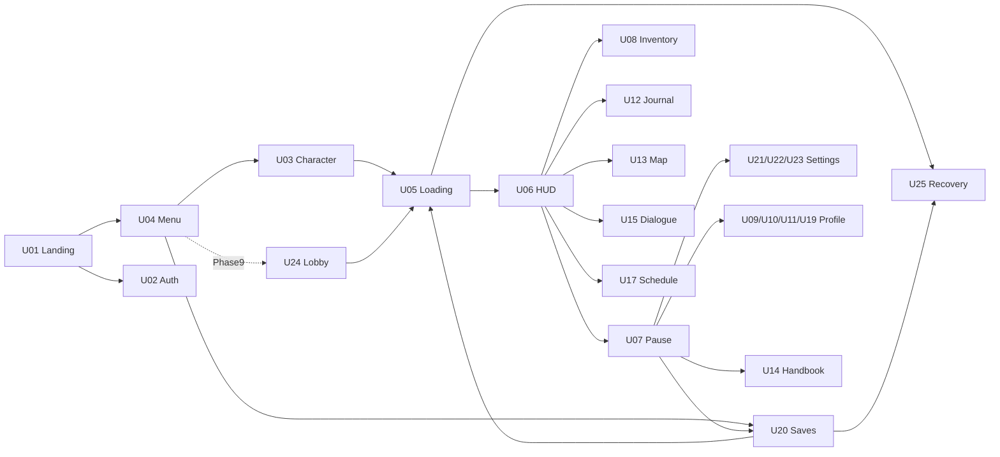

# 05 — UI/UX Design Specification

**Revision1.1:** [11 — Full Life contracts](11-prison-life-contracts.md) bổ sung U26–U35 và screen flow đời sống. Design tokens/C-UI ở đây áp dụng cho toàn35 màn hình. Các tab mới dùng một hub Đời sống trong pause/profile và contextual links, không tăng clutter HUD bằng10 hotkeys.

## Design system [D]

Hướng hình ảnh: chất điện ảnh từ cảnh 3D và âm thanh, UI rõ và tiết chế. Không đặt hiệu ứng blur nặng sau mọi panel, không dùng chữ nhỏ xám chỉ để có vẻ cao cấp. Tone nhân văn, vật liệu giấy/sơn/kim loại của thế giới phản ánh ở màu và đường kẻ; không giả màn hình quản trị SaaS trong HUD.

| Token | Quy chuẩn |
|---|---|
| Typography | Font sans có đầy đủ dấu Việt, license được duyệt; đề xuất Noto Sans (license cần kiểm artifact), system fallback. Body 16 px, labels 14–16, section 20–24, title 32–48; subtitle 18–26 tùy user. Line height 1,5; không all-caps đoạn dài |
| Palette | Canvas `#101719`, panel `#1B2629`, text `#F2F0E8`, secondary `#C2CDCA`, accent warm `#E8B77A`, positive `#8FD1AA`, warning `#F3C76C`, error `#FFAAA0`. Phải đo contrast từng cặp và alpha trên scene, không tự nhận đạt AA chỉ từ hex |
| Spacing/layout | Grid 8 px, fine 4 px; safe area 24 px desktop/16 px compact; panel max text width 65ch, form 480 px; HUD giữ 70% vùng trung tâm ít che |
| Components | Button, IconButton có accessible name, TextField, Select, Slider có numeric input, Toggle, Tabs, Dialog, Toast, Progress, ItemCell, QuestRow, Keycap, Subtitle, ErrorPanel, Skeleton; states normal/hover/focus/pressed/disabled/pending/error |
| Focus | Ring 2 px contrast rõ + offset; tab order theo đọc, modal trap và restore; không focus loss khi HUD update |
| Motion | 120–180 ms opacity/translate ≤8 px; reduced-motion bỏ movement, không zoom/blur; không animation chặn thao tác |
| Icons | Bộ SVG đơn giản nhất quán stroke, text kèm action quan trọng; không chỉ màu để phân biệt rarity/needs |
| Sound/haptic | UI cue nhẹ, volume độc lập; cue thành công/lỗi có text; haptic chưa MVP |
| Density | Desktop 2–3 cột khi đủ chỗ; dưới 1280 px panel một cột/scroll; không scale cả canvas UI khiến chữ không đọc được |
| Content | Tiếng Việt đầu tiên, localization keys/ICU-like plural abstraction; không nối câu gây sai ngữ pháp. Text có dấu, không gán tù nhân = chỉ số hay tội danh |

Nguồn accessibility: [WCAG 2.2](https://www.w3.org/TR/WCAG22/) (S35). Mục tiêu UI: contrast text thường ≥4,5:1, text lớn ≥3:1, target tương tác ≥24 CSS px (ưu tiên 44), zoom text 200%, keyboard/focus và errors có nhãn. Đây là mục tiêu cần audit, không chứng nhận toàn game 3D. Hỗ trợ chỉnh subtitle, speaker label, volume, remap, hold/toggle, giảm chuyển động, hỗ trợ hoạt động. Screen reader đọc menu/journal; không cập nhật live region đồng hồ/needs từng giây. Thông báo quan trọng polite, fatal error assertive có kiểm soát.

## Screen contract C-UI (kế thừa cho U01–U25)

Mỗi screen bên dưới có 14 trường bắt buộc, nhóm thành hàng để dễ đọc. Hành vi mặc định: keyboard Tab/Shift+Tab, Enter/Space kích hoạt, Esc đóng cấp hiện tại nếu không đang commit; không hủy write đã gửi bằng cách chỉ đóng dialog. Mouse hover bổ sung, không là cách duy nhất thấy thông tin. Transition giữ focus origin; SP overlay sâu pause domain, MP ghi “Phiên vẫn tiếp tục”. Responsive: 1280×720 trở lên gameplay, 200% text reflow trong panel; viewport nhỏ hơn có shell hỗ trợ nhưng cảnh báo chưa hỗ trợ chơi. Performance: chỉ mount screen đang dùng, lazy load panel nặng, preview scene dispose khi thoát, HUD subscription theo selector. Mỗi screen có Loading/Empty/Error/Ready phù hợp; nội dung riêng phía dưới bổ sung chứ không loại bỏ C-UI.

### U01 — Landing

| Trường | Đặc tả |
|---|---|
| Purpose / Layout | Giải thích game và yêu cầu máy; hero screenshot thực + mô tả + CTA + requirements, không tải toàn scene |
| Hierarchy / Content | Shell > Header > Hero > Play/Continue > Features > Requirements > Privacy; “Một ngày mới. Những lựa chọn nhỏ có ý nghĩa.” |
| Actions / States | Play guest, sign in, đọc requirements; CheckingCapabilities/Supported/Unsupported/NetworkError |
| Transitions / Responsive | Play→U04 hoặc U03; sign in→U02; mobile vẫn đọc landing và requirements |
| Keyboard/Mouse / Accessibility | C-UI, skip-to-content, alt screenshot; không background autoplay audio |
| Visual / Performance | Typography lớn, ảnh poster responsive; game bundle chỉ tải sau chủ ý Play |
| Acceptance Criteria | UI01: landing không download GLB/WASM, CTA bằng keyboard, unsupported giải thích lý do và browser capability test |

### U02 — Sign In / Sign Up

| Trường | Đặc tả |
|---|---|
| Purpose / Layout | Tài khoản tùy chọn cho cloud; form 480 px trên nền tĩnh |
| Hierarchy / Content | AuthPanel > Email > LoginMethod > Submit > Guest > Help; “Tiếp tục không tài khoản” rõ ràng |
| Actions / States | Login/signup, magic link/provider nếu cấu hình, reset; Idle/Submitting/EmailSent/Expired/RateLimited |
| Transitions / Responsive | Success về intended screen/U20 sync, không auto overwrite local; narrow full-width form |
| Keyboard/Mouse / Accessibility | Autofill/email labels, password manager, errors liên kết field; không generic “Sai rồi” |
| Visual / Performance | Không scene 3D sau form; provider button theo brand đã duyệt, SDK lazy |
| Acceptance Criteria | UI02: guest luôn dùng được, expired link retry rõ, email không bị lộ qua account enumeration text |

### U03 — Character Creation

| Trường | Đặc tả |
|---|---|
| Purpose / Layout | Tạo character; 55% preview, 45% controls, footer confirm |
| Hierarchy / Content | Preview > PresetTabs > Body/Hair/Skin/Outfit > Name > Randomize/Undo > Start |
| Actions / States | Rotate, reset, choose, randomize, validate, create; LoadingPreset/Draft/Invalid/Pending/Error |
| Transitions / Responsive | Confirm F01→U05→U06; back U04 giữ draft; compact preview trên controls |
| Keyboard/Mouse / Accessibility | Rotate bằng buttons/keys, palette có tên + selected mark; no color-only choice |
| Visual / Performance | Neutral light preview, bounded render resolution; single model, asset cancellation |
| Acceptance Criteria | UI03: không cần drag để dùng, create double click 1 character, missing cosmetic có fallback |

### U04 — Main Menu

| Trường | Đặc tả |
|---|---|
| Purpose / Layout | Điểm vào phiên; menu trái, still/small scene phải, build/status footer |
| Hierarchy / Content | Title > Continue > New > Saves > Settings > Account > Credits; Continue ghi ngày/khu/lần lưu |
| Actions / States | Continue, new, choose saves/settings; NoSave/HasSave/SyncPending/ServiceIssue |
| Transitions / Responsive | Continue→U05, new→U03, saves→U20; compact giữ CTA đầu |
| Keyboard/Mouse / Accessibility | First focus Continue/New tương ứng, no shortcut accidental deletion |
| Visual / Performance | Baked still mặc định, animation nền optional và reduced-motion off |
| Acceptance Criteria | UI04: no-save không nút Continue giả, loading metadata không block Settings |

### U05 — Loading

| Trường | Đặc tả |
|---|---|
| Purpose / Layout | Chuẩn bị scene, cho biết tiến trình thực; artwork + stage list + cancel/retry |
| Hierarchy / Content | SceneTitle > Stage/Bytes > Progress > Tip > Retry/Back; “Đang chuẩn bị va chạm” khi đúng stage |
| Actions / States | Cancel trước scene swap, retry failed chunk; Downloading/Decoding/Warming/Ready/Failed |
| Transitions / Responsive | Readiness→U06, cancel→origin; panel stage text wrap |
| Keyboard/Mouse / Accessibility | Progress announce theo mốc 25% hoặc đổi stage, không spam mỗi byte |
| Visual / Performance | Artwork tĩnh, progress không fake 99%; shader warm budget theo phần 02 |
| Acceptance Criteria | UI05: network fail retry không duplicate allocation, không spawn trước collider/nav ready |

### U06 — In-game HUD

| Trường | Đặc tả |
|---|---|
| Purpose / Layout | Quan sát trạng thái mà thấy thế giới; top-left time/current activity, top-right quest, bottom-left needs, center interaction, bottom subtitle |
| Hierarchy / Content | HUD > Clock/Schedule > QuestTracker > Needs > Interaction > Subtitle > ToastAnchor |
| Actions / States | Open journal/map/inventory; Normal/Minimal/Cinematic/Paused/Disconnected |
| Transitions / Responsive | I→U08, J→U12, M→U13, Esc→U07; bindings thực tế theo F20; compact quest chỉ 1 objective |
| Keyboard/Mouse / Accessibility | Noninteractive HUD không chiếm tab; text needs label/value, cue màu kèm icon; subtitle không overlap prompt |
| Visual / Performance | Nền gradient/local opaque, tránh toàn màn blur; needs 4 Hz, clock 1 Hz, quest events |
| Acceptance Criteria | UI06: 720p/text200% đọc subtitle + prompt không đè nhau, HUD CPU budget PERF, minimal vẫn báo save fail |

### U07 — Pause

| Trường | Đặc tả |
|---|---|
| Purpose / Layout | Điều khiển phiên; panel giữa, snapshot nền |
| Hierarchy / Content | PausedLabel > Resume > Save > Load > Settings > MainMenu; MP label “Phiên vẫn tiếp tục” |
| Actions / States | Resume/save/load/settings/quit; Paused/Writing/Unsaved/Error |
| Transitions / Responsive | Resume→U06 restore pointer-lock có gesture; child settings quay lại pause; scroll khi text lớn |
| Keyboard/Mouse / Accessibility | Focus Resume, trap, Esc resume nếu không child; không thả input cũ khi trở game |
| Visual / Performance | Dim snapshot, không phải realtime full-scene blur; SP render có thể dừng |
| Acceptance Criteria | UI07: pause SP không tiến lịch; quit pending save báo đúng state, không silent discard |

### U08 — Inventory

| Trường | Đặc tả |
|---|---|
| Purpose / Layout | Túi + equipment + item detail, 3 cột desktop |
| Hierarchy / Content | Title/Capacity > Grid/List > Equipment > Detail > Use/Equip/Drop/Split |
| Actions / States | Select/move/use/drop/split/sort; Empty/Selected/Pending/Full/StaleRevision |
| Transitions / Responsive | Close→U06/U07, detail stacked dưới list ở compact; confirm drop quest item bị disable có lý do |
| Keyboard/Mouse / Accessibility | Arrow grid + list mode, Enter context, quantity input; drag optional, announced item name/count |
| Visual / Performance | 12 cells MVP, thumbnails atlas, no 12 canvas previews; pending indicator per action |
| Acceptance Criteria | UI08: toàn bộ thao tác không drag, full state không mất reward, pending không duplicate use |

### U09 — Character Profile

| Trường | Đặc tả |
|---|---|
| Purpose / Layout | Danh tính, mục tiêu, needs và tiến trình; portrait trái, timeline phải |
| Hierarchy / Content | Name/Portrait > Chapter > DaySummary > Goals > Needs > LinksSkills/Relations |
| Actions / States | Review, change cosmetic F13, open skill/relation; NewCharacter/Progress/Loading/Error |
| Transitions / Responsive | U11/U10 tabs, return origin; portrait tĩnh compact |
| Keyboard/Mouse / Accessibility | Heading order, numeric needs có text nguyên nhân gần nhất; không biểu đồ chỉ màu |
| Visual / Performance | Tĩnh thay model live khi không cần, memoized selectors |
| Acceptance Criteria | UI09: profile và HUD cùng revision, tab switching không tạo renderer mới |

### U10 — Relationships / Reputation

| Trường | Đặc tả |
|---|---|
| Purpose / Layout | Hiểu quan hệ đã biết, NPC list và detail |
| Hierarchy / Content | SearchKnown > NPCList > TrustLabel > RecentObservedEvents > NextKnownMeeting; group tab P1 |
| Actions / States | Filter/select/track meeting; Unknown/NoKnownNPC/Known/Unavailable |
| Transitions / Responsive | Track→U13/U17, close→origin; list-detail một cột compact |
| Keyboard/Mouse / Accessibility | Không yêu cầu nhìn portrait để nhận diện; text names, status và event |
| Visual / Performance | Chỉ dữ liệu player biết, không render debug utility/memory secrets; paginate nếu mở rộng |
| Acceptance Criteria | UI10: không lộ vị trí NPC chưa biết hoặc secret memories; empty có cách làm quen |

### U11 — Skills

| Trường | Đặc tả |
|---|---|
| Purpose / Layout | Ba kỹ năng và unlock rõ, không skill tree khổng lồ giả chiều sâu |
| Hierarchy / Content | Focus/Fitness/Communication > Level/XP > NextUnlock > SuggestedActivity |
| Actions / States | Select, inspect unlock, track activity; Locked/Progress/Max/NoEligibleActivity |
| Transitions / Responsive | Track→U13/U17, close origin; cards thành list compact |
| Keyboard/Mouse / Accessibility | Progress có text `150/250 XP`, no hover-only unlock; suggested activity buttons |
| Visual / Performance | 3 static progress bars, events-only updates, no animated particle reward nền |
| Acceptance Criteria | UI11: XP và F16 ngưỡng khớp, max không chia 0 hoặc hiển thị mục tiêu không có |

### U12 — Quest Journal

| Trường | Đặc tả |
|---|---|
| Purpose / Layout | Quest list trái, objective/recap phải |
| Hierarchy / Content | Active/Done tabs > QuestList > Story > Objectives > Reward > Track/Abandon |
| Actions / States | Track one quest, read recap, abandon side quest nếu cho phép; Empty/Active/Ready/Completed/Blocked |
| Transitions / Responsive | Track cập nhật U06, location→U13; stacked master/detail compact |
| Keyboard/Mouse / Accessibility | Checkbox trạng thái có label, focus không nhảy khi objective hoàn thành |
| Visual / Performance | Text 65ch, không icon-only reward; content data projection cập nhật theo event |
| Acceptance Criteria | UI12: blocked objective có lý do/alternative, completed không còn claim button có thể bấm lại |

### U13 — Map

| Trường | Đặc tả |
|---|---|
| Purpose / Layout | Schematic facility hư cấu + danh sách khu và route |
| Hierarchy / Content | ZoneList > MapCanvas/SVG > Legend > Current/Target > RouteStatus |
| Actions / States | Select zone/waypoint, zoom/reset; Unexplored/Reachable/Closed/RouteChanged |
| Transitions / Responsive | Waypoint→HUD, activity→U17; compact list default thay bắt pan map |
| Keyboard/Mouse / Accessibility | Zone list tương đương click map, labels/closed pattern; wheel zoom không chặn page scroll ngoài map |
| Visual / Performance | Vector schematic, không render world camera thứ hai; graph route only |
| Acceptance Criteria | UI13: door close cập nhật trong 1 s, không hiển thị route xuyên unavailable zone |

### U14 — Handbook / Help

| Trường | Đặc tả |
|---|---|
| Purpose / Layout | Ôn tutorial và luật, mục lục + bài ngắn |
| Hierarchy / Content | Search > Movement/Interaction/Routine/Save/Accessibility > Text/Keycaps > ReplayTutorial |
| Actions / States | Search/read/replay; EmptySearch/Results/Article/UnavailableReplay |
| Transitions / Responsive | Replay về bước F03, close origin; một cột đọc compact |
| Keyboard/Mouse / Accessibility | Keycaps theo remap, heading/link navigation, no text baked into image |
| Visual / Performance | Text offline đi kèm client, không nhúng video autoplay |
| Acceptance Criteria | UI14: đổi binding phản ánh mọi help prompt; search không kết quả có cách xóa filter |

### U15 — NPC Dialogue

| Trường | Đặc tả |
|---|---|
| Purpose / Layout | Focus NPC nhưng giữ đọc; speaker/text bottom 30%, choices bên dưới |
| Hierarchy / Content | Speaker > Line > Continue > Choices > History/Exit; busy line có thời gian hẹn nếu biết |
| Actions / States | Advance/skip line/select/exit; PlayingText/AwaitingChoice/Committing/Busy/Invalidated |
| Transitions / Responsive | Choice updates graph; exit→U06, cinematic camera trở êm; max width text và scroll choices compact |
| Keyboard/Mouse / Accessibility | Số chọn tùy chọn, Tab/Enter đầy đủ, subtitle speaker và size; typewriter off, auto-advance opt-in |
| Visual / Performance | Camera blend không motion nếu reduced; no per-character React rerender, text reveal CSS hoặc bounded cadence |
| Acceptance Criteria | UI15: skip không chọn hộ, locale dài không che choices, stale choice trả lời dễ hiểu không double reward |

### U16 — Interaction Prompt

| Trường | Đặc tả |
|---|---|
| Purpose / Layout | Hành động contextual, center-low tránh crosshair/subtitle |
| Hierarchy / Content | TargetName > Verb+Key > Duration/Reason > Progress/Cancel |
| Actions / States | Interact/cancel; Hidden/Available/Busy/OutOfRange/Acting/Blocked |
| Transitions / Responsive | Action→animation/U15, target loss→hide với hysteresis; safe area tránh subtitle |
| Keyboard/Mouse / Accessibility | Toggle thay hold, reason text, no mandatory fast QTE, readable on bright/dark background |
| Visual / Performance | Chỉ một target, focus query 10 Hz hoặc khi đổi aim, không DOM cho mọi prop |
| Acceptance Criteria | UI16: phím remap đúng, target flicker không nhiều hơn ngưỡng thiết kế, busy không cho commit |

### U17 — Daily Schedule

| Trường | Đặc tả |
|---|---|
| Purpose / Layout | Timeline ngày + activity list, current highlighted |
| Hierarchy / Content | Day/Time > Current > UpcomingRows > Location > Optional/Recommended > Track |
| Actions / States | Track/read details, reminders on/off; Upcoming/Open/Closing/Closed/Override |
| Transitions / Responsive | Location→U13, close→HUD; list thay timeline ngang compact |
| Keyboard/Mouse / Accessibility | Current status bằng chữ + icon; time game phân biệt real duration |
| Visual / Performance | Update boundary/minute, không animate timeline mỗi frame |
| Acceptance Criteria | UI17: sleep qua boundary đúng state, không gợi ý hoạt động đã đóng mà thiếu alternative |

### U18 — Notifications

| Trường | Đặc tả |
|---|---|
| Purpose / Layout | Phản hồi ngắn và history, toasts top-right ngoài quest area |
| Hierarchy / Content | SeverityIcon > Message > OptionalAction > Dismiss; history nhóm quest/save/social |
| Actions / States | Dismiss/read/action; Queued/Visible/Persistent/Read; save failure persistent |
| Transitions / Responsive | Action→U12/U20, không tự mở modal; compact tối đa 2 toast |
| Keyboard/Mouse / Accessibility | Live region polite, focus không tự chuyển; critical error action có trong pause/history |
| Visual / Performance | Max3, dedup by eventId, cap history100, không animation toàn viewport |
| Acceptance Criteria | UI18: 20 simultaneous rewards không flood/steal focus, save fail không tự mất trước đọc |

### U19 — Achievements

| Trường | Đặc tả |
|---|---|
| Purpose / Layout | Danh sách ghi nhận, filter trạng thái |
| Hierarchy / Content | Summary > Locked/Unlocked > AchievementRow > Condition/Progress/Date |
| Actions / States | Filter/read; NoneUnlocked/Progress/Unlocked/LocalOnly |
| Transitions / Responsive | Related activity→U17 nếu biết, close origin; list compact |
| Keyboard/Mouse / Accessibility | Conditions text, hidden story badge nói chưa khám phá không spoil; progress labels |
| Visual / Performance | Icon atlas, no 10 looping animations, lazy thumbnails |
| Acceptance Criteria | UI19: local/untrusted phân biệt rõ, accessibility mode không làm badge “không hợp lệ” |

### U20 — Save Management

| Trường | Đặc tả |
|---|---|
| Purpose / Layout | Local/cloud slots, metadata, compare conflict |
| Hierarchy / Content | Local/Cloud > SlotRows > Day/Zone/Revision/Time > Load/Save/Export/Delete > ConflictCompare |
| Actions / States | Save/load/export/import/delete/select fork; Empty/Writing/Corrupt/Offline/Conflict/Migrating |
| Transitions / Responsive | Load→U05, sign in→U02 return, conflict lựa chọn cụ thể; stacked comparisons compact |
| Keyboard/Mouse / Accessibility | Delete destructive confirmation ghi slot cụ thể; metadata thời gian có timezone; no drag/import only |
| Visual / Performance | Metadata trước thumbnail, checksum/migration off hot render loop |
| Acceptance Criteria | UI20: 409 không overwrite tự động, corrupt có previous/export, success chỉ sau durable ack |

### U21 — Graphics Settings

| Trường | Đặc tả |
|---|---|
| Purpose / Layout | Auto và manual quality, live cost explanation ngắn |
| Hierarchy / Content | Auto/Preset > Resolution/DPR > Shadows/AO/Reflections/Fog/LOD > Apply/Reset |
| Actions / States | Preview/apply/reset; Auto/Custom/Unsupported/Rebuilding/Reverted |
| Transitions / Responsive | Apply giữ origin, renderer reset có U05 mini-stage; form scroll compact |
| Keyboard/Mouse / Accessibility | Sliders numeric alternative, unsupported label lý do; high contrast HUD riêng quality |
| Visual / Performance | Không mọi slider rebuild shader mỗi pixel drag; debounce/apply, 15 s revert cho setting rủi ro |
| Acceptance Criteria | UI21: auto không override manual lock, unsupported WebGPU không gây blank screen |

### U22 — Audio Settings

| Trường | Đặc tả |
|---|---|
| Purpose / Layout | Master/music/SFX/dialogue/ambience/UI/subtitles |
| Hierarchy / Content | VolumeGroup > DynamicRange > Subtitle/Caption > Preview > Reset |
| Actions / States | Adjust/test/toggle; Active/Muted/Suspended/DeviceUnavailable |
| Transitions / Responsive | Apply live, return origin; single-column form |
| Keyboard/Mouse / Accessibility | Sliders keys + numeric, mute text status, preview not required; caption controls |
| Visual / Performance | Không fetch audio track lớn chỉ mở settings; audio context resume từ gesture |
| Acceptance Criteria | UI22: master0 im toàn game kể cả UI, muted vẫn nhận critical cue text |

### U23 — Controls & Accessibility

| Trường | Đặc tả |
|---|---|
| Purpose / Layout | Remap, sensitivity, motion, text và assist |
| Hierarchy / Content | ActionBindingTable > Mouse > Hold/Toggle > Motion > Text/Subtitle > NeedsAssist > Reset |
| Actions / States | Capture key/resolve conflict/test/reset; Listening/Conflict/Valid/Unsupported |
| Transitions / Responsive | Esc cancel key capture trước close; prompt refresh ngay; rows wrap compact |
| Keyboard/Mouse / Accessibility | Không bind mất cách mở menu; key capture không trap vĩnh viễn; screen reader labels |
| Visual / Performance | Plain table/form, input subscription cleanup khi thoát |
| Acceptance Criteria | UI23: rebind I/J/M và interact hiện đúng toàn UI, reset từng nhóm, reduced motion xóa camera shake |

### U24 — Multiplayer Lobby (P2)

| Trường | Đặc tả |
|---|---|
| Purpose / Layout | Private room, region, players, ready state |
| Hierarchy / Content | Region/RTT > Create/JoinCode > Members > Ready > Start > InviteCopy |
| Actions / States | Create/join/leave/ready; Empty/Full/VersionMismatch/Connecting/Ready/Draining |
| Transitions / Responsive | Start→U05→U06 MP, fail→U25; player cards thành rows compact |
| Keyboard/Mouse / Accessibility | Code copy có feedback text, no color-only ready; no auto-send invitations |
| Visual / Performance | Presence low rate, no 4 live animated model previews; lobby không physics tick |
| Acceptance Criteria | UI24: full room có reason, host leave có policy rõ, protocol mismatch không vào scene |

### U25 — Error / Empty / Recovery States

| Trường | Đặc tả |
|---|---|
| Purpose / Layout | Recovery cụ thể tại nơi lỗi; fatal panel giữa, inline errors cục bộ |
| Hierarchy / Content | WhatHappened > ProgressSafety > Retry/Back/Export > SupportCode; không stacktrace/secret |
| Actions / States | Retry/back/export/sign-in/reconnect; Offline/AuthExpired/SaveConflict/AssetFail/ContextLost/ServerRestart |
| Transitions / Responsive | Retry resume stage an toàn, back main giữ local fork; narrow text reflow |
| Keyboard/Mouse / Accessibility | Focus heading khi fatal, inline field associations; không toast làm cách duy nhất sửa lỗi |
| Visual / Performance | Tĩnh khi renderer chết; error boundary nằm ngoài canvas; bounded retries jitter |
| Acceptance Criteria | UI25: simulate mỗi error class có recovery, support code đủ correlate log không PII |

## Wireframes tái sử dụng trong Figma/Penpot

Thiết kế ở đây là đặc tả tài liệu; chưa tạo file Figma hoặc tuyên bố có design artifact. Frame desktop 1440×900 và compact 1280×720, text200% riêng. Dựng tokens → primitives → component variants → screens → prototype flow. Auto layout và constraints theo các vùng sau:

```text
HUD 1440×900, margins24
┌ clock / current ───────── clear world ─────── quest tracker 320w ┐
│                                                               │
│                    WORLD / CHARACTER                          │
│                                                               │
│                 target / [E] action                           │
│ needs 240w        subtitles max800w          notification queue │
└───────────────────────────────────────────────────────────────┘

INVENTORY / JOURNAL
┌ title ─────────────────────────────────────────── close ┐
│ filters/list 240w │ grid/objectives flex │ detail 320w   │
│                  │                      │ actions       │
└ keyboard help ──────────────────────────────────────────┘

DIALOGUE
┌──────────────── 3D speaker, no UI over face ─────────────┐
│                                                        │
│ speaker                                                │
│ subtitle max65ch / continue                             │
│ [choice1] [choice2] [choice3]                            │
└ history / exit ─────────────────────────────────────────┘
```



Review prototype bằng 5 nhiệm vụ: guest start, đổi phím và subtitle, nhận/track quest, ăn và chọn thoại, conflict cloud save. Ghi completion/time/error/misclick; không dùng điểm thẩm mỹ thay usability. QA UI trong phần 07 phải kiểm locales dài, focus return, pointer-lock, game pause và screen reader.
