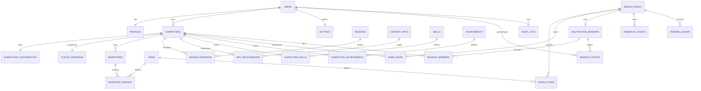
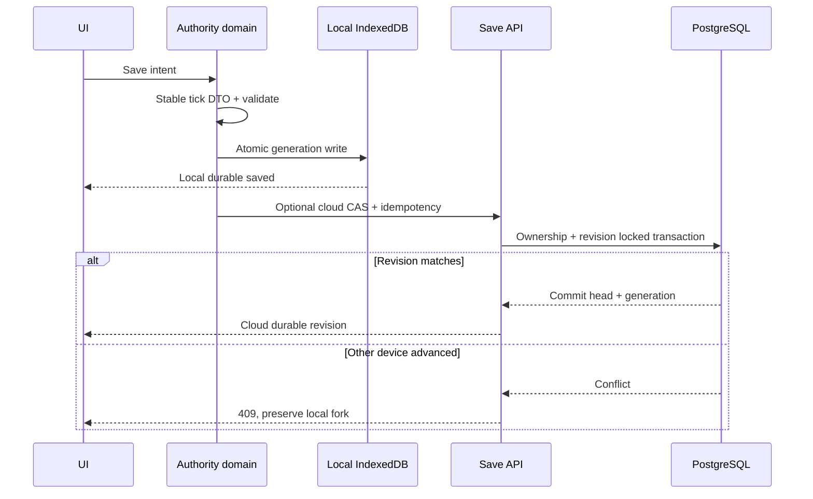

# 06 — Backend, Database, API & Security Architecture

**Revision1.1:** [11 — Full Life contracts](11-prison-life-contracts.md) nối tiếp DB28–DB44/API09–API13 và save schema2. Quy tắc B/O/V,R0–R5,auth/idempotency/CAS và trust mode ở đây vẫn bắt buộc. Thêm private care/legal/family scopes,financial ledger,service bookings và lifecycle sagas; không cho room membership mặc nhiên đọc hồ sơ riêng.

## Mô hình domain và nguồn sự thật

Account có nhiều Character; Character có **mode** `sp_untrusted` hoặc `mp_authoritative`. MP không lấy stats/item/reward từ SP, kể cả save đã đồng bộ cloud. World là lineage phiên chơi SP hoặc room world MP. Inventory sở hữu item instances; item definitions là catalog immutable theo contentVersion. Quest và dialogue dùng definition IDs + version; progress là projection bền vững của kết quả authority. Không gọi checksum client là anti-cheat.

SP snapshot là nguồn truth gameplay trong lineage, các bảng projection (inventory/progress/relationships) được cập nhật cùng transaction với metadata save nếu lưu dạng chuẩn hóa. **Không** cho client sửa projection rồi tải snapshot cũ đè lên. MVP chọn snapshot JSONB validated trong `game_saves`, bảng chuẩn hóa dùng cho definitions, profile/settings và metadata; các bảng gameplay projection bên dưới được định nghĩa cho full/MP, chỉ bật khi worker transactional projection đã hoàn thành. API đọc một revision nhất quán; không trộn hai nguồn trên cùng lineage.

MP room memory là authority tạm thời, DB checkpoint và reward/inventory transaction là durable authority. Một owner/epoch/fencing token per world; chỉ server có thể ghi trusted progress. Không dùng DB trigger để chạy physics.

## Schema notation và policy templates

Đây là **thiết kế logical schema**, chưa có SQL migration thực thi. Nullability ghi `!` = NOT NULL, `?` = NULL. `=...` là default; `=∅` nghĩa không có default, caller/server phải cấp. `uuid` PK dùng server UUID generator được pin trong migration; `timestamptz` luôn UTC, UI dùng timezone người chơi. Không sử dụng float cho inventory quantities/XP. IDs trong content là text slug versioned; IDs runtime UUID. Mọi FK referenced unique/PK, index trên FK hoặc composite access path nêu bên dưới.

Nhóm cột kế thừa **B**: `id uuid! PK=generated`, `created_at timestamptz!=now()`, `updated_at timestamptz!=now()` do DB update hook. Nhóm **O**: `owner_id uuid! FK auth.users(id)=∅`, index(owner_id), không được client chuyển owner. Nhóm **V**: `revision bigint!=1 CHECK>0`, increment bởi transaction CAS. Các bảng ghi B/O/V là có đầy đủ các cột đó. Không dùng `updated_at` thay concurrency token.

Policy templates (đều bật RLS, không mặc định grant cho anon):

| Policy | Quyền SELECT | INSERT/UPDATE/DELETE | Kiểm soát bổ sung |
|---|---|---|---|
| R0 | Auth metadata do Supabase quản lý | Auth service only | Không expose auth.users qua public API |
| R1 | `auth.uid()=owner_id` | Không direct write trừ prefs/profile allowlist riêng | API xác minh JWT và owner; nếu SECURITY DEFINER phải search_path cố định, revoke public EXECUTE, không tùy ý dùng service bypass |
| R2 | Character/world thuộc caller, hoặc projection participant được cho phép | Game service transaction only | Role server scoped, quyền qua function/command allowlist; không SELECT bí mật NPC cho client |
| R3 | Public read published definitions (anon/auth), hidden/unpublished deny | Content publisher service only | Catalog không có private narration/secret metadata; version immutable |
| R4 | Participant của session, chỉ public projection | Session service only | membership check không recursive RLS; helper security review |
| R5 | Không client access | Ops/audit worker limited | Admin dashboard qua server và role MFA, không service key browser |

Các grant là phần của thiết kế, không chỉ RLS. API service role có thể bypass RLS theo S18, do đó mọi endpoint cần explicit owner/scope check; ưu tiên caller JWT cho read và function hẹp cho writes. Không cho client direct update inventory/XP bằng policy owner. RLS phải kiểm SELECT/INSERT/UPDATE/DELETE và WITH CHECK, não bộ “người dùng chỉ thấy hàng của mình” không đủ chống đổi owner.

Storage policy cụ thể [D]: bucket `assets-public` chỉ published immutable files được đọc công khai, client không INSERT/UPDATE/DELETE; publisher role mới được ghi. Bucket `saves-private` không public read; object key do backend sinh `ownerUUID/characterUUID/lineageUUID/generationUUID`, không tin prefix client đưa lên. SELECT/download phải đối chiếu `storage.objects` bucket/key với game_saves owner và trạng thái ready; client không đổi owner bằng rename/move. Upload staging chỉ signed operation key riêng do API cấp sau owner check, giới hạn size/type/expiry, không cấp write wildcard cả thư mục. Ready pointer chỉ sau hash/schema verify. Delete qua tombstone/purge service có audit. QA02 phải thử truy cập chéo bằng URL, list bucket, prefix giả, expired signed link, move và overwrite cùng key; URL đã ký có thể chia sẻ trong TTL nên giữ ngắn và không log token.

## Data dictionary — đầy đủ từng bảng

### DB01 `auth.users` / Users

Mục đích: danh tính do Supabase Auth quản lý (S19). Cột phụ thuộc provider schema, chỉ tham chiếu `id uuid! PK` và identity metadata do Auth quản lý; **không tự đặt default hoặc sửa migration auth schema**. R0; không tạo bảng users chứa password. Emails/tokens không sao vào gameplay events. Profile FK là identity boundary. Nullability/default phần nội bộ Auth phải introspect ở T00-04, chưa xác nhận hết managed schema.

### DB02 `profiles`

| Column | Type/null/default | Key/constraint |
|---|---|---|
| user_id | uuid! =∅ | PK, FK auth.users(id), delete cascade sau deletion workflow |
| display_name | text! =∅ | length 2..24 normalized, không globally unique |
| locale | text! ='vi' | allowlist locales |
| consent_version | text? =NULL | policy consent version, không thay telemetry consent boolean |
| telemetry_opt_in | boolean! =false | optional gameplay analytics |
| created_at/updated_at | timestamptz! =now() | DB controlled |

Indexes: PK đủ owner lookup. R1 với ownership qua user_id thay owner_id; API chỉ update display_name/locale/consent prefs. Không ghi email/tội danh. Deletion audited, personal data scrub.

### DB03 `characters`

Columns: B + O + V; `name text!=∅ CHECK length2..24`; `mode text!='sp_untrusted' CHECK IN(sp_untrusted,mp_authoritative)`; `content_version text!=∅`; `active_lineage_id uuid?=NULL FK world_states(id)`; `archived_at timestamptz?=NULL`. Index(owner_id,archived_at), index(active_lineage_id); composite UNIQUE(id,owner_id) hỗ trợ FK ownership. R1 read, API create/archive only; immutable mode, no direct delete. World/character circular initial link giải bằng tạo character chưa active_lineage rồi world rồi set FK trong transaction. Không FK từ character tới một world của người khác mà chỉ dựa API: constraint/trigger kiểm membership và mode.

### DB04 `character_customization`

Columns: `character_id uuid! PK/FK characters(id) ON DELETE CASCADE=∅`; V; `body_preset text!=∅`, `skin_preset text!=∅`, `hair_preset text!=∅`, `outfit_preset text!=∅`, `rig_version text!=∅`, `updated_at timestamptz!=now()`. Preset IDs validate published content/rig compatibility bằng service và content registry, không raw asset URLs. R2 character-owner read, cosmetic API write allowlist; PK index đủ. Các continuous morphs tương lai vào schema version mới, không JSON arbitrary chưa hạn chế.

### DB05 `player_progress`

Columns: `character_id uuid! PK/FK characters=∅`; V; `chapter smallint!=1 CHECK>=1`; `days_played integer!=0 CHECK>=0`; `energy/hunger/hygiene/mood smallint!=80 CHECK0..100` (mood default60); `tutorial_flags jsonb!={}`; `discovered_zones text[]!={}`; `story_flags jsonb!={}`; `reputation jsonb!={}`; `last_tick bigint!=0 CHECK>=0`. JSON schema bounded by known keys, total ≤64 KiB proposed. R2; trusted mutations server only. Snapshot-backed SP read through save, không direct projection writes. Index PK; analytics aggregate qua pipeline riêng.

### DB06 `world_states`

Columns B + V; `mode text!=∅ CHECK allowed modes`; `owner_id uuid?=NULL FK auth.users` (SP required, MP may null); `content_version text!=∅`; `schema_version integer!=1 CHECK>0`; `seed bigint!=∅`; `day integer!=1 CHECK>=1`; `minute_of_day numeric(8,4)!=360 CHECK>=0 AND<1440`; `simulation_tick bigint!=0 CHECK>=0`; `weather text!='clear'`; `state jsonb!={}`; `authority_epoch bigint!=1 CHECK>0`; `fencing_token bigint!=1 CHECK>0`. CHECK mode=SP implies owner not null. Index(owner_id,updated_at), unique(id,mode); JSON <=512 KiB checkpoint target. R2 via owner or session membership, filtered API projection only. `state` includes active events/interactables/NPC memory checkpoint/reservations; transient leases reconstructed with safe expiry after restore. Never expose private NPC state raw in MP.

### DB07 `inventories`

Columns B + V; `character_id uuid!=∅ FK characters`; `kind text!='bag' CHECK IN(bag,locker,reward_mailbox)`; `capacity smallint!=12 CHECK1..200`. UNIQUE(character_id,kind), index(character_id). R2, service only writes, FK mode through character. Mailbox overflow cap policy sends quest reward not lost; no client-controlled capacity.

### DB08 `items`

Definition catalog: `id text!=∅`, `content_version text!=∅` composite PK; `name_key text!=∅`; `type text!=∅`; `stack_limit integer!=1 CHECK1..999`; `quest_bound boolean!=false`; `allowed_actions text[]!={}`; `asset_id text!=∅`; `effects jsonb!={}` schema bounded; `published boolean!=false`. R3; index(content_version,published,type). Definition immutable once published; reference payloads version, no rewards in arbitrary executable code.

### DB09 `inventory_entries`

Columns B + V; `inventory_id uuid!=∅ FK inventories ON DELETE CASCADE`; `item_id text!=∅`, `content_version text!=∅` composite FK items; `slot smallint!=∅ CHECK>=0`; `quantity integer!=1 CHECK>0`; `equipped_slot text?=NULL`; `instance_meta jsonb!={}` max4KiB. UNIQUE(inventory_id,slot); partial unique equipment slot per inventory where non-null; index(item_id,content_version). Service enforces capacity/stack limit/cosmetic socket compatibility inside locked transaction, not only CHECK depending another row. R2 via inventory→character; no direct write.

### DB10 `world_items`

Columns B + V; `world_id uuid!=∅ FK world_states`; item_id/content_version composite FK items; `quantity integer!=1 CHECK>0`; `zone_id text!=∅`; `position jsonb!=∅` exactly finite xyz; `state text!='available' CHECK IN(available,reserved,removed)`; `reservation_action uuid?=NULL`; `source_entry_id uuid?=NULL` provenance, not live FK to a deleted stack. Index(world_id,zone_id,state). R2 filtered visible objects only. Inventory↔world transfer commits transaction with reward ledger, no duplicate live instance ID; preserving identity stack semantics defined in API06.

### DB11 `missions`

`id text!`, `content_version text!` composite PK; `kind text! CHECK main/side`; `title_key text!`; `prerequisites jsonb!={}`; `objective_graph jsonb!=∅`; `reward_spec jsonb!={}`; `repeat_policy text!='once'`; `published boolean!=false`; all unspecified defaults =∅. Index(content_version,published,kind). R3 public sanitized definition; hidden story branches kept private content service. Graph validated acyclic objective dependencies, referenced items/zones valid.

### DB12 `mission_progress`

`character_id uuid! FK characters`, `mission_id text!`, `content_version text!` FK missions composite; PK(character_id,mission_id,content_version); V; `state text!='offered' CHECK locked/offered/active/ready/completed/abandoned`; `objectives jsonb!={}`; `choice_flags jsonb!={}`; `accepted_at_tick bigint?=NULL`; `completed_at_tick bigint?=NULL`. Index(character_id,state). R2. Completion requires objective validation and unique reward ledger key, not client claimed state. Migrations map mission versions explicitly, no duplicate reward on content upgrade.

### DB13 `npc_relationships`

`character_id uuid! FK characters`, `npc_id text!`, `content_version text!` FK content_npcs composite; PK(character_id,npc_id,content_version); V; `trust smallint!=0 CHECK−100..100`; `respect smallint!=0 CHECK−100..100`; `familiarity smallint!=0 CHECK0..100`; `last_event_tick bigint!=0 CHECK>=0`; `recent_causes jsonb!=[]` bounded16. Index PK; R2 own summary only, not raw NPC secret memories. Service validates direct/rumor provenance.

### DB14 `skills`

`id text!`, `content_version text!` composite PK; `name_key text!`; `thresholds integer[]!=∅` strictly increasing, first0; `unlocks jsonb!={}`; `published boolean!=false`. R3; index(content_version,published). Array checks via validated publisher; database constraint function immutable and versioned if implemented. No negative XP thresholds.

### DB15 `character_skills`

`character_id uuid! FK characters`, `skill_id text!`, `content_version text!` composite FK skills; composite PK(character_id,skill_id,content_version); V; `xp integer!=0 CHECK>=0`; `last_award_tick bigint!=0`. Level derived thresholds, not independent mutable column. R2; PK access, no extra unnecessary indexes. Awards source ledger unique.

### DB16 `achievements`

`id text!`, `content_version text!` composite PK; `title_key text!`; `condition_spec jsonb!=∅`; `hidden boolean!=false`; `published boolean!=false`. R3 sanitized, hidden content not leaked via raw table; filtered view needs invoker security verified. Index(content_version,published).

### DB17 `character_achievements`

`character_id uuid! FK characters`, `achievement_id text!`, `content_version text!` FK achievements; composite PK(character_id,achievement_id,content_version); `counter integer!=0 CHECK>=0`; `unlocked_at timestamptz?=NULL`; `source_mode text!=∅ CHECK SP/MP modes`; V. R2, server awards MP, SP marked untrusted. Partial index(character_id,unlocked_at) where unlocked_at non-null for profile list.

### DB18 `settings`

`owner_id uuid! PK/FK auth.users`; V; `accessibility jsonb!={}`, `audio_preferences jsonb!={}`, `control_preferences jsonb!={}`, `locale text!='vi'`, `updated_at timestamptz!=now()`. R1 with allowed-field write API or own policy USING + WITH CHECK. Device-specific graphics/DPR stored locally, account only preferred preset hint; no hardware fingerprint. JSON schema key/type/range bounded max16KiB. No arbitrary auth role in settings metadata.

### DB19 `game_saves`

Columns B + O + V; `character_id uuid!=∅ FK characters`; `world_id uuid!=∅ FK world_states`; `slot smallint!=∅ CHECK0..4`; `generation bigint!=1 CHECK>0`; `schema_version integer!=∅`; `content_version text!=∅`; `snapshot jsonb?=NULL`; `object_key text?=NULL`; `sha256 text!=∅ CHECK64 hex`; `byte_size integer!=∅ CHECK>0`; `trust_mode text!=∅`; `status text!='ready' CHECK staging/ready/quarantined`; `parent_save_id uuid?=NULL FK game_saves`. CHECK exactly one snapshot/object_key. UNIQUE(character_id,world_id,slot,generation); index(owner_id,updated_at DESC), index(world_id,generation DESC). R1 read metadata/API snapshot; API checks character owner + world mode, DB trigger/composite ownership invariant. MVP ≤512KiB JSONB; object storage only above threshold after staged upload verification, no orphan half-ready pointer. Retain two auto generations, manual delete respects parent lineage retention.

### DB20 `gameplay_events`

`event_id uuid!`, `occurred_at timestamptz!=now()` composite PK(event_id,occurred_at) if time-partitioned; `world_id uuid! FK world_states`; `character_id uuid? FK characters=NULL`; `tick bigint!=∅`; `event_type text!=∅`; `schema_version integer!=1`; `payload jsonb!={}` max8KiB; `trace_id uuid?=NULL`. Index(world_id,tick), BRIN(occurred_at). R5 by default; sanitized player journal separate projection. Sampling cosmetics, no chat/email/tokens; retention30d proposal. This append log is not full event-sourced game authority. Dedup across partitions handled reward/idempotency ledger, not assume composite PK forbids same event at different timestamps.

### DB21 `multiplayer_sessions`

Columns B + V; `world_id uuid!=∅ FK world_states UNIQUE`; `region text!=∅`; `protocol_version integer!=∅`; `content_version text!=∅`; `status text!='lobby' CHECK lobby/active/draining/ended`; `max_players smallint!=4 CHECK1..8`; `room_owner text?=NULL`; `owner_epoch bigint!=1`; `lease_expires_at timestamptz?=NULL`; `checkpoint_tick bigint!=0`. Index(region,status), index(lease_expires_at). R4 sanitized metadata only. Internal owner/lease hidden from clients. Atomic acquire/renew/fence, no two server writes same epoch.

### DB22 `session_members`

`session_id uuid! FK multiplayer_sessions`, `character_id uuid! FK characters`, composite PK; `owner_id uuid! FK auth.users`; `joined_at timestamptz!=now()`; `left_at timestamptz?=NULL`; `ready boolean!=false`; `resume_until timestamptz?=NULL`. Partial unique(character_id) where left_at null; index(owner_id,session_id). R4 session public display projection, no tokens. Constraint/transaction verifies MP mode, owner matches character, room capacity and protocol.

### DB23 `audit_logs`

`id uuid! PK=generated`; `occurred_at timestamptz!=now()`; `actor_user_id uuid?=NULL FK auth.users ON DELETE SET NULL`; `actor_service text?=NULL`; `action text!=∅`; `resource_type text!=∅`; `resource_id text!=∅`; `outcome text!=∅ CHECK allowed/denied/error`; `trace_id uuid!=∅`; `details jsonb!={}` redacted. Index(occurred_at), index(resource_type,resource_id), index(trace_id). R5 append only; write role cannot update/delete, retention job separately authorized. No token/IP full logs by default; if security IP needed documented minimization and short retention.

### DB24 `content_npcs`

`id text!`, `content_version text!` composite PK; `name_key text!`; `archetype text!`; `appearance_spec jsonb!=∅`; `schedule_id text!`; `dialogue_id text!`; `published boolean!=false`. R3 sanitized public appearance/name only; private decision weights/story secrets in server content bundle. Index(content_version,published). Build validates schedule/dialogue references; no runtime code in JSON.

### DB25 `idempotency_records`

`owner_scope text!`, `route text!`, `key uuid!` composite PK; `request_hash text!`; `status text!='pending' CHECK pending/done/failed`; `response_code smallint?=NULL`; `response_body jsonb?=NULL` bounded/redacted; `expires_at timestamptz!=∅`; `created_at timestamptz!=now()`. Index(expires_at). R5; API only, 24h HTTP retention [A], keys scoped by actor + method/path. Same key different body → 409; in-progress retry → 202+Retry-After, never duplicate mutation.

### DB26 `reward_ledger` / durable command outcomes

`world_id uuid! FK world_states`, `source_key text!`, composite PK(world_id,source_key); `character_id uuid! FK characters`; `action_id uuid!=∅`; `kind text!=∅`; `result jsonb!=∅` bounded; `committed_at timestamptz!=now()`. UNIQUE(world_id,action_id,character_id); index(character_id,committed_at). R2 sanitized result read via API, no direct write. Retention at least lineage lifetime, not 24h; mission/version migration maintains canonical source key. Item transfer uses actionId outcome even if no reward, so transport retry cannot duplicate. Transaction locks deterministic order to avoid deadlocks.

### DB27 `session_tickets`

`id uuid! PK=generated`; `token_hash text!=∅ UNIQUE`; `owner_id uuid! FK auth.users`; `session_id uuid! FK multiplayer_sessions`; `character_id uuid! FK characters`; `protocol_version integer!=∅`; `expires_at timestamptz!=∅`; `consumed_at timestamptz?=NULL`; `created_at timestamptz!=now()`. Index(expires_at), index(owner_id,session_id). R5. Ticket opaque random ≥128-bit, store hash, expiry60s [A], single-use atomic consumption, bind identity/session/character; never log raw token or put bearer ticket in URL.

Default convention: every required column not explicitly assigned default is `=∅`, nullable columns `=NULL`; content definitions IDs/version supplied by publisher. All mutable gameplay tables use V unless explicitly append-only; partition/deletion details finalized with actual data volume, not speculative sharding.

## ERD

## API contract chung

HTTPS JSON, `/v1`; IDs UUID/validated content slug. Request headers: `Authorization: Bearer <Supabase JWT>`, `Content-Type: application/json`, `Idempotency-Key` cho mutation retriable; `If-Match: "revision"` cho update. Verify JWT signature/issuer/audience/expiry, không chỉ decode. Rate limit per actor + coarse network bucket; trả 429 và Retry-After. CORS exact origins, Origin check WSS; cookie auth cần CSRF protection nếu chọn BFF, không trộn tùy tiện cookie và bearer. Client không chứa service/secret key.

Success shape `data`, `meta:{requestId,revision,serverTime}`; list thêm `nextCursor`. Error shape `error:{code,message,fieldErrors?,retryable}`, `meta:{requestId}`. 400 malformed, 401 auth, 403 forbidden, 404 unavailable (không tiết lộ owner khác), 409 revision/idempotency/room conflict, 413 too large, 422 semantic validation, 429 limit, 503 unavailable. Không trả stacktrace/SQL. requestId cũng là support code.

Ví dụ payload dưới là **hợp đồng dữ liệu minh họa**, không source game. UUID biểu diễn `<uuid>` cần thay UUID thật lúc test. Các mutation transaction có timeout/lock retry bounded, không giữ DB transaction trong lúc chờ upload/network.

### API01 — Profile/settings

`GET /v1/me` → profile, preferences, character summaries; không trả auth tokens. `PATCH /v1/me/settings` với If-Match, body `{accessibility:{subtitleScale:1.25,reducedMotion:true},locale:"vi"}` → revision mới. Reject unknown keys/type/range, max16KiB; server derives owner. Idempotency lưu24h, request quota30 mutations/min [A]. Concurrent prefs conflict409, UI fetch rồi chọn/reapply draft. Test cross-account + owner field injection + stale revision.

### API02 — Create character

`POST /v1/characters` body `{name:"An",mode:"sp_untrusted",customization:{bodyPreset:"body_a",hairPreset:"hair_a",skinPreset:"skin_03",outfitPreset:"uniform_a"},contentVersion:"candidate-1"}` →201 `{characterId,revision:1,lineageId,trustMode:"sp_untrusted"}`. Allowlist presets, rig compatibility, name normalization, cap3 active characters/user [A], rate5/min. Client cannot choose MP trusted mode through this SP endpoint; MP allocation server provisioned API07. Transaction character/customization/progress/inventory/world initial + idempotency. Existing key returns same character; wrong mode422.

### API03 — List/read saves

`GET /v1/characters/{id}/saves?cursor=&limit=20` → metadata only, limit1..50, owner guard. `GET /v1/saves/{id}` → `{snapshot,schemaVersion,contentVersion,sha256,revision,trustMode}` or short-lived signed download with immutable hash. Private URL expiry5min proposal, not public bucket. Corrupt/quarantined save returns422 `SAVE_CORRUPT` + permitted previous IDs, not silent fallback. Read rate60/min per actor [A], conditional ETag. No idempotency needed reads.

### API04 — Write SP save (CAS)

`PUT /v1/characters/{id}/saves/{slot}` body `{lineageId,baseGeneration:7,schemaVersion:1,contentVersion:"candidate-1",trustMode:"sp_untrusted",snapshot:{...},sha256:"64hex"}` + If-Match revision7 + idempotency UUID. Initial write uses `If-None-Match:*`. Server validates owner, mode, known schema/content, finite/ranged numbers, referenced catalog IDs, inventory capacity/stack totals, action states and size≤512KiB. Checksum server recomputes canonical representation; mismatch422, not authentication. Use consistent canonical serialization algorithm version in manifest.

Transaction lock slot/lineage → compare generation and revision → insert new immutable generation → update head + SP projections if enabled → idempotency outcome → commit. Response200 `{saveId,generation:8,revision:8,durable:true}`. Conflict409 `{code:"SAVE_REVISION_CONFLICT",currentRevision:8,currentSaveId}`; UI preserves local fork. Same idempotency key/hash returns same outcome even if head advanced. Mutation limit12/min with short burst3 [A]. Server cannot prove SP game progress legitimate: mode stays untrusted.

### API05 — Load/import/delete

`POST /v1/saves/{id}/fork` body `{targetCharacterId?,reason:"device_conflict"}` →201 new lineage, never overwrite source. Import `POST /v1/saves/import` uses same validation API04, mode forced SP, max512KiB; migration allowlist N−2..N, newer unsupported422 with export preserved. `DELETE /v1/saves/{id}` + If-Match + idempotency →202 tombstone, purge after7d [A]; prevent deletion of only active head without explicit replacement/archive. All owner checked, rate10/min. No merging item/XP totals between divergent snapshots.

### API06 — Gameplay command boundary

SP commands go to LocalSession, **not HTTP per frame**. MP action message `{protocolVersion:1,epoch:3,seq:127,actionId:"<uuid>",type:"pick",targetId:"<uuid>",expectedEntityRevision:4,clientTick:913}`. Server derives actor, checks sequence/range/LOS/availability, not client claimed position; atomic world item removal + inventory add + ledger result. Ack `{actionId,status:"committed",serverTick:920,entityRevision:5,ackSeq:127}` or `{status:"rejected",code:"TARGET_BUSY"}`. Commands payload cap2KiB, rates movement30Hz/actions10/s with burst20 [A]; excess throttled/closed after sustained abuse. Quantities split/merge preserve provenance/canonical identity rules, logical stack instance may be replaced atomically, no two active containers owning same unique item.

### API07 — Room matchmaking/tickets

`POST /v1/sessions` body `{regionPreference:"auto",protocolVersion:1,contentVersion:"candidate-1",privacy:"private"}` →201 session metadata (no raw internal owner info). `POST /v1/sessions/{id}/join` body `{characterId,protocolVersion,contentVersion}` →200 `{wssEndpoint,ticket,expiresAt,sessionId}`. Auth/MP mode/version/capacity checked, ticket bound identity and epoch, consumed in WSS first auth message under TLS; no URL token. Room admission atomic so ticket not promise until slot reserved/expiry. Rate10 joins/min, invitation brute-force5/min; failure409 ROOM_FULL/CONTENT_MISMATCH,503 NO_CAPACITY. Resume uses new ticket and existing member record, not client-supplied previous identity. One active session per MP character.

### API08 — Account export/delete / ops

`POST /v1/me/export` recent auth + idempotency →202 jobId, `GET /v1/me/jobs/{id}` owner metadata, signed private archive when ready. `DELETE /v1/me` recent auth + explicit UI intent →202 revoke sessions/tickets then deletion workflow. State exporting/ready/expired/failed or deletion pending/running/done; no account deletion as incidental save delete. Proposed retention/purge30d subject to policy/legal review, disclose exact behavior before release. Admin operations separate `/ops`, role/MFA and audit; never hidden client route as security. Rate1 export/hour, 1 deletion/day [A].

## Save sequence and data consistency

Object save lớn: upload staging private key → verify hash/schema → DB pointer ready transaction → orphan cleanup. DB backup không tự sao lưu bytes Storage; cần object backup riêng ([Supabase backups](https://supabase.com/docs/guides/platform/backups)). Không ghi “saved” sau HTTP accepted nếu job chưa durable.

## Migration strategy

DB migrations versioned expand→backfill→verify→switch reads→contract; backups trước destructive change, dry-run trên sanitized production-sized fixture. Content/save schema migration pure bounded transformations, giữ source generation read-only, record from/to + hash + warnings. Fixtures tối thiểu hai phiên bản trước, branching quests, full inventory, NPC mid-action, missing asset. Breaking content IDs có alias map và recovery quest; không xóa definition referenced save trong retention window. Rollback app chỉ khi DB/save backward-compatible; nếu không forward-fix có maintenance. Review schema/RLS migration bởi backend + security; record exact Supabase/Postgres runtime tại deploy thay giả định version trong hồ sơ.

## Security, reliability và privacy

| Threat / Rủi ro | Control thiết kế | Test bắt buộc |
|---|---|---|
| IDOR / sửa owner | RLS+grants, owner derive từ JWT, composite invariants, scoped service functions | QA09 cross-user mọi endpoint/table/bucket |
| Client cheat | MP authority validate command, immutable trust mode, không nhập SP stats | Teleport/speed/reward/item replay tests |
| Save tamper/corrupt | Bounds/schema/hash để integrity, server rejects mode escalation; backups/generations | Fuzz NaN/huge arrays/unknown ID/hash mismatch |
| XSS/content injection | Escape text, sanitized rich-text allowlist nếu có; CSP exact sources, không inline eval mặc định | Inject name/dialogue/import file; CSP report staging |
| CSP WASM/workers | Script/worker/connect/img/media sources tối thiểu theo actual bundle, `wasm-unsafe-eval` chỉ khi runtime cần và browser test | Cold boot tất cả browsers, không tắt CSP chỉ để chạy decoder |
| Token/secret exposure | Publishable/anon key chỉ với RLS; service/DB/signing secrets server vault/env, rotate; log redaction | Build scan bundles/source maps, secret scanner, rotation drill |
| Supply chain/assets | Lockfiles, SBOM/license ledger, audit dependency, checksum decoder/WASM, no arbitrary user asset URLs | CI scan severity review, reproducible asset manifest |
| Abuse/DoS | Payload caps, per actor rates, queue bounds, admission control, WSS auth timeout5s | QA10 load/throttle/malformed frames |
| Browser storage loss | Two local generations, cloud opt-in, export, visible failure, quota handling | Kill-tab/eviction/private-mode tests |
| Data breach | Least privilege, PII separate, optional analytics opt-in, retention jobs | Access review, redaction/deletion verification |
| Cloud outage | Local SP remains playable; sync queue bounded/latest coalesced, no silent conflict merge | Inject auth/DB/storage outage and retries |
| Lost room ownership | Lease/epoch/fencing, old owner writes rejected, durable command ledger | Split-brain chaos test before MP |

CSP bắt đầu report-only staging, chuyển enforcement trước release sau resolve legitimate violations. COOP/COEP chỉ yêu cầu nếu dùng shared-memory/threaded feature; kiểm OAuth/CDN/iframe compatibility, không tự đặt header mà chưa test. Public asset đã tải không thể ngăn sao chép; secure delivery là quyền phân phối/giảm hotlink, không DRM tuyệt đối.

Proposed recovery objectives: SP local RPO≤60s đang chơi, cloud RPO≤5 phút khi online/sync khỏe; MP world checkpoint≤30s, durable inventory/reward sau ack không được mất do process crash, cần DB durability và tested recovery. DB platform disaster mục tiêu RPO15ph/RTO4h **chỉ khi** plan/PITR/object backup và drill chứng minh; chưa cam kết hiện tại. PITR/backup retention/restore cost phụ thuộc plan, kiểm lại S backups trước mua.

Incident: phát hiện → triage severity → giữ bằng chứng redacted → đóng join hoặc khóa mutation phạm vi hẹp → restore/forward-fix ở staging clone → verify integrity → communicate trạng thái → postmortem/issue preventive. On-call owner và contact chưa có, T06-04 phải điền trước production. Privacy không thu biometrics, không lưu nội dung nhạy cảm tự do/real-world criminal records. Region, age policy, export/deletion retention và nghĩa vụ pháp lý cần owner xác nhận; hồ sơ này không coi đó là tư vấn luật đã xác minh.
