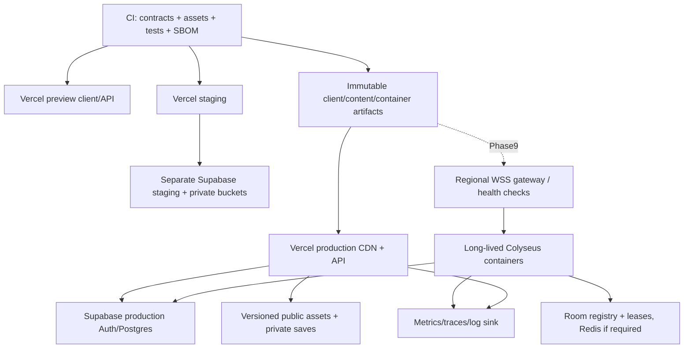

# 07 — Performance, QA, Infrastructure, Roadmap, WBS & Cost

**Phạm vi estimate:** các số103–170PW/36 task và mốc MVP ở file này thuộc baseline1.0. [12 — Full Life delivery](12-realism-delivery.md) thêm47–78PW/12 task và cập nhật tổng SP Full Life150–248PW trước reserve, MP increment riêng. Không dùng rates/lịch/quote giả định cũ để cam kết toàn60 feature. PERF01–21 và QA01–16 ở đây vẫn áp dụng, bổ sung QA17–24/Gate L khi mở rộng.

## Performance budget — mục tiêu cần đo, không phải benchmark

Mỗi tier là một profile thử nghiệm **đề xuất**; phải có máy vật lý và inventory chính xác ở T00-01. Không phân tier theo user-agent. Chọn máy yếu đại diện GPU integrated (ví dụ Intel UHD 620, 8 GB RAM), trung bình GPU rời phổ thông (ví dụ GTX1650/16 GB), mạnh (ví dụ RTX3060/16 GB) và ít nhất một Apple Silicon/macOS để kiểm Safari. Những ví dụ này chưa được test, không cam kết thiết bị đạt mục tiêu. Driver/thermal/power mode quan trọng như tên GPU.

| PERF | Chỉ tiêu [A] | Low | Medium | High |
|---|---|---|---|---|
| 01 | Resolution / FPS steady route | 1280×720 /30 | 1920×1080 /60 | 1920×1080 /60, quality cao hơn |
| 02 | Presented frame p95 / p99 | ≤33,3/50 ms | ≤16,7/33,3 ms | ≤16,7/25 ms |
| 03 | CPU frame work p95 / GPU p95 | ≤20/28 ms | ≤10/14 ms | ≤10/14 ms |
| 04 | Input-to-display p95 offline | ≤120 ms | ≤85 ms | ≤85 ms |
| 05 | Main JS heap steady / total browser working-set cảnh báo | ≤256/900 MiB | ≤384/1400 MiB | ≤512/1800 MiB |
| 06 | GPU resident estimate cảnh báo | ≤256 MiB | ≤512 MiB | ≤768 MiB |
| 07 | Visible draw calls / triangles cảnh báo | ≤180 /0,5M | ≤350 /1,2M | ≤500 /2M |
| 08 | Visible skinned full-detail / NPC simulated | 6 /24 | 12 /24 | 16 /60 (full release) |
| 09 | Physics p95 / AI amortized p95 | ≤2/2 ms | ≤2/2 ms | ≤2/2 ms |
| 10 | HUD React commits CPU p95 | ≤2 ms at update | ≤1,5 ms | ≤1,5 ms |
| 11 | Audio voices simultaneous target | 16 | 24 | 32 |
| 12 | Shadow setup target | 1 atlas1024, short distance | 2048, restricted cascades | 2048–4096 only if headroom |

CPU/GPU budgets chạy chồng chéo, không cộng CPU+GPU rồi so frame budget như pipeline nối tiếp. Subsystem budgets là phần CPU envelope, không mỗi hệ được tiêu hết cùng lúc. GPU memory không có API cross-browser đáng tin cậy phổ quát; ghi engine estimate, process memory và pressure/context loss riêng; “không đo được” không coi bằng 0. Draw/triangle thresholds là cảnh báo điều tra; pass release dựa frame pacing + visual target, không tối ưu số cho đẹp báo cáo.

| PERF | Loading/network/runtime targets [A] | Điều kiện đo |
|---|---|---|
| 13 | Shell transfer≤2 MiB compressed; initial playable total≤25 MiB; common+first zone assets≤20 MiB ứng viên | Chưa có asset thật; codec/WASM/font tính vào total, không loại trừ để đạt số |
| 14 | Cold click-to-playable p95≤20 s trên 20 Mbps/RTT50 ms; warm≤5 s; low≤30 s | Tắt cache cho cold; TLS/decoding/shader tính đầy đủ; 25 MiB cần ~10,5 s lý thuyết transfer, còn lại là CPU/network overhead |
| 15 | Streaming không có main-thread task>100 ms; steady long tasks>50 ms tối đa1/5 phút, không lặp định kỳ | Exclude initial boot nhưng báo riêng, PerformanceObserver nơi supported |
| 16 | Shader warm và GPU upload không tạo hitch>100 ms trong route sau warmup | Báo boot warm thời gian riêng, không gọi “đã tối ưu” nếu chỉ chuyển hitch sang loading vô hạn |
| 17 | GC pause p99≤10 ms nếu công cụ đo được; memory tăng≤5% sau warmup qua 10 load/unload cycles | Heap snapshots + retained objects, không dùng forced GC làm điều kiện production |
| 18 | MP RTT target≤120 ms p95 tại region phù hợp; playable degradation tới250 ms, jitter50 ms và loss1% | Network emulator + geographic tests; chưa hứa cho mọi quốc gia |
| 19 | MP bandwidth steady ≤25 KiB/s down, ≤8 KiB/s up/player; handshake/baseline peak báo riêng | AOI12–20 entities, binary schema; đo actual compressed/framed bytes, không ước tính payload JSON đơn giản |
| 20 | Server tick30Hz p95≤20 ms, p99≤30 ms với room target; no sustained debt>1s | 4→8 players +24 active NPC benchmark, host vCPU/RAM/version logged |
| 21 | SP save capture+local write p95≤200 ms async, main blocking≤8 ms; cloud durable p95≤2 s khi khỏe | Snapshot≤512KiB, DB region RTT≤100 ms; offline hiển thị pending thay giả success |

## Auto Graphics Quality và manual controls

Boot capability check WebGL2/WASM, limits/extensions, renderer init; WebGPU chỉ thử opt-in và fallback nếu fail. Không dùng GPU fingerprint để theo dõi. Start conservative preset; sample frame timing 20 s ở gameplay, không lấy menu/loading làm baseline. Giảm resolution scale trước (0,6..1), rồi shadow distance/AO; cooldown30 s, tăng sau60 s ổn định >20% headroom; hysteresis tránh pumping. CPU-bound thì giảm active animation/AI LOD hoặc view distance, không chỉ giảm resolution. Auto không đổi gameplay NPC outcomes, không tắt critical cues. Manual locks được tôn trọng; user có thể về Auto. “High” không bật toàn bộ effect vô điều kiện. UI nói setting sẽ reload renderer nếu cần, giữ checkpoint trước thay backend.

Low: AO/SSR/volumetric tắt, probes+baked, DPR cap1, foliage alpha thấp. Medium: AO nhẹ, shadows selected, no SSR mặc định. High: AO tốt hơn, optional SSR/fog nếu frame headroom. Full dynamic weather/volumetric chỉ sau art+performance gate, không hy sinh controller để giữ effect.

## Benchmark protocol

Không viết code game trong nhiệm vụ hiện tại; đây là kế hoạch thực nghiệm. T00-02 sẽ dùng cùng GLB, light count, shadow quality, cameras, NPC rig và pixel resolution trên từng engine. Báo cả fidelity mismatch. Route chuẩn 180 s: L02 close camera → L03 8 NPC crowd → L05 peak meal → L04 sun/foliage → trở L02 unload. Warmup30 s, 5 runs/tier/browser, thêm cold cache 5 lần và long session2h. Report median/p95/p99 frame distribution, worst hitch, CPU/GPU samples, draw/material, transfer/decode, heap before/after. Laptop cắm điện, power mode cố định, 10 phút heat-soak; không chạy DevTools open trong capture timing chính nếu overhead lớn; profiling capture riêng.

Report template: runId, date, build SHA/content hash/lockfile/WASM versions, device/OS/browser/driver, tier/settings/render backend, route seed, cache/network, raw CSV/trace links, failures and anomalies. Phase0 renderer comparison chỉ kết luận scene đó; chưa chứng minh toàn production scale.

## Testing & QA strategy

Tools là **ứng viên thiết kế**, exact versions/API/license chưa được nghiên cứu trong hồ sơ: Vitest cho TS unit, Playwright cho browser flow, axe-core cho UI audit, Spector.js/engine inspector + browser performance panel cho graphics, k6 hoặc custom protocol bots cho load. Chọn/pin T00-01; không khẳng định browser automation thay được GPU/device test thật. Mỗi test có fixture seed/build/content, expected outcome và artifact; CI không chạy mọi GPU render như test snapshot HTML.

| QA | Loại / dữ liệu | Phương pháp/công cụ đề xuất | Pass/fail và evidence |
|---|---|---|---|
| QA01 | Unit/domain, 1k generated inventory operations, needs fixed ticks, quest reducer | Unit + property/invariant tests: conservation, bounded stats, idempotency, seeded RNG | 0 invariant fail; reject malformed commands; failure seed reproducible |
| QA02 | Integration/API/RLS, users A/B/anon/service, expired tokens | Local/staging Supabase fixtures, policy matrix ALL verbs/buckets; transactional concurrency | 0 cross-user leak/write; 100 duplicate/revision races 1 outcome, rollback atomic |
| QA03 | Physics/controller, 100 routes, doorway/crouch/step/props/low FPS | Headless movement traces + visible collision debug reviews, compare30/60physicsHz | No penetration/world escape/stuck>10s; movement distance render Hz within2%; camera no sustained wall clipping |
| QA04 | AI/schedule, 100 seeds×10 game days, blocked NPC and full queues | Fast deterministic domain simulation + sampled visual runs; decision trace and reservations | No orphan reservation, no unreachable mandatory quest, no omniscient witness; AI CPU budget on real client |
| QA05 | Gameplay/usability, new testers across 5 tasks U section | Observed playtest, event funnel opt-in, 20–30 min sessions | ≥80% understand schedule; ≥70% see meaningful choice; 0 progression blocker, actual sample size/report not fabricated |
| QA06 | Browser/device compatibility, 4 families ×3 profiles plus macOS | Physical hardware manual + automation on available builds; capability/fallback/audio/pointer-lock/IndexedDB | No crash/blank/unsupported silent failure; feature parity baseline; exact supported matrix published |
| QA07 | Graphics regression, 20 seeded camera/time fixtures per tier | Controlled screenshots, per-browser baseline, perceptual diff + artist review | 0 unapproved major visual regressions, all validator errors fixed; tolerate known nondeterministic particles by mask not hide artifacts |
| QA08 | Performance/long-session, route+2h+10 zone cycles | Protocol above, CPU/GPU/heap/longtask telemetry | PERF01–17 pass target tier, memory growth≤5% after warmup, no context-loss crash; actual inability recorded, scope/tier adjusted explicitly |
| QA09 | Security/privacy/save integrity, malicious import/payload/token | Threat-based fuzz, secret/SBOM scan, IDOR/RLS/Origin/rate tests, consent/export/delete | 0 critical/high exploitable unresolved; no secrets/PII log; manual exceptions documented owner/date/expiry |
| QA10 | Load/API/storage, 3×expected peak burst, DB pool exhaustion | Synthetic authenticated clients, save conflicts, retry storms, queue limits | No unbounded queues, 429 Retry-After correct, p95 service SLO at agreed peak; no fabricated CCU claim |
| QA11 | MP network at0/50/120/250ms RTT, jitter0/50ms, loss0/1/5%, 10s disconnect | Bots + real clients, WSS congestion/queue measurement, prediction errors | At120ms/1% loss no duplicate items, correction p95<0,3m target; 250ms/5% degrades visibly but no corruption; reconnect≤10s after network healthy target |
| QA12 | MP chaos, room crash/split-brain/DB unavailable during commit | Kill owner process, expire lease, replay old epochs/tickets, restore checkpoints | Old owner writes rejected, committed awards preserved; checkpoint loss≤30s target; no success ack before durability |
| QA13 | Save reliability,100 interrupted writes×local/cloud and N−2 schema | Kill tab, quota denied, bad hash, concurrent tabs/devices, content alias migration | ≥1 valid generation each interrupted atomic write; corrupt detected; 409 preserves forks; round-trip digest stable excluding expected volatile fields |
| QA14 | Accessibility/UI, 720p/text200%, keyboard/screen reader, long Vietnamese text | axe candidate + manual NVDA/VoiceOver where supported, contrast over real scene, remap/motion tests | No critical UI audit failures, focus visible/restored, no essential color/audio-only cue; gameplay limitations explicitly disclosed |
| QA15 | Deployment/DR, previous client/content, DB clone, object backup | Staging rollout/rollback, secret rotation, restore drill + synthetic user | Recover data with verified checksums, no orphan pointers, RPO/RTO measured vs goals, rollback compatibility proven |
| QA16 | Content/licensing/localization, all catalog IDs and 30 quest target | Build validators + narrative/asset ledger review, graph path coverage | No missing refs/licenses/strings, every quest has recovery/test/reward canonical key, rating/content review signed |

Test fixture pack: one new character, one full bag, one max skills, one quest ready/reward pending, one NPC mid-sit, one night/rain world, one old save, one corrupt save, two accounts with similar IDs, two simultaneous room owners in chaos. Fixtures không dùng production PII. Golden state digest không bao gồm wall timestamps/UUID random ngoài seeded fixtures.

Bug workflow: report build/device/steps/seed/trace → triage → assign → reproduce minimal case → fix → targeted regression → reviewer/QA verify → close linked requirement. Severity S0 data leak/loss blocks deploy; S1 progression/crash blocks release; S2 visible issue requires owner decision; S3 polish scheduled. Required CI gates contract/type/lint/domain/security/schema/asset checks; no arbitrary 100% coverage target, focus invariants và failure paths. GPU/perf nightly/release on dedicated devices; tests không ổn định phải quarantine có owner/deadline, không “retry đến xanh”.

## Deployment Diagram và environment

Dev, staging và prod tách Supabase projects/keys/buckets. Preview không kết nối production DB hoặc lưu ticket thật. Không deploy hạ tầng trong nhiệm vụ này. API và DB chọn region gần nhau; assets CDN toàn cầu; room region theo users và RTT. Nhà cung cấp container chưa chọn do chưa có region/budget quote; T09-01 so ít nhất2 provider bằng RTT/cost/health/drain, không cố định vendor chưa nghiên cứu.

Deploy order: publish immutable assets → compatible DB expand → API support versions → small client canary (5% proposal khi có traffic/control) → synthetic+error metrics → ramp → retain previous release → delayed DB contract. Hosting cache: hashed JS/assets immutable, HTML/manifest revalidate; no caching auth/private API in public CDN. WASM/GLB/KTX2 correct MIME/CORS. Content and API version negotiation fail có hướng dẫn update, không crash khi stale cache.

Monitoring đề xuất: client crashes/context lost/save failures, FPS/frame p95 theo tier (sample, consent), load funnel và shader hitch; API latency/error/429, DB pool/locks/query latency, storage egress; room tick/debt/memory/persistence lag/corrections. OpenTelemetry-compatible naming và dashboard, vendor chọn sau. Redact tokens/name/email, sampling cosmetic logs, correlate requestId/actionId không PII. Initial SLO online API availability99,5%/month và save durable p95≤2s [A], đo burn rate; chưa SLA. Alert p95 tick>30ms5min, save error>1%5min với minimum20 requests, DB unavailable immediate synthetic2 consecutive; tuning tránh paging từ một request lỗi.

Runbooks bắt buộc: auth outage, save conflict/corruption, bad asset deploy, migration failure, high egress, GPU regression, compromised key, room overload/crash và data export/deletion. Backup: DB/PITR theo plan thật + private objects/version manifest/source backups + restore test hàng quý; development daily export không thay production DR. Không cắm service role vào client để “sửa RLS nhanh”.

## Roadmap và Work Breakdown Structure

Effort là **person-week (PW), 1 PW=5 ngày×6 giờ focus=30 giờ**, không phải lịch tuần. Range thấp/cao phản ánh rework/unknown; estimate cho phạm vi SP full đề xuất với kit reuse, không asset AAA bespoke toàn bộ. Một người làm nhiều role không tăng capacity. Tasks là work package có thể tách issue sau spike, mỗi package có deliverable/acceptance, priority và dependencies. Phase sau không bắt buộc đợi toàn phase trước nếu dependency task đã qua gate.

Nguồn lực tham chiếu small team: 2 gameplay/engine, 1 backend/network/DevOps, 2 environment/character artists, 1 technical artist/animator, 1 designer/writer, 1 QA/product kiêm nhiệm. 8 người danh nghĩa, **effective focus capacity6 PW/calendar week** do cộng tác, PTO, review; phải đo velocity thực thay giả định sau2 sprints. Dedicated audio/narrative specialist contractor nằm trong asset/content allowance và effort tương ứng nếu bổ sung. Producer không tự động được tính thêm8th dev.

### Phase 0 — Research & Technical Validation

Objective: kiểm chứng engine/browser/art/server risks trước sản xuất. Scope prototype kỹ thuật ở nhiệm vụ tương lai, chưa phải game content. Deliverables: version manifest, benchmark raw data, controller/nav spike, cloud policy/save spike, ADR cập nhật. Testing QA02/03/06/08/13. Risks R01/R02/R03/R05; exit khi chọn engine/physics được chứng minh trên low/medium hoặc hạ scope/tier có ký duyệt.

| Task | Công việc / technical requirement | Dependencies | Priority / role | Effort PW | Acceptance / deliverable |
|---|---|---|---|---|---|
| T00-01 | Device/content/version inventory, test harness và license/tool audit | None | P0 tech lead+TA+QA | 1–2 | Reproduce build; exact versions + 3 device profiles, candidate tooling pinned |
| T00-02 | Babylon vs Three cùng scene route/fidelity, WebGL2 baseline; optional WebGPU | T00-01 | P0 graphics+QA | 2–4 | 5 runs/profile, raw traces, no misleading fidelity mismatch, ADR01 decision |
| T00-03 | Rapier vs Havok controller/headless/navmesh binding/door links | T00-01 | P0 gameplay+network | 2–3 | 100 route tests, same domain headless smoke, pin nav binding/license |
| T00-04 | Supabase RLS/Auth/save CAS + Vercel actual limits/region/plan | T00-01 | P0 backend+security QA | 1–2 | Cross-user denies, duplicate saves one outcome; record platform constraints |
| T00-05 | Blender export/rig/PBR/Meshopt vs Draco/KTX2 cold-load spike | T00-01,T00-02 | P0 TA+artist | 2–3 | One room/rig pipeline report, no validator errors, prove budget feasibility |

Phase effort8–14 PW. Không qua gate thì dừng mở rộng, chọn giảm population/resolution/content, không dùng roadmap cũ như cam kết cứng.

### Phase 1 — Technical Foundation

Objective: runtime ổn định có thể sản xuất nội dung. Scope modules/loop/input/controller/camera/asset lifecycle. Deliverables foundation build, contracts và pipeline docs. Tests QA01/03/07/08. Risks R02/R04/R05; exit traversal, load/unload và action lifecycle đạt invariants.

| Task | Công việc / technical requirement | Dependencies | Priority / role | Effort PW | Acceptance / deliverable |
|---|---|---|---|---|---|
| T01-01 | Workspace/module boundaries, CI/schema/content contracts, fixed loop/clock/events | Phase0 gate | P0 architect+gameplay | 2–3 | Domain headless, dependency lint, deterministic fixture digest |
| T01-02 | Input/remap/controller/camera/context loss & recovery | T01-01,T00-03 | P0 gameplay | 3–5 | AC04 + camera collision route, pointer-lock/focus tests |
| T01-03 | Asset manager/stream cells/renderer/probes/light pipeline | T01-01,T00-02,T00-05 | P0 graphics+TA | 3–5 | 10 zone cycles no leaks, correct color/LOD/cache fallback |
| T01-04 | Interaction/action FSM/animation bridge/audio and HUD projection | T01-02,T01-03 | P0 gameplay+animator+UI | 3–5 | AC05, markers no duplicate commit, HUD budgets |

Phase effort11–18 PW.

### Phase 2 — Playable Vertical Slice

Objective: chất lượng game có thể đánh giá, không chỉ tech demo. Scope: 4 zones, 12 NPC, 3 quests, local saves, HUD/menu. Deliverables: 20–30 phút slice + findings. Tests QA04/05/07/08/13/14. Risks R01/R04/R06/R07; exit: 3 quests complete, no blocker, medium target và usability gates hoặc documented scope change.

| Task | Công việc / technical requirement | Dependencies | Priority / role | Effort PW | Acceptance / deliverable |
|---|---|---|---|---|---|
| T02-01 | L02/L03/L04/L05 blockout→art representative, rigs và 12 NPC variants | T01-03,T00-05 | P0 env/character/TA | 5–8 | Zone manifests, collider/nav, art review and route perf captures |
| T02-02 | Schedule/utility/task AI, dialogue,3 quests & activities | T01-04,T02-01 | P0 gameplay+designer | 4–6 | AC06/07/15/26, witness and queue tests |
| T02-03 | Local save + U03–U08/U12/U15–U18/U20 minimal | T01-04 | P0 backend/client+UI | 3–5 | AC18, complete tutorial/start/save/load/quit flows |
| T02-04 | Slice usability/performance review và scope gate | T02-01..03 | P0 QA+producer+art lead | 2–3 | Raw playtest report, prioritize fixes, no unresolved progression loss |

Phase effort14–22 PW. Slice tạo nền cho MVP, không cộng thêm một lần riêng khi tính full budget.

### Phase 3 — Core Gameplay Systems / MVP

Objective: vòng lặp SP hoàn chỉnh. Scope6 zones24 NPC10 quests3 skills20 item types10 achievements; Auth/cloud save sớm qua T06-01, không chờ Phase6. Deliverables MVP candidate & schema fixtures. Tests QA01/02/04/05/13/14. Risks R04/R06/R08/R09; exit MVP acceptance dưới phần08, cloud conflict/RLS pass.

| Task | Công việc / technical requirement | Dependencies | Priority / role | Effort PW | Acceptance / deliverable |
|---|---|---|---|---|---|
| T03-01 | Inventory/equip/skills/achievements/needs/day transitions | T02-02,T02-03 | P0 gameplay | 4–6 | AC11–17/21–25/29, conservation & bounded balance |
| T03-02 | Quest/dialogue/relationship depth +7 quests + tutorial/handbook | T03-01 | P0 designer+gameplay | 4–6 |10 playable quests with alternatives, no farm/reward replay |
| T03-03 | L07/L13, customization variants,24 NPC content+animations | T02-01,T03-01 | P0 artists+animator | 5–8 | Pipeline QC, memory and NPC LOD budget |
| T03-04 | U01–U23 complete, accessibility/balance/perf MVP QA | T03-01..03,T06-01 | P0 UI+QA+design | 3–5 |AC19/20/30/31, end-to-end fresh/returning/offline/conflict |

Phase effort16–25 PW.

### Phase 4 — World Expansion

Objective: full-release scope có khác biệt gameplay, không clone rooms. Scope8 zones còn lại,60 NPC identities,30 quests total. Deliverables content complete build và catalog. Tests QA04/05/07/16. Risks R04/R06/R07; exit mọi khu có activity/NPC/route khác biệt và quest graph kiểm tra được.

| Task | Công việc / technical requirement | Dependencies | Priority / role | Effort PW | Acceptance / deliverable |
|---|---|---|---|---|---|
| T04-01 | L01/L06/L08/L09/L10/L11/L12/L14 full art/nav/audio | MVP gate | P1 env artists+LD | 8–14 |15 trường mỗi zone đạt, manifest/LOD/perf review |
| T04-02 |20 quests mới,story branches/dynamic events/world overrides | T03-02,T04-01 blockouts | P1 writer+designer+gameplay | 8–12 |30 quests total, recovery alternatives, all reward ledger keys |
| T04-03 |60 NPC identities,group/reservation tuning,reputation content | T03-03,T04-01 | P1 character/animation+AI | 4–7 |Distinct authored behavior, AI LOD CPU cap, no omniscience |

Phase effort20–33 PW.

### Phase 5 — Advanced Graphics & Immersion

Objective: cải thiện fidelity có đo. Scope day/night art polish, animation/IK tùy budget, spatial audio/weather nhẹ; không yêu cầu realtime GI. Deliverables quality presets, visual goldens, content audio. Tests QA06/07/08/14. Risks R01/R02/R07; exit art target và PERF đồng thời, effect không đạt tắt/cắt.

| Task | Công việc / technical requirement | Dependencies | Priority / role | Effort PW | Acceptance / deliverable |
|---|---|---|---|---|---|
| T05-01 |Lighting/probes/postprocess quality tiers+optional WebGPU parity | T04-01,T01-03 | P1 graphics+TA | 4–7 |Reference captures/tier, no backend-specific missing assets |
| T05-02 |Animation blends/context/near IK/expressions polish | T04-03 | P1 animator+gameplay | 4–7 |Foot/hand/camera review every body/outfit, no action semantic change |
| T05-03 |Audio mix/captions/weather and graceful disabled modes | T04-01,T04-02 | P1 audio+graphics+QA | 2–4 |AC27, voice cap, captions critical cues, weather fallback |

Phase effort10–18 PW.

### Phase 6 — Backend, Persistence & Operations

Objective: dữ liệu an toàn và có thể vận hành. **T06-01 chạy song song Phase3**, phần hardening sau content. Scope Auth/RLS/save/backup/runbooks/monitoring, chưa room server. Deliverables deployed staging infrastructure khi được triển khai, verified migrations/DR. Tests QA02/09/10/13/15. Risks R08/R09/R10/R11; exit restore và cross-user tests pass.

| Task | Công việc / technical requirement | Dependencies | Priority / role | Effort PW | Acceptance / deliverable |
|---|---|---|---|---|---|
| T06-01 |Auth/profile/RLS/save CAS API01–05/08 + cloud UI | T02-03,T00-04 | P0 backend+UI | 4–6 |AC19/QA02/13, schemas migration fixtures; blocks MVP gate |
| T06-02 |Full projections/ledger/concurrency/retention/deletion/backups | T06-01,T03-01 | P0 backend | 3–5 |DB dictionary invariants enforced, export/delete/restore verified |
| T06-03 |CDN/cache/CI environments/telemetry/secret management | T06-01,T01-03 | P0 DevOps+graphics | 2–4 |Preview isolation, version rollback, redacted correlation |
| T06-04 |Security/load/DR/runbooks/on-call ownership hardening | T06-02,T06-03 | P0 backend+QA+ops | 2–3 |QA09/10/15, measured RPO/RTO and named owner |

Phase effort11–18 PW; công này được cộng **một lần** dù task chạy sớm.

### Phase 7 — Performance Optimization & QA

Objective: release candidate đo được, không “tối ưu cuối cùng” lần đầu. Scope profiling xuyên hệ, browser/device regression, balance and fixes. Deliverables benchmark archive/compatibility matrix/bug sign-off. Tests QA01–10/13–16. Risks mọi performance/save/content risk; exit 0S0/S1 và release checklist pass.

| Task | Công việc / technical requirement | Dependencies | Priority / role | Effort PW | Acceptance / deliverable |
|---|---|---|---|---|---|
| T07-01 |CPU/GPU/AI/physics/asset profiling và targeted optimization | T04/T05/T06 candidates | P0 engine+TA+QA | 4–7 |PERF gates, raw before/after cùng settings |
| T07-02 |Regression matrix,long sessions/accessibility/security/failure cases | T07-01 candidate | P0 QA+all owners | 4–6 |Every required QA evidence, no unresolved critical defect |
| T07-03 |Balance/usability/content/localization final pass | T04-02,T07-02 findings | P0 design+writer+QA | 2–4 |No nuisance needs grind, captions/locales/licenses complete |

Phase effort10–17 PW.

### Phase 8 — Production Release

Objective: staged release vận hành được. Scope release management, monitoring, rollback, support handoff. Deliverables release package/runbooks/release notes. Tests QA15 + production smoke without destructive real-user test. Risks R10/R11/R12; exit canary/ramp khỏe, ownership/support ready.

| Task | Công việc / technical requirement | Dependencies | Priority / role | Effort PW | Acceptance / deliverable |
|---|---|---|---|---|---|
| T08-01 |Release compatibility/backup/rollout/rollback rehearsal | Phase7 gate | P0 DevOps+backend+QA | 1–2 |Previous client/content and current schema rollback drill |
| T08-02 |Staged deploy,monitor/support handoff,post-release review | T08-01 | P0 producer+ops+QA | 2–3 |08 checklist, SLO/dashboard/incident contacts, healthy observation window48h [A] |

Phase effort3–5 PW. Publication là task tương lai, không thực hiện trong hồ sơ này.

### Phase 9 — Multiplayer Expansion

Objective: co-op nhỏ authority an toàn. Scope4-player pilot→8 gate, server gameplay, lobby/reconnect/ops. Deliverables protocol/room artifacts/load & chaos reports. Tests QA11/12/09/10/15 + core regressions. Risks R03/R08/R10/R13; exit network/authority/tick/data-integrity gates, không extrapolate pilot ra MMO.

| Task | Công việc / technical requirement | Dependencies | Priority / role | Effort PW | Acceptance / deliverable |
|---|---|---|---|---|---|
| T09-01 |Colyseus hosting/region/capacity/headless prototype, pin protocol | Stable domain+T00-03+SP release | P2 network+DevOps | 3–5 |Real WSS tick/persistence RTT test,2 provider options with quotes |
| T09-02 |Server room ownership/AOI/authoritative action validation+durable ledger | T09-01,T06-02 | P2 network+backend | 6–10 |Race/cheat/split-brain tests,4-player tick gate |
| T09-03 |Prediction/interpolation/reconciliation/reconnect and U24/U25 | T09-02 baseline | P2 client/network+UI | 5–9 |QA11 at120ms/1%loss, no reward from prediction |
| T09-04 |4→8 load/chaos/drain/monitoring/anti-abuse/beta playtest | T09-02,T09-03 | P2 QA+network+ops | 6–11 |QA12,capacity envelope and operating cost verified,8-player gate or cap4 |

Phase effort20–35 PW; content co-op redesign/extra animation/voice moderation chưa nằm trong phạm vi, phải re-estimate nếu yêu cầu.

## Effort & Cost Estimation

WBS total SP Phase0–8 = **103–170 PW** (3.090–5.100 giờ focus). Thêm reserve25% cho uncertainty = **129–213 PW** làm tròn lên; không coi reserve là task đã làm. MP riêng20–35 PW, reserve25% →25–44 PW. Estimate sẽ được cập nhật sau Phase0 và slice dựa throughput, scope và asset reuse. Đây là mô hình bottom-up từ task, không báo giá studio.

| Kịch bản [A] | Capacity / lịch suy ra | Chi phí nhân công mô hình | Phạm vi thực tế và trade-off |
|---|---|---|---|
| Solo |1 PW/tuần danh nghĩa;0,7–0,9 hiệu dụng, context switch cao; full SP129–213 PW tương đương143–304 tuần làm việc, trước lịch nghỉ bổ sung | Rate tự quy ước15–35 USD/giờ ×3.870–6.390h =58k–224k USD opportunity cost; không tiền lương bắt buộc | Nên chỉ slice preset/art mua hợp pháp,6–12 NPC,3–5 quests; full blueprint rất rủi ro, cần cắt scope trước |
| Small indie8 roles |6 PW/calendar week hiệu dụng;129–213/6≈22–36 tuần capacity-only; dependencies/content reviews khiến planning envelope khoảng8–12 tháng phải reforecast | Blended giả định25–50 USD/giờ →97k–320k USD | Full SP kit-based có điều kiện, contractor art/audio; MVP trước để kiểm vốn |
| Professional studio |12–16 người,9–12 PW/tuần hiệu dụng; capacity-only11–24 tuần nhưng art pipelines/playtesting/certainty tạo critical path; planning6–10 tháng, re-estimate bespoke fidelity | Blended giả định60–120 USD/giờ →232k–767k USD cho cùng scope kit-based | Chất lượng art bespoke/face/animation cao làm tăng WBS, không dùng thêm người để hứa AAA trong6 tháng |

Rates là **giả định tính toán**, không dữ liệu thị trường đã xác minh, chưa gồm thuế/phí pháp lý/marketing/thiết bị. Giá tiền quy USD vì chưa biết địa điểm hợp đồng, không tự đổi VND theo tỷ giá chưa nghiên cứu. Team calendar envelopes là planning ranges, không cam kết deadline. Dùng critical path/availability thực lập schedule tại kickoff.

Slice Phase0–2 =33–54 PW trước reserve; MVP thêm Phase3 + T06-01 =53–85 PW trước reserve. Solo được khuyến nghị slice giảm: chỉ1 zone,6 NPC,preset character,1–2 quests; cần WBS rút gọn riêng, không gọi phiên bản đó là full MVP ở trên. Team thuê ngoài vẫn cần technical art/integration/QC, asset marketplace không xóa công đó.

### Infrastructure và operating cost model

Không báo giá Supabase/Vercel/container khi chưa chọn plan/region/traffic. Dùng worksheet sau để lấy quote thật T00-04/T09-01. Tất cả giả định workload có thể đổi:

| Driver | Công thức và ví dụ [A] | Quyết định cần kiểm chứng |
|---|---|---|
| CDN initial download |10k MAU×2 cold-equivalent sessions×40 MiB candidate total downloads≈781 GiB/month, chưa gồm patch/cache misses |40MiB là ví dụ traffic toàn session, không initial PERF25MiB; đo hit ratio/egress/requests |
| Cloud save writes |1k DAU×1h/day×60 autosave/hour×30≈1,8M writes/month trước coalescing; không ghi nếu state không đổi |512KiB cap không phải typical size; typical50KiB →~86GiB ingress, thêm retained versions/index/WAL/backups |
| Save storage |Active users×characters×slots×retained generations×mean snapshot bytes |Lifecycle/purge, objects backup và DB storage tách; không nhân writes cả tháng thành active retained size |
| MP rooms |ceil(peakCCU/playersPerRoom);200CCU/4=50 full rooms trước occupancy headroom |Số rooms/container do tick CPU/RAM benchmark, chưa giả100 rooms/vCPU |
| MP bandwidth |avgCCU×hours×3600×bytes/player/s;avg50×720h×20KiB/s≈2,41TiB/mo outbound |Egress/TLS/AOI/region overhead, packet framing, peaks; inbound khác outbound |
| Compute |instances×hours×unit rate + CPU/memory usage + spare capacity |Container/managed room quotes, drain/autoscale reserve30% ứng viên |
| Observability |events/sec×bytes×retention + metrics series + trace sampling |Cardinality bound, không label by player ID vào mọi metric |
| Backups/DR |DB PITR + object versions/copies + restore drills + secondary storage |Plan backup không tự chứa file bytes; region/durability requirements |
| Assets |License seats + purchased kits + bespoke artist hours + audio/localization |Allowance giả định2k–10k USD slice,10k–40k full kit/custom mix; cần quotes/license review, không cộng trùng wages artist nội bộ |
| Operations |On-call/support/moderation hours + incident reserve + patch QA |SP có support, MP tăng abuse/network ops; không giả hạ tầng là toàn chi phí |

TCO tháng = subscription base + usage(egress/compute/DB/storage/requests) + observability/backup + support nhân lực + amortized assets/tools. Đặt monthly caps/alerts70/90/100% budget đã duyệt; không mua service/plan từ hồ sơ này. Ví dụ workload không là dự báo tăng trưởng hay bằng chứng chịu tải.

## Risk Register

| R | Probability / impact | Trigger / mitigation | Owner / contingency |
|---|---|---|---|
| R01 |High/High fidelity vượt web GPU |PERF fail medium; baked/probe, reduce overdraw/variants, compare engine route |Graphics lead; giảm effect/resolution trước mở content |
| R02 |Medium/High browser/WASM/context issues |Crash Safari/lowGPU; capability fallback, device matrix, exact pins |Tech lead; baseline WebGL2, unsupported messaging |
| R03 |High/High multiplayer assumptions sai |Tick debt/headless mismatch; T00-03/T09-01 spike, scoped rooms |Network lead; cap4/defer MP, không DB realtime workaround |
| R04 |High/High content scope creep |Quests/zones tăng ngoài WBS; content budget/gate, scope change review |Producer; ship6-zone MVP trước |
| R05 |Medium/High adapter/navmesh tool risk |Binding unavailable/license/parity fail; pin + controller/path tests |Gameplay lead; Havok/native nav alternative có spike |
| R06 |Medium/High sim gây phiền hoặc khô |Playtest không hiểu choices, warning spam; soft needs caps, alternatives |Design lead; giảm decay/gộp routine actions |
| R07 |High/High art/animation throughput |Export/clipping/LOD lỗi; shared rig/kit, QC early |TA; fewer body/gear variants, no advanced facial |
| R08 |Medium/Critical save/cheat/concurrency |Duplicate rewards/409 overwritten; CAS/ledger/trust separation/DR |Backend lead; block writes, restore lineage, no trusted import |
| R09 |Medium/Critical RLS/secret/privacy |Cross-account test fail/token log; least grants, scans, role review |Security owner; halt release, rotate/revoke and incident plan |
| R10 |Medium/High cost/region/cloud outage |Egress/bill spike, RTT high; usage model, alerts, local play, quotes |Ops; cap usage/admission, pause optional features |
| R11 |Medium/High no ops readiness |Restore fails/on-call unnamed; drills/runbooks before launch |Producer+ops; defer production until recovery works |
| R12 |Medium/Medium naming/license/content rating |Asset rights unclear/sensitive portrayal; ledger and narrative review |Art+product; replace asset/edit story, no real layouts |
| R13 |High/High MP loss/desync/abuse |Corrections/queue explode; AOI/prediction/backpressure/auth/rate limits |Network+QA; private beta, cap room/region |
| R14 |Medium/High underestimation/team missing role |Velocity below estimate2 sprints; update WBS/capacity/cost |Producer; drop P1 before overtime/false dates |

Open risk không được đánh dấu “giải quyết” chỉ vì có mitigation trong tài liệu. Chỉ đóng khi evidence test/quote/owner acceptance có liên kết trong RTM.
