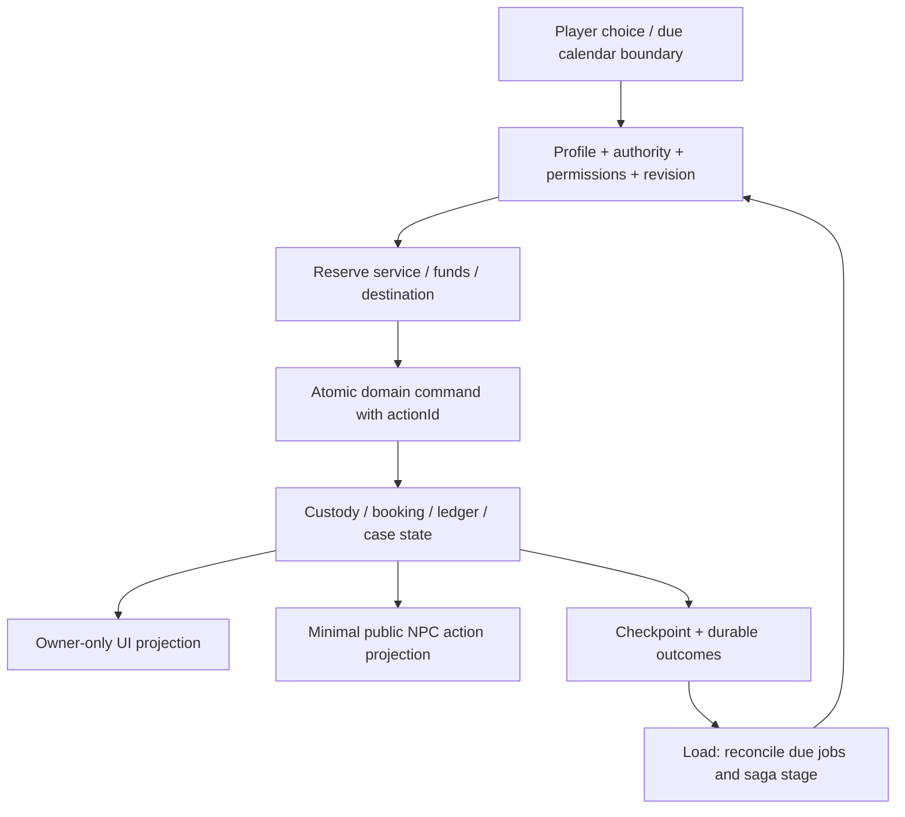
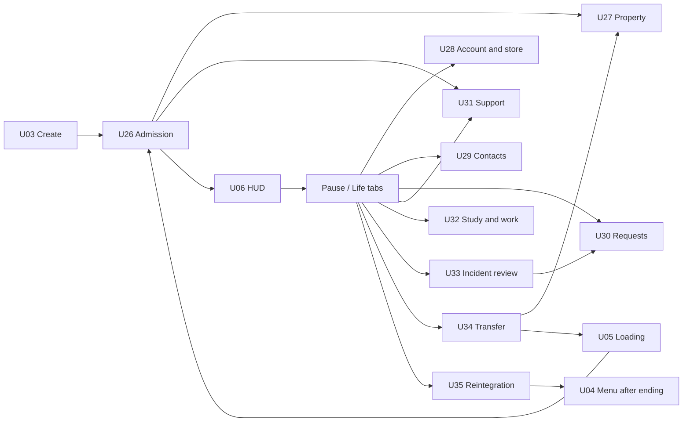

# 11 — Hợp đồng runtime, dữ liệu và UI cho Full Life

**CR-LAB-01 / thiết kế 1.3:** [18](18-labour-rehabilitation-spec.md) bổ sung DB51–58/API18–20/module save; [19](19-labour-ui-art-direction.md) bổ sung U39–44. Logical data IDs không tự là bảng SQL, module/schema chưa đổi trong lần viết docs.

**CR-VN-01 / thiết kế 1.2:** [15](15-custody-ui-mapping.md) cập nhật UI và [16](16-custody-contracts.md) mở rộng dữ liệu/runtime; v2 là baseline, v3 chỉ là đề xuất.

Phần bổ sung1.1 cho [02](02-architecture.md), [05](05-ui-ux.md) và [06](06-data-api-security.md). Mọi nội dung là thiết kế, không migration/source code. F33–F60 tại [10](10-prison-life-systems.md) là yêu cầu đầu vào; phạm vi và mức mô phỏng tại [09](09-realism-audit.md).

## Runtime integration và quyền quyết định

Thêm domain modules `custody`, `services`, `economy`, `contact`, `programs`, `support`, `casework`, `transitions` bên dưới packages/domain, adapters tại simulation/persistence/presentation hiện có. Không dựng một engine hoặc event bus khác. Config policy/content versioned, UI chỉ gửi intent và hiển thị projection. SP LocalSession chạy cùng invariant, MP room/server giữ authority; `service actor` trong fiction không đồng nghĩa credential cloud hoặc tài khoản admin thật.

Vòng tick bổ sung: consume input → apply due policy/service boundaries → resolve lifecycle/urgent overrides → schedule/AI goals → movement/physics/triggers → validate/commit actions → produce bounded events/HUD/save projections. Nghiệp vụ không cần30Hz dùng priority queue theo due tick/game minute; trạng thái care/legal/family private không phát broadcast Realtime. Fast-forward dùng cùng boundary reducers; số due events quá lớn chia work budget và progress UX, không bỏ qua item/ledger/case transitions.

Booking điều kiện: known participant/service, eligibility/profile, interval half-open `[start,end)`, capacity và conflicts được kiểm bằng authority; không chỉ dựa UI. Exemption tạo explicit record, không gọi “absent” rồi trừ reputation trước khi biết care plan. Role capability matrix: custodial general chỉ routine/housing/incident public facts; healthcare chỉ care scope; advisor chỉ case/reintegration scope; service clerk chỉ request metadata phù hợp; peer listener không quyền đọc hồ sơ chuyên môn. Fictional knowledge và backend authorization đều phải tách riêng.

Financial mutation có sequence: quote → reserve → prepare → atomic debit+delivery khi cùng store transaction hoặc saga durable với compensation khi khác store. MP UI “đã hoàn tất” chỉ sau durable authority ack. Chờ database không block toàn room tick: entity/account/action pending bounded, intent mới xung đột reject/busy; không cho physics snapshot biến pending thành đã trả tiền. Receipt và ledger audit không phải feed gossip của NPC.

## Data dictionary bổ sung — DB28–DB44

Kế thừa notation phần06: `!` NOT NULL, `?` nullable, B=id/created_at/updated_at, O=owner_id immutable+index, V=revision CAS. **Quy tắc E** cho mọi bảng cá nhân bên dưới: `world_id uuid! FK world_states`, `character_id uuid! FK characters`, `episode_id uuid! FK custody_episodes` trừ DB28 tự là episode. Cả ba cùng mode/lineage/character; constraint service/trigger kiểm consistency, không tin các FK độc lập. Required columns không ghi default là `=∅`; nullable defaultNULL; JSON `{}`/array `[]` bounded theo schema. Các cột min/max integer không nhận NaN/floating input.

Các bảng gồm **thiết kế persistence**, SP có thể chỉ nằm trong save DTO `lifeState` ở MVP; bật chuẩn hóa cần transaction/projection invariant phần06. Không đánh đồng player_profile với simulated medical/legal file. Không thu health/legal/religion/family thật từ người chơi để điền fiction. Data này vẫn owner-private vì có thể phản ánh lựa chọn nhạy cảm; logs/analytics chỉ dùng event class tổng hợp, không payload riêng.

### DB28 `custody_episodes`

Columns B+O+V; `character_id uuid! FK characters`; `world_id uuid! FK world_states`; `policy_profile_id text!`; `policy_version text!`; `policy_hash text! CHECK64hex`; `legal_status text! CHECK sentenced/remand/transfer_pending/release_preparation`; `state text!='arrived' CHECK arrived/orienting/admitted/transferring/released/archived`; `arrival_game_minute bigint!=0 CHECK>=0`; `closed_game_minute bigint?`; `orientation_flags jsonb!={}` max16KiB; `story_milestones jsonb!={}` max32KiB. UNIQUE(id,character_id,world_id), partial UNIQUE(character_id,world_id) for active episode; index(owner_id,state). Policy references validated registry in DB44 config. R2 owner read only via sanitized projection, authoritative writes; no client edit legal status/release date. Deleted account lifecycle follows06; retain simulated episode with save until lineage purge, không hồ sơ hình sự thật.

### DB29 `property_receipts`

Columns B+V+E; `source_action_id uuid!`; `receipt_kind text! CHECK deposit/issue/inspect/transfer/return/replace`; `state text!='listed' CHECK listed/stored/issued/return_pending/returned/disputed`; `lines jsonb!=[]`1..100 typed item identity/quantity/from/to/reason; `supersedes_id uuid? FK property_receipts`; `committed_tick bigint! CHECK>=0`. UNIQUE(world_id,source_action_id), index(episode_id,created_at), index(supersedes_id). Lines refer canonical item IDs/version or historical retired IDs via alias; no arbitrary URLs. Receipt immutable after commit, amendment creates linked receipt; R2 own read/server writes. Container totals and no duplicate active custody checked transaction, not by JSON schema alone.

### DB30 `housing_assignments`

Columns B+V+E; `zone_id text!`; `room_id text!`; `bed_slot_id text!`; `state text!='reserved' CHECK reserved/active/moving/ended`; `starts_game_minute bigint! CHECK>=0`; `ends_game_minute bigint? CHECK>=starts`; `placement_reason text! allowlist`; `accommodation_revision bigint! CHECK>0`; `transfer_id uuid? FK lifecycle_transitions`. Partial unique(world_id,bed_slot_id) where reserved/active/moving; partial unique(world_id,character_id) where active; index(episode_id,state), index(transfer_id). During move old assignment marked moving vẫn giữ chỗ, destination được reserved trong cùng transaction; rollback khôi phục old active và bỏ destination reservation. Khi commit destination thành active, old thành ended atomic; character vẫn có một current location qua transition controller. Không tái cấp giường cũ khi người chơi chưa chuyển xong. R2 participant own summary, public room occupancy stripped needs metadata. Room IDs refer level content registry.

### DB31 `service_bookings`

Columns B+V+E; `service_id text!`; `service_version text!` composite FK service_definitions; `kind text! CHECK routine/call/visit/legal/care/support/study/work/laundry/culture`; `participant_ref text?` fictional NPC/contact slug; `start_game_minute bigint! CHECK>=0`; `end_game_minute bigint! CHECK>start`; `state text!='requested' CHECK requested/booked/waiting/active/completed/excused/missed/cancelled/rescheduled`; `slot_key text?`; `priority smallint!=0`; `reason_code text?`; `source_action_id uuid!`; `supersedes_id uuid? FK service_bookings`; `outcome_key text?`. UNIQUE(world_id,source_action_id), index(world_id,start_game_minute,state), index(character_id,state), index(supersedes_id). Non-overlap/capacity via locked slot intervals or exclusion constraint for exclusive resources; shared capacity via server transaction. R2 owner read, public service occupancy only aggregated; confidential booking types never raw participant feed.

### DB32 `fictional_accounts`

Columns B+V+E; `currency_code text!='CREDIT_FICTION'`; `state text!='open' CHECK open/review/settled`; `balance_minor bigint!=0 CHECK>=0`; `reserved_minor bigint!=0 CHECK>=0 AND<=balance_minor`; `last_batch_seq bigint!=0 CHECK>=0`. UNIQUE(world_id,character_id,currency_code), index(episode_id). R2 own read/service write only; no payment gateway/withdrawal/account routing fields. Balance is transactional projection ledger; period reconciliation verifies sum. System clearing accounts need separate internal ownerless account kind with service-only access if implemented, not forge character_id of another player.

### DB33 `fictional_ledger_entries`

`id uuid! PK=generated`; `world_id uuid! FK world_states`; `account_id uuid! FK fictional_accounts`; `batch_id uuid!`; `batch_seq bigint! CHECK>0`; `source_key text!`; `direction text! CHECK debit/credit`; `amount_minor bigint! CHECK>0`; `reason_code text! allowlist`; `reverses_entry_id uuid? FK fictional_ledger_entries`; `committed_tick bigint! CHECK>=0`; `created_at timestamptz!=now()`. UNIQUE(account_id,batch_id,direction,source_key), UNIQUE(account_id,batch_seq); index(world_id,source_key), index(reverses_entry_id), index(account_id,created_at). Batch service ensures balanced journal including clearing side, once-per-source action via DB26; reversal cannot exceed original outstanding amount. Append-only; R2 only own account projection; support agent cannot arbitrarily mint credits. No real currency conversion.

### DB34 `commissary_orders`

Columns B+V+E; `account_id uuid! FK fictional_accounts`; `catalog_version text!`; `quote_id uuid!`; `quote_expires_game_minute bigint!`; `lines jsonb!=[]`1..12 typed item/quantity/unitPrice; `total_minor bigint! CHECK>=0`; `state text!='quoted' CHECK quoted/reserved/preparing/delivered/cancelled/refunded`; `stock_reservation_key text?`; `ledger_batch_id uuid?` reference logical committed batch; `delivery_inventory_id uuid? FK inventories`; `source_action_id uuid!`. UNIQUE(world_id,source_action_id), index(account_id,state), index(episode_id,created_at), index(delivery_inventory_id). Catalog server content includes item FK/version, prices/nonnegative and quotas; stock state checkpointed with source dedup, no display-only cart authority. R2 own read, service write; debit/reservation fields not writable directly. Retain order receipt for lineage lifetime; completed history in save bounded/archived with rollup, durable source keys retained.

### DB35 `fictional_contacts`

Columns B+V+E; `content_contact_id text!`; `display_name_key text!`; `relation_kind text! CHECK family/friend/advisor/peer/mentor/dependent`; `approved_channels text[]!={}` allowlist letter/call/video/visit/legal; `state text!='known' CHECK known/available/unavailable/archived`; `privacy_scope text!='owner' CHECK owner`; `story_flags jsonb!={}` max8KiB. UNIQUE(episode_id,content_contact_id); index(character_id,state). No real address/phone/email/child name input, only authored fiction. R2 owner read, server storyline writes; no service sending real communications.

### DB36 `correspondence_records`

Columns B+V+E; `contact_id uuid! FK fictional_contacts`; `booking_id uuid? FK service_bookings`; `channel text! allowlist`; `direction text! CHECK incoming/outgoing`; `content_node_id text!`; `state text!='draft' CHECK draft/submitted/processing/delivered/returned/completed/archived`; `due_game_minute bigint?`; `privacy_class text!='personal' CHECK personal/legal/support`; `source_action_id uuid!`; `parcel_receipt_id uuid? FK property_receipts`. UNIQUE(world_id,source_action_id), index(character_id,channel,state), index(due_game_minute,state), index(contact_id), index(booking_id), index(parcel_receipt_id). Text from localized authored graph, not stored arbitrary player prose. R2 owner-only, confidential class further service-role filtered. Archive repeated ambient letters to bounded summaries, preserve quest source dedup.

### DB37 `service_cases`

Columns B+V+E; `category text! CHECK property/legal/care/safety/accommodation/maintenance/discipline_review/general`; `privacy_class text!='personal'`; `incident_ref uuid?` polymorphic ref validated kind+world (not unconstrained cross-world lookup); `assigned_role text!`; `assigned_actor_id text?`; `state text!='submitted' CHECK submitted/acknowledged/in_review/answered/appealed/resolved/withdrawn`; `priority smallint!=0`; `due_game_minute bigint?`; `fact_codes jsonb!=[]` max16 facts; `decision_history jsonb!=[]` max32 typed records; `source_action_id uuid!`; `parent_case_id uuid? FK service_cases`. UNIQUE(world_id,source_action_id), index(episode_id,state), index(assigned_role,state,due_game_minute), index(parent_case_id). R2 owner projection; role-scoped handler access, legal/care/safety details isolated; no raw broadcast. Appeals require independent reviewer role/actor rule where authored, old decisions append-only.

### DB38 `support_plans`

Columns B+V+E; `kind text! CHECK functional/care/wellbeing/diet/privacy/language/cultural/family`; `state text!='offered' CHECK offered/active/declined/review_needed/closed`; `functional_flags text[]!={}` allowlist; `preference_codes text[]!={}` allowlist; `constraints jsonb!={}` max8KiB; `next_review_game_minute bigint?`; `consent_scope text!='private'`; `source_case_id uuid? FK service_cases`. UNIQUE(episode_id,kind), index(character_id,state), index(source_case_id). No disease code/dosage/real diagnosis required; narrative care abstract. R2 own projection and capable care/advisor actors only; general NPCs get eligible activity bool, not why. Player can request changes but cannot directly forge trusted MP exemption without rule validation.

### DB39 `program_enrollments`

Columns B+V+E; `program_id text!`; `content_version text!`; `kind text! CHECK study/work/culture/recreation`; `state text!='available' CHECK available/waitlisted/enrolled/in_progress/paused/excused/completed/withdrawn`; `completed_units text[]!={}`; `attendance jsonb!={}` max32 recent outcomes+totals; `completion_source_key text?`; `support_variant_id text?`; `work_credit_minor bigint? CHECK>=0`. UNIQUE(episode_id,program_id,content_version), index(character_id,kind,state). Program definitions validated content registry with session IDs, eligibility, outcomes and accessibility equivalents. R2 owner read; public group attendance projection no private reason. Award XP/credit via DB26/33 canonical session keys.

### DB40 `incident_reviews`

Columns B+V+E; `kind text! CHECK conduct/property/social/safeguarding`; `rule_id text?`; `policy_version text!`; `state text!='reported' CHECK reported/notified/in_review/decided/appealed/overturned/expired/dismissed`; `facts jsonb!=[]` ≤16 provenance/confidence records; `response_codes text[]!={}`; `decision_history jsonb!=[]` ≤16 typed records; `consequence_spec jsonb!={}` allowlisted optional privileges only; `expires_game_minute bigint?`; `appeal_case_id uuid? FK service_cases`; `canonical_incident_key text!`. UNIQUE(world_id,canonical_incident_key), index(episode_id,state), index(expires_game_minute,state), index(appeal_case_id). R2 involved owner facts-only, no private third-party histories; staff permission scoped. RightsFloor validator rejects any consequence removing essentials, no free JSON effect scripts.

### DB41 `facility_incidents`

Columns B+V; `world_id uuid! FK world_states`; `zone_id text!`; `fixture_id text?`; `kind text! CHECK maintenance/service_outage/drill/weather_override`; `state text!='reported' CHECK reported/assigned/unavailable/workaround/resolved`; `affected_services text[]!={}`; `fallback_spec jsonb!={}` max16KiB; `assigned_role text!`; `due_game_minute bigint?`; `canonical_incident_key text!`. UNIQUE(world_id,canonical_incident_key), index(world_id,zone_id,state), index(due_game_minute,state). R2 public world service projection only; no diagnostic security-sensitive layout data. Service-only writes, repair outcome dedup. No sabotage activation endpoint for clients.

### DB42 `lifecycle_transitions`

Columns B+V+E; `kind text! CHECK room_move/facility_transfer/release`; `state text!='proposed' CHECK proposed/approved/packing/staged/in_transit/committed/cancelled/recovering`; `from_anchor text!`; `to_anchor text!`; `target_policy_version text?`; `source_action_id uuid!`; `source_checkpoint_kind text! CHECK sp_save/server_snapshot`; `source_checkpoint_id uuid? FK game_saves`; `source_world_revision bigint? CHECK>0`; `source_server_checkpoint jsonb?` immutable validated server snapshot≤512KiB target; `stage_payload jsonb!={}` max32KiB of references; `committed_tick bigint?`. UNIQUE(world_id,source_action_id), partial UNIQUE(world_id,character_id) for in-flight states; index(episode_id,state), index(source_checkpoint_id). CHECK sp_save requires source_checkpoint_id and no server snapshot; server_snapshot requires source_world_revision+server snapshot and no client save ID. Mode must match checkpoint kind. R2 owner summary read, lifecycle authority only write; source_server_checkpoint/internal staging chỉ service role, không raw return qua API. Server snapshot captured durable at fenced revision before move, chỉ giữ trong recovery window, purge sau checkpoint committed được verify và retention policy. Không dùng client save import làm recovery trusted MP. Commit validates destination reserved and source fencing epoch, current location pointer once.

### DB43 `reintegration_plans`

Columns B+V+E; `state text!='planning' CHECK planning/review/ready/departed/archived`; `goals jsonb!={}` allowlist housing/work/study/finance/contact/support, max16KiB; `known_next_steps jsonb!=[]` max16; `eligibility_story_key text?`; `advisor_service_id text!`; `advisor_service_version text!` FK service_definitions; `departure_transition_id uuid? FK lifecycle_transitions`; `ending_id text?`; `settlement_source_key text?`. UNIQUE(episode_id); index(departure_transition_id), index(advisor_service_id,advisor_service_version). No real home address/employer input. R2 owner/advisor role scoped, no future sentence prediction or entitlement claim. One episode departure outcome and settlement canonical key.

### DB44 `service_definitions`

`id text!`, `version text!` composite PK; `kind text!`; `published boolean!=false`; `allowed_roles text[]!={}`; `capacity smallint!=1 CHECK1..64`; `time_windows jsonb!=[]`; `eligibility_spec jsonb!={}`; `privacy_class text!='public_service'`; `fallback_service_id text?`; `fallback_service_version text?` composite self FK; `policy_config jsonb!={}` max64KiB contains profile registry refs/validated fiction flags; `content_refs jsonb!={}`. Index(kind,published), index(fallback_service_id,fallback_service_version). R3 only sanitized name/availability/public rules; private routing/eligibility weights server content. Publisher writes only, version immutable. Staff role assignments actual NPC availability in DB06 world checkpoint keyed stable actor ID, validated against definitions; no new real-user admin role granted by this table. Cyclic fallback chains rejected at publish.

### Save schema và compatibility bổ sung

Save schema version2 thêm `lifeState:{profileRef,episodes,property,housing,bookings,accounts,orders,contacts,correspondence,cases,support,programs,incidents,transitions,reintegration}`, với reference IDs, due queue và ledger compact summaries. **Không** nhét toàn bộ DB ledger vô hạn vào512KiB. Giữ active records/last32 ambient events, archive summaries + persistent canonical source set cho quan trọng; target maximum measured sizes (base512KiB) vẫn gate. Nếu exceeded thì thất bại rõ/export/staged object save có support, không truncate quest/financial/appeal record lặng lẽ.

Migration v1→v2: giữ progress/XP/item instances, policy fictional default, episode active admitted cho character cũ, synthetic historical property opening balance **không phát item mới**, starter account0 + designated opening source key, no random conviction/release date. Existing meal/care quest flags map, unsupported episode state đưa review-safe anchor; source save read-only. Downgrade v2→v1 không supported; old client thông báo version và giữ file, không wipe. SP fork phải clone toàn episode graph/remap IDs và preserve canonical outcome associations; MP không import SP financial/care entitlement stats.

## API09–API13 — hợp đồng bổ sung

Kế thừa HTTPS/JWT/owner/If-Match/idempotency/errors/rate rules của06. UUID trong ví dụ là placeholder. SP local dùng cùng command contracts, không HTTP mỗi action khi offline; API HTTP phục vụ cloud-owned durable operations hoặc session service, MP action qua API06 WSS intent và authority jobs. Response chung `data`, `meta:{requestId,revision,serverTime}`, lỗi409/422/429/503 theo06. Mọi request reject unknown keys và derive actor/world/mode từ session. Các API truy cập private notes không chỉ kiểm room membership mà kiểm đúng participant và privacy role.

| Contract | Request / response | Validation, concurrency, lỗi và quyền |
|---|---|---|
| API09 casework |`POST /v1/characters/{id}/cases` body `{episodeId,category,factCodes,relatedEntityId?}` →201 `{caseId,status:"submitted",receiptId,revision,nextReviewGameMinute}`; `GET .../cases?cursor&limit`; `POST .../cases/{caseId}/appeals` body `{reasonCode,expectedRevision}` →201 linked review |Category/facts allowlist, owner/same-world incident, max16 facts/8KiB; source incident dedup; 409 stale/duplicate intent,422 unsupported route; writes6/min with urgent request coalescing rather than deny help; no retaliation effect |
| API10 bookings |`POST /v1/characters/{id}/bookings` body `{episodeId,serviceId,serviceVersion,contactId?,requestedStartGameMinute}` →201 `{bookingId,start,end,state,revision}`; `POST .../{bookingId}/cancel` body `{reasonCode}` →200 updated state |Exclusive interval/capacity lock, actor eligibility, permitted contact/channel and private notes scope; conflict409 `SLOT_UNAVAILABLE` + alternatives; reschedule old booking linked not erased;20 writes/min target, urgent services bypass ordinary slot limits |
| API11 economy |`POST /v1/characters/{id}/commissary/quotes` body `{episodeId,lines:[{itemId,quantity}]}` →201 `{quoteId,version,totalMinor,expiresGameMinute}`; `POST .../orders` body `{quoteId,expectedAccountRevision}` →201 `{orderId,state:"reserved",availableMinor,revision}`; `POST .../orders/{id}/cancel` →refund/hold release outcome |Server price/stock/quota, quantity1..99 and≤12 lines; account/item/world consistency, no negative/overflow,30s real auth timeout independent quote game expiry; quote expiry409,low funds422, stale revision409. 10 mutations/min; no endpoint accepting arbitrary credit amount from player |
| API12 lifecycle |`POST /v1/characters/{id}/transitions/{transitionId}/confirm` body `{expectedRevision,packingConfirmed:true}` →202 `{transitionId,stage,jobId}`; `GET .../{transitionId}` →stage + outcome; intent create transfer only story/service authority |Require authorized existing proposal/destination capability, actor owner/profile/mode, exactly1 in-flight transition. If timeout/retry resumes same action, never new transfer; completion status only after commit. 409 stage conflict,422 incompatible profile,503 staging unavailable;2 confirmations/min |
| API13 support/programs |`POST .../support-requests` body `{episodeId,functionalPreferenceCodes,requestedServiceId?}` →201 case+pending/applicable support; `POST .../enrollments` body `{episodeId,programId,contentVersion,supportVariantId?}` →201 enrolled/waitlisted; `GET .../life-summary` →owner-only bounded profile/services/bookings/case/progress summary |Functional flags allowlist, no diagnoses/real PII, privacy, course eligibility and capacity, XP/wages only authority outcomes;10 mutations/min. Unsupported variant422 with alternatives;409 duplicate/stale. No client direct `excused=true` or `released=true` input |

Fictional incident events do not call emergency services, email staff, submit real legal cases or send actual visitor invites. Bug/support reporting for the real game is a separate product/ops channel to be designed if user asks; no hidden external actions from gameplay.

## UI26–UI35 — đặc tả màn hình bổ sung

Kế thừa C-UI phần05 về keyboard, responsive1280×720/text200%, focus trap/restore, state Loading/Empty/Error/Ready, accessibility và lazy mounting. Bảng có đủ purpose/layout/hierarchy/content/actions/states/transitions/responsive/input/accessibility/visual/performance/AC; labels ghép chia rõ từng yêu cầu. Screen overlays SP pause như05; countdown có game-time label và MP world continues. Không mở35 màn riêng bằng hotkey; thêm tab “Đời sống” trong pause/profile, contextual links từ HUD/handbook/stations.

### U26 — Tiếp nhận / hồ sơ hành trình

| Trường | Đặc tả |
|---|---|
| Purpose / Layout |Admission từng bước và episode status; stepper trái, form/summary phải |
| Hierarchy / Content |EpisodeTitle > FictionalProfileLabel > Status > Orientation > Property/Housing > Next; “Thông tin trong thế giới hư cấu” |
| Actions / States |Review/acknowledge/ask/skip presentation/continue; Draft/StepPending/Admitted/UnsupportedProfile |
| Transitions / Responsive |U03→U26→U27/U31→U05→HUD; compact stepper top và form scroll |
| Keyboard/Mouse / Accessibility |All controls labeled, Back không undo committed receipt, simplified language; keyboard skip summary tương đương |
| Visual / Performance |Document panel readable, still portrait, no full new scene renderer; stages event-driven |
| Acceptance Criteria |UI26: every completed step persisted, no real legal claim, reload đúng stage, status remand không ghi kết tội |

### U27 — Tài sản, cấp phát và biên nhận

| Trường | Đặc tả |
|---|---|
| Purpose / Layout |Phân owned/carried/stored/issued/returned; list trái, receipt detail phải |
| Hierarchy / Content |Containers > ItemRows > Provenance/Reason > ReceiptHistory > AskReview/Collect |
| Actions / States |Inspect/confirm transfer/request correction/collect; Empty/Pending/Committed/Disputed/Full |
| Transitions / Responsive |Link U08 inventory/U30 dispute/U34 packing; compact list-detail stacked |
| Keyboard/Mouse / Accessibility |Multi-select checkbox + quantity input, no mandatory drag, item identity text and quantity |
| Visual / Performance |Static item icons, paged receipt history, partial pending state no modal flood |
| Acceptance Criteria |UI27: every removed item shows destination/reason/source, capacity error preserves item, receipt không editable |

### U28 — Tài khoản / cửa hàng

| Trường | Đặc tả |
|---|---|
| Purpose / Layout |Balance/statement/catalog/cart/orders in tabs |
| Hierarchy / Content |FictionalCredits > Available/Reserved > Catalog > Cart/QuoteExpiry > Confirm > Orders/RefundHistory |
| Actions / States |Filter/select quantity/quote/confirm/cancel/review; NoFunds/StockOut/StaleQuote/Reserved/Delivered/Refunded |
| Transitions / Responsive |Collect U27/U08, essentials link U31, compact cart riêng step trước confirm |
| Keyboard/Mouse / Accessibility |Price/quantity text, no color-only discount, no purchase by Enter key focus bất ngờ |
| Visual / Performance |No cash checkout/payment provider, lazy icons, totals from authority không animate số tiền giả |
| Acceptance Criteria |UI28: no debit until confirmed, pending/durable distinction, old quote fail có re-quote, balance0 có free-essential route |

### U29 — Thư, liên hệ và thăm gặp

| Trường | Đặc tả |
|---|---|
| Purpose / Layout |Contact list + inbox/outbox + booking conversation details |
| Hierarchy / Content |KnownContacts > ChannelTabs > Message/BookingRows > Status > Read/ComposeTopic/Book/Rebook |
| Actions / States |Choose authored topic/read/book/cancel; NoContact/Delayed/Booked/NoShow/Private/Completed |
| Transitions / Responsive |U15 dialogue/U17 schedule, close origin; compact contact then channel then detail |
| Keyboard/Mouse / Accessibility |No real address/number field, no camera/mic permission, caption/transcript all conversation |
| Visual / Performance |Letter typography, static portrait/video-style authored animation only on action, bound history |
| Acceptance Criteria |UI29: no-show has alternative, legal channel marked separate/private, unknown contacts not leaked to MP |

### U30 — Yêu cầu, kiến nghị và hỗ trợ hồ sơ

| Trường | Đặc tả |
|---|---|
| Purpose / Layout |Ticket list + structured new request + status timeline |
| Hierarchy / Content |ServiceCategories > KnownFacts > Submit > Receipt > Handler/NextReview > Response/Appeal; fictional label |
| Actions / States |Create/withdraw/read/review/appeal; Empty/Submitting/Acknowledged/Overdue/Answered/Appealed/Closed |
| Transitions / Responsive |Related U27/U31/U33, return origin; compact single-column step form |
| Keyboard/Mouse / Accessibility |Topic lists instead of mandatory free writing, help plain language, urgent route visible with no currency cost |
| Visual / Performance |Document layout, no private case toast text on public HUD, poll at low bounded cadence or events |
| Acceptance Criteria |UI30: request has receipt/reference, retry not duplicate, appeal independent case link, private details no screen-reader live spam |

### U31 — Chăm sóc và nhu cầu cá nhân

| Trường | Đặc tả |
|---|---|
| Purpose / Layout |Functional needs/support services/appointments in readable tabs |
| Hierarchy / Content |Preferences > AvailableSupport > PlanSummary > Book/Change/Decline > PrivacyInfo; “Không nhập thông tin y tế thật” |
| Actions / States |Select functional options/request support/schedule/optout; Unset/Offered/Active/Review/Declined/ServiceUnavailable |
| Transitions / Responsive |Booking U17, case U30, UI controls U23; compact summary trước form |
| Keyboard/Mouse / Accessibility |Optional disclosure, numeric/sliders where needed, screen-reader headings, no timed cognitive test |
| Visual / Performance |No real medical charts/dosage, icons+text, no high-frequency updates or diagnosis inference |
| Acceptance Criteria |UI31: player can decline/skip, equivalent actions visible, no private preference shown in lobby/others' feed |

### U32 — Học tập / công việc / hoạt động văn hóa

| Trường | Đặc tả |
|---|---|
| Purpose / Layout |Programs list, terms, timetable and completion detail |
| Hierarchy / Content |ProgramKindTabs > Eligibility > Units/ShiftTimes > SupportVariant > Enroll > Progress/Recap |
| Actions / States |Read/enroll/waitlist/pause/reassign/view completion; NoSlots/Eligible/Enrolled/Excused/Complete |
| Transitions / Responsive |Track U17/U13, skill summary U11; compact schedule as list |
| Keyboard/Mouse / Accessibility |Outcomes/time/fictional credit transparent, equivalent participation no shame label, no precision QTE compulsory |
| Visual / Performance |Static curriculum graph, no background live classroom preview; updates per unit/session event |
| Acceptance Criteria |UI32: course and shift attendance distinct from XP, makeup option for excused, certificate clearly in-game |

### U33 — Sự việc và xem xét quyết định

| Trường | Đặc tả |
|---|---|
| Purpose / Layout |Notice/facts/response/decision/review timeline, alleged vs established distinct |
| Hierarchy / Content |IncidentTitle > KnownFacts > YourResponse > ReasonedDecision > Duration/Effects > ReviewLink |
| Actions / States |Read/respond/ask help/appeal; Reported/Notified/InReview/Dismissed/Decided/Overturned/Expired |
| Transitions / Responsive |U30 appeal, U14 rule info, return origin; compact facts and effects stacked |
| Keyboard/Mouse / Accessibility |No forced countdown choice, neutral wording, content skip summary, consequence text never only red icon |
| Visual / Performance |No cinematic humiliation, owner-only data projection, history paginate/cap |
| Acceptance Criteria |UI33: allegation not labeled proven, effects+expiry+review shown before apply, overturned decisions show restored effects |

### U34 — Chuẩn bị chuyển nơi

| Trường | Đặc tả |
|---|---|
| Purpose / Layout |Transfer summary, packing checklist, affected bookings and status |
| Hierarchy / Content |From/ToFictionalLabels > Reason > Property > AppointmentChanges > Confirm > Stage/Recovery |
| Actions / States |Review/pack/request clarification/confirm/retry; Proposed/Packing/Staging/InTransit/Committed/Recovering |
| Transitions / Responsive |U27 packing→U05 load→U26 orientation delta, compact stepper/list |
| Keyboard/Mouse / Accessibility |No route/security blueprint, clear cancel-before-commit availability; text stage for screen reader |
| Visual / Performance |Loading art, no cinematic vehicle physics needed; reused scene readiness barrier |
| Acceptance Criteria |UI34: 202 not claimed completed, retry resumes same transition, every affected booking reason/replacement visible |

### U35 — Kế hoạch rời cơ sở / kết thúc hành trình

| Trường | Đặc tả |
|---|---|
| Purpose / Layout |Optional goals + support checklist + settlement + ending recap |
| Hierarchy / Content |StoryMilestone > Housing/Study/Work/SupportGoals > Property/Balance > Departure > Epilogue/Archive/SandboxFork |
| Actions / States |Choose goals/ask advisor/review/confirm departure/read recap; Planning/Ready/Departing/Released/Archived |
| Transitions / Responsive |U27/28/30 details, departure U05→epilogue→U04; compact goals list |
| Keyboard/Mouse / Accessibility |Ending skippable with transcript, no surprise permanent overwrite, restore focus main menu |
| Visual / Performance |Cinematic optional reduced-motion still, dispose episode scenes, no reopening old loop silently |
| Acceptance Criteria |UI35: no max-stat gate, archive vs new sandbox explained, repeat load no double settlement or return items |

## NPC và nội dung mở rộng

Archetypes thêm receptionist/property clerk, residential officer/support staff, scheduler, kitchen/laundry supervisor, teacher/librarian, care professional, wellbeing/peer listener, cultural facilitator/interpreter, maintenance worker, case/reintegration advisor và fictional family/visitor. Đây là roles có thể reuse asset/rig; không cộng mỗi role thành một NPC full-detail thường trực. Không cho custodial staff làm clinical decision nếu content không xác định đúng service capability.

NPC social memory chỉ biết service outage public, interaction trực tiếp hoặc authored rumor allowed. Không rò religion/support/legal/medical/family facts từ DB sang utility/social dialogue. Separate task memory (booking pending) và gossip/relationship memory. Door closures/care appointment exemptions phát minimized public state như “không có mặt theo lịch được phép”, không lý do sức khỏe. Handover service không yêu cầu play cả animation staff đi nhận hồ sơ mới commit case. Performance budget phần07 giữ nguyên, thêm nghiệp vụ phải nằm trong cùng CPU/memory envelope hoặc rebaseline có evidence.
