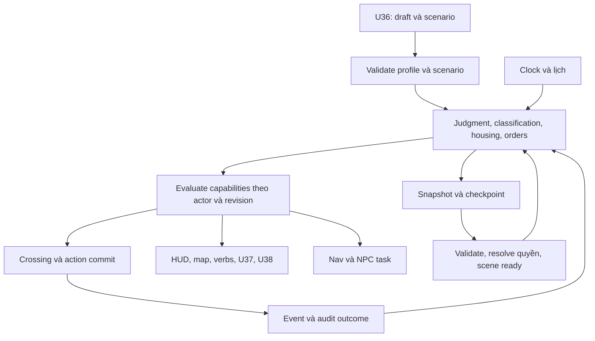
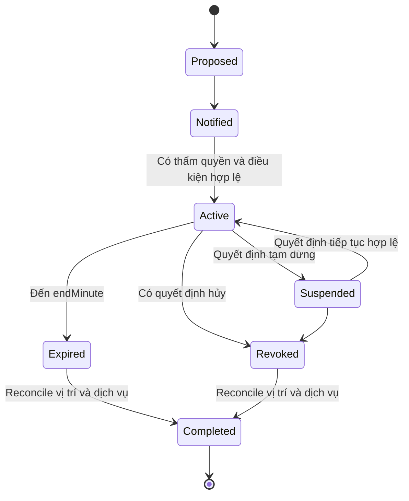

# 16 — Hợp đồng dữ liệu, runtime, lưu và tích hợp custody

CR-VN-01 / baseline mục tiêu 1.2 / 02/11/2026. **Thiết kế [D], không có migration hoặc code thực thi trong tài liệu này.** Nghiệp vụ tại [14](14-sentence-custody-spec.md), UI tại [15](15-custody-ui-mapping.md), QA tại [17](17-custody-delivery-qa.md). Dùng chung domain state, clock, command/event và ledger hiện tại; không tạo simulation thứ hai.

## 1. Một nguồn sự thật, nhiều projection

Local SP authority sở hữu judgment/custody/housing và quyền. UI store chỉ giữ draft, panel/focus và projection theo revision; renderer chỉ giữ mesh/camera. Cloud SP lưu snapshot untrusted; việc đã upload Supabase không làm quyết định do client tạo thành dữ liệu đáng tin cho MP.

Chuỗi quyết định: scenario đã publish → judgment → classification decision → housing assignment → active orders + lịch + support → capability evaluation → movement/action → events → HUD/map/nav/scene/save. Cached capability bị invalidate khi đổi phút game, phase, order, assignment, service state hoặc revision; không lưu cache làm truth.

Sơ đồ là tài liệu, cần render check trong tool của đội. Đường privilege không thông qua React setState hoặc material cửa.

## 2. Data dictionary logical DB45–DB50

SP tiếp tục snapshot-first như phần 06/11. Sáu ID dưới là logical aggregates/content, **không yêu cầu tạo sáu bảng Supabase ngay**. Nếu chuẩn hóa ở giai đoạn khác phải bổ sung migration/RLS/transaction và truy vấn nhất quán, không trộn snapshot cũ với projection mới.

Kế thừa owner/lineage/episode/revision, timestamp và privacy của DB templates phần 06, trừ definitions là published read-only. IDs ổn định; mọi reference kèm version/hash; số thời gian hữu hạn, dữ liệu JSON-serializable. Không chứa DOM, mesh, callback, Set/Map hoặc Date object.

| ID | Aggregate / ownership | Trường bắt buộc và nullability | Invariant, index/projection dự kiến |
|---|---|---|---|
| DB45 | Scenario và policy catalog / publisher | `id`, `version`, `hash`, `mode`, `status`, `supportedPopulation`, `sentenceTemplate`, `startStateRef`, `scheduleRef`, `sourceRefs`, `reviewStatus`, `effectiveFrom`, `reviewedAsOf`; `effectiveTo` optional | Published immutable; key id+version; status draft/reviewed/published/retired; không sửa save khi catalog mới publish |
| DB46 | Judgment / owner episode | `judgmentId`, `version`, `sentenceKind`, `basis`, `declaredTermMonths` nullable, `effectiveTermRef`, `calendarStart`, `creditedDays`, `servedDaysAtStart`, `sourceEventId`, `amendments`; `scenarioReleaseDate` nullable | Term có integer months hợp lệ theo basis; life term/date null; không credit hai lần; amendment có supersedes; projection episode+version |
| DB47 | Classification history / owner episode | `decisionId`, `group` A/B/review_required, `reasonCode`, `judgmentVersion`, `factsRef`, `issuerRole`, `validFromMinute`, `policyRef`, `supersedes` nullable | Một head decision mỗi episode; không xóa lịch sử; group không suy từ mesh; index episode+active |
| DB48 | Custody orders / owner episode | `orderId`, `kind`, `reasonCode`, `issuerRole`, `sourceDecisionId`, `state`, `startMinute`, `reviewAtMinute` nullable, `endMinute` nullable, `scope`, `returnHousingRef` nullable, `supersedes` nullable | State proposed/notified/active/suspended/revoked/expired/completed; discipline có end hữu hạn, duration >0 và ≤10 ngày ở profile này; separation có review condition, không ép cùng max |
| DB49 | Movement grants và service entitlements / owner episode | `grantId`, `actorId`, `purpose`, `fromRef`, `destinationRef`, `boundaryRefs`, `validFromMinute`, `validUntilMinute`, `issuerRef`, `policyRevision`, `state`, `sourceKey`; service entitlement có channel/method/reason | Bound actor/episode/purpose/interval; không dùng một grant vào mọi khu; direction/return semantics rõ; index actor+state+expiry |
| DB50 | Custody transition/outcome journal / owner episode | `eventId`, `canonicalSourceKey`, `actionId`, `kind`, `fromStateRef`, `toStateRef`, `minute`, `revision`, `policyRef`, `reasonCode`, `effectsSummary` | Outcome idempotent; lịch sử bounded có archive integrity, không xóa outcome keys còn cần chống lặp; index episode+revision/sourceKey |

### Mở rộng aggregates hiện có

| Aggregate | Delta cần có |
|---|---|
| GameState | `experienceMode`, `custodyState`, scenario/policy pin; schema mục tiêu 3; không thay trustMode SP |
| CharacterDraft | Mode, selected scenario/version, sentence selection, start segment, draft id; identity/appearance giữ riêng |
| Episode / DB28 | Judgment ref, legal status và chapter state tách nhau; không dùng `releaseEligibleDay` cho VN |
| Housing / DB30 | `facilityInstanceId`, `zone`, `roomInstanceId`, `bedSlotId`, classification ref, cohort compatibility, start/end và reason |
| World doors / DB06 | Physical state + animation readiness; reason hiển thị không thay actor access; boundary IDs riêng cell door |
| Bookings / DB31 | Capability revision lúc đặt, method at-room/authorized-movement/abstract; cause khi reschedule; không punish system-blocked |
| Support / DB38 | Phương thức phục vụ, exemption source/interval; thông tin nhạy cảm owner-only |
| Incident / DB40 | Decision ref, order refs, restriction refs; alleged/decided rõ; reversal effects cụ thể |
| Transition / DB42 | Source/destination room, custody revision, reserved grant/slot, readiness, recovery stage, idempotency key |
| Reintegration / DB43 | Chapter recap khác release result; release reason/decision ref; settlement ledger chỉ khi release |
| Save metadata / DB19 | Mode/preset, room label, order summary không nhạy cảm, profile version, schema; không đưa case facts vào list save |

Nhóm xã hội `readers/sports/...` của NPC không thay legal classification. Metadata cohort của NPC phục vụ placements; chỉ staff có capability phù hợp mới nhận task chứa dữ kiện cần thiết. Người chơi không được thấy toàn bộ luật nội bộ/diagnosis/decision riêng của NPC.

## 3. Các trục trạng thái độc lập

| Trục | Giá trị/quan hệ |
|---|---|
| Experience mode | fictional_life / vn_custody; immutable trong lineage, đổi bằng fork đã xác nhận |
| Legal status | sentenced là playable ban đầu; remand có contract nhưng chưa publish; released terminal trong episode |
| Sentence kind | term / life; các loại khác disposition tại 13, không silently coerce |
| Placement group | A / B / review_required; từ DB47 |
| Housing | active room/bed và cohort; đúng một active tại một thời điểm |
| Custody phase | Các phase tại 14; derive và lưu mốc transitions, không dùng PlayerMode thay thế |
| Active orders | Nhiều order có thể đồng thời: confinement/separation/care/contact; resolver theo từng capability |
| Player action | grounded/moving/acting/sleeping/talking… giữ hệ thống hiện tại; confinement không ép `sleeping` |
| Chapter | active/recap/completed; không quyết định release |

### Vòng đời lệnh và thay thế

Không nối lại order suspended bằng cách tự reset `startMinute/endMinute`. Profile phải quy định thời gian đã chấp hành được tính thế nào; chưa kiểm được thì không publish variant suspend/resume cho kỷ luật. Một appeal là case riêng, không tự chuyển order sang suspended. Decision superseding có transaction cập nhật head và outcome; không để cả lệnh cũ/mới cùng tính thời hạn.

## 4. Hợp đồng đánh giá quyền

Input: actor ID, episode, purpose/verb, from/to room or boundary, current simulation minute, judgment/classification/housing/order revisions, service metadata và support plan. Output: `allowed`, `method`, `reasonCode`, `explanationKey`, `validUntilMinute` optional, `requiredAuthorization`, `alternativeActions`, `policyRevision`. `method` gồm self/authorized_movement/at_room/abstract/not_available. Unknown/missing phải ra review-required, không mặc định allowed.

### Thứ tự xử lý nhất quán

1. Kiểm mode, episode lifecycle, identity/ownership, schema/content/profile pin. Nếu episode released không chạy command routine.
2. Xử lý tất cả due boundary/order expiry đến phút hiện tại theo thứ tự ổn định; không đánh giá trên order đã quá hạn nhưng chưa reconcile.
3. Resolve placement, active orders và service-specific entitlements. Không lấy “order nặng nhất” áp cho toàn bộ quyền.
4. Với dịch vụ thiết yếu/hỗ trợ: chọn cách cung cấp phù hợp; không suy được hỗ trợ = tự do bước ra cửa.
5. Với movement: kiểm cohort, room boundary, direction, mục đích grant, phase và validity interval. NPC staff dùng actor/task grant của họ; người chơi không kế thừa.
6. Với activity/contact: kiểm channel, lịch, slot, decision restrictions và exemptions riêng. Restriction một kênh không lan sang tất cả.
7. Kiểm physical readiness/path/collision. Quyền hợp lệ không cho xuyên tường; yêu cầu mở cửa/chuyển trừu tượng phải có event và checkpoint.
8. Recheck expected revision tại commit; nếu stale trả reason + khả năng retry/rebook, không ghi một nửa.

Thứ tự giải quyết xung đột: explicit lawful scenario decision đúng scope > policy default trong cùng scope; service method vẫn phải giữ design floor. Nếu không thể dung hòa, mark review-required và cung cấp safe in-room service/recovery; không bịa quyền luật hoặc phạt người chơi. Legacy policy vẫn giữ nguyên ở mode cũ.

### Cửa và mọi đường thay đổi vị trí

Render open/closed không là permission. Global door collider có thể mở vì staff; boundary evaluator vẫn chặn actor không có phép trước bước move. Ngược lại, actor có phép mà collider chưa mở phải chờ readiness, không bỏ collision. Boundary có swept crossing để chống đi nhanh/đi chéo lọt khi hai endpoint ở ngoài vùng mỏng.

Mọi đường đặt tọa độ phải đi qua kiểm vị trí đích: movement, sit/stand/slot snap, sleep/fast-forward, transition commit, admission finish, `lastSafe` recovery, load/resume, assist, map waypoint/travel nếu có. `safeAnchorFor(zone)` cũ không đủ; chọn room-specific anchor hợp lệ với actor. Không phát sinh incident từ điều chỉnh vị trí do bug hoặc recovery.

`zoneOpen` chỉ là khả dụng cơ sở; thêm actor eligibility riêng. Map dùng reachability cùng rules, không hardcode “khu hiện tại → hành lang → đích”. NPC path jobs mang actorId/policyRevision, kết quả stale bị bỏ; AI LOD không bỏ classification. Khi cửa/phase đổi, invalidate nav link và grants theo scope, không rebuild cả thế giới mỗi frame.

### Hành động đang chạy khi quyền thay đổi

| Thời điểm | Xử lý |
|---|---|
| Trước reserve | Từ chối có reason, không tiêu tài nguyên |
| Đã reserve, chưa commit | Tùy rule cho hoàn tất tại chỗ hay cancel/compensate; ghi system-blocked; release slot |
| Đã commit | Không undo phần thưởng bằng cancel presentation; hậu quả mới chỉ áp từ event tiếp theo |
| Đang đối thoại | Không lặp effect; kết thúc/suspend có transcript và restore mode hợp lệ |
| Ngủ/tua nhanh | Xử lý các boundary ở giữa; không đi thẳng tới phút cuối rồi bỏ order/meal/bookings |
| Actor ngoài room lúc thu hồi | Vào return/recovery phase có phép về; không khóa hai phía hay teleport tùy ý |

## 5. Clock, thời hạn và thời gian đã chấp hành

Tiếp tục một đồng hồ mô phỏng `minute`. Calendar pháp lý là phép chiếu từ mốc scenario lên cùng đồng hồ, không là interval chạy riêng. Pause dừng cả hai; wall-clock chỉ dùng timestamp lưu/telemetry, không dùng trừ hạn kỷ luật khi tab bị ẩn.

DB46 giữ tháng/năm đã tuyên và các mốc date-only theo lịch scenario. Không quy một năm luôn 365 ngày, tháng luôn 30 ngày. Scenario authoring tính mốc và bảng kiểm credit/end date, bao gồm năm nhuận, ngày cuối tháng và quy tắc tính hạn đã được reviewer xác nhận. Runtime dùng mốc đã publish; bản đầu không nhận hồ sơ thật hoặc tự tính ngày thả từ tội danh.

Progress hiển thị: elapsed simulation days + `servedDaysAtStart` + credited days theo bộ quy tắc không trùng; các tập thời gian chồng lấn phải được validate loại bỏ trước publish. Chưa có mốc xác minh thì “Ngày dự kiến: chưa xác định”, không unlock release. Term end candidate chỉ chuyển release workflow; policy/decision scenario quyết định event release, không ép goal/XP. Life không có term end, không tự chuyển về term vì đã chơi đủ 30 năm.

Tua nhanh yêu cầu preview: sẽ qua bữa/giờ học/order/review/mốc chương nào, actions có thể bị dừng. Xử lý due queue theo time rồi priority ổn định: decision/order changes → housing/movement reconciliation → services/exemptions → attendance/actions → chapter/release projection. Timestamp cùng phút có tie-break event ID/sequence, không dựa frame rendering. Reload đúng cùng minute cho cùng kết quả, không random lại decision.

## 6. Commands và API14–API17 mục tiêu

Hiện không có HTTP tương ứng. SP triển khai trước bằng typed domain commands trong session/controller; đường dẫn là hợp đồng dự kiến nếu tách service, không tuyên bố Vercel API đã tồn tại. C0/auth/owner/CAS của phần 06 tiếp tục áp dụng khi có backend.

| ID | Intent / input bắt buộc | Output / validation |
|---|---|---|
| API14 | `CreateScenarioExperience`: draftId, character draft, scenario/profile version+hash, selected sentence, start segment | Một lineage/state+summary; validate range/basis/support/versions; idempotency draftId; content changed trả conflict, không coerce |
| API15 | `RequestMovementOrService`: episodeId, purpose/service, destination, expectedCustodyRevision, actionId | Grant/request receipt hoặc at-room alternative; client không gửi `allowed=true`, role staff hay end time tùy ý |
| API16 | `ReadCustodySummary`: owner episode, known revision | Summary của U37, reason codes/capabilities và next event; private projection; không expose toàn facts cho người khác |
| API17 | `RespondOrRequestReview`: notice/decision ID, response code, expected revision, actionId | Case/response/outcome reference; không cho player tự approve order, sửa án hoặc thay judgment |

Các thay đổi chính sách, judgment, classification và orders do authority/content scenario event thực hiện, không là public API nhận tùy ý từ người chơi. Internal operation có event ID, issuer capability và expected revision. Mã lỗi: INVALID_SENTENCE, UNSUPPORTED_SCENARIO, PROFILE_MISSING, STALE_CUSTODY_REVISION, MOVEMENT_DENIED, SERVICE_METHOD_CHANGED, NO_COMPATIBLE_ROOM, TRANSITION_NOT_READY, SAVE_SCHEMA_UNSUPPORTED. Không bỏ lỗi vì UI đã disabled.

## 7. Saga chuyển nơi và hết order

Luồng: Proposed → validated decision → reserve compatible destination → snapshot staged source → loading/readiness → commit housing+position+capabilities+order stage một transaction domain → release old slot → reconcile actions/bookings/property → checkpoint. Saga chỉ có một active transition trên actor. Lệnh mới có thể thay destination nhưng phải supersede transition cũ, giải phóng reservation có record.

| Sự cố | Kết quả bắt buộc |
|---|---|
| Hết chỗ tương thích | Giữ nguồn hợp lệ, trạng thái chờ và service tại chỗ; không nhét vào cohort khác |
| Hỏng load scene trước commit | Source còn active, cancel/retry không mất đồ |
| Crash sau commit trước presentation | Resume từ destination, không trả lại nguồn hoặc cấp đồ lần hai |
| Order hết hạn trong khi đang chuyển | Re-evaluate destination/return anchor trước commit; không hoàn tất vào L22 đã hết căn cứ |
| Kỷ luật bị hủy | Order revoked, return saga đúng grouping; đảo các hệ quả đã định nghĩa, không xóa audit history |
| Có restriction gặp còn hiệu lực | Giữ restriction riêng dù đã ra khỏi buồng; U29 giải thích và cho xem xét lại |

## 8. Save schema mục tiêu v3 và chuyển đổi

Không đổi hằng SCHEMA_VERSION hoặc SQL trong lần viết docs. Kế hoạch thực thi sau này:

1. Sao lưu nguồn/giữ hai thế hệ; kiểm checksum bản gốc trước migrate. v1 → v2 theo đường cũ, sau đó thêm mode legacy và metadata compatibility; không tự tạo sentence hoặc chuyển chỗ.
2. v2 → v3: đánh dấu `fictional_life`, custody legacy wrapper tương đương hành vi cũ, giữ items/ledger/housing/clock/quests/dialogue/NPC reservations. Không gán chung thân/5 năm để lấp field.
3. New VN tạo v3 trực tiếp. Validate toàn graph: refs, cohorts, một active housing, orders intervals, grants actor/scope, lastSafe và action target. Không chỉ kiểm account như codec hiện tại.
4. Pin policy/scenario version/hash. Version cũ được giữ registry để load; nếu không có thì recovery đọc-only/export/đổi bản tương thích, không tự thay policy mới. Đổi VN/legacy hoặc sentence là fork với preview, giữ save nguồn.
5. Checkpoint cùng tab phải serialize custody và UI mới U37/U38/life tab. Draft U36 dùng namespace/version riêng, không giả ResumeSnapshot chơi khi chưa tạo lineage. Không lưu held keys/pointer lock hay microphone.
6. Cập nhật codec/validator, envelope metadata, resume allowlist/version negotiation, local store và cloud adapter đồng bộ. Checkpoint mismatch content version có recovery, không xóa current/previous trước kiểm.
7. SQL `game_saves.schema_version between 1 and 2` hiện sẽ từ chối v3. Migration cho v3, RPC validation và old-client read/forward-version behavior phải kiểm ở staging trước bật cloud v3. Không deploy client trước rồi gọi lỗi sync là người dùng sai.
8. Giữ budget hiện tại 512 KiB save / 768 KiB checkpoint làm ngưỡng ban đầu cần đo. Đo byte UTF-8 thực, không dựa `string.length`; SQL JSONB size khác encoding client phải test cả hai. Nếu vượt ngưỡng, versioned archival hoặc thay limit có kế hoạch; không cắt timeline/source keys âm thầm.

Current/PREVIOUS journal không được dùng để né quyết định trong thiết kế chức năng; tuy nhiên local SP vẫn untrusted, không cam kết chống chỉnh file. Với MP tương lai phải server-authoritative riêng, không nhập tiến trình/án/quyền từ SP cloud.

## 9. Điểm chạm code cần cập nhật khi triển khai, chưa sửa trong lần này

| File/nhóm | Thay đổi mục tiêu |
|---|---|
| `src/domain/types.ts`, `newgame.ts` | Draft/aggregates/schema v3, validators và invariants |
| `src/content/life.ts`, `schedule.ts` | Registry profile/scenario immutable, lịch theo context; không thay global policy cho save cũ |
| `src/content/world.ts` | L19–22, room/boundary/anchors và cohorts; giường không hardcode |
| `src/domain/life.ts`, `actions.ts` | Admission/placement, restrictions, services, release/chapter split, shared evaluator |
| `src/content/quests.ts`, `dialogues.ts`; domain counterparts | Context variants, no release Q06 trong VN, predicates không bypass quyền |
| `src/simulation/session.ts`, `nav.ts`, `npcAi.ts` | Crossing, per-actor routing, return/expiry/fast-forward, slot/revision handling |
| `src/physics/physics.ts` | Door/boundary enforcement tích hợp, safe recovery; không coi collision là policy |
| `src/presentation/worldBuilder.ts`, `gameView.ts`, `characters.ts`, audio | Scene/door/readiness/pose/caption cues; cosmetic không làm đổi luật |
| `src/app/controller.ts`, `App.tsx`, `store.ts` | Setup/boot/HUD/custody projection, new screens/allowlist, event/checkpoint order |
| `src/ui/screens/*`, `src/ui/life/LifeHub.tsx`, device/settings/styles | Mapping đầy đủ phần 15, keyboard/touch/gamepad và privacy |
| `src/persistence/*`, SQL/cloud | v3 migration/recovery/CAS/size, metadata và backwards compatibility |
| `tests/*`, `scripts/*` | Không dùng helper teleport bỏ qua authority làm bằng chứng kiểm movement; bổ sung tests 17 |

## 10. Bảo mật và quyền riêng tư

Mức án nhân vật là fiction, không hỏi tội danh/án thật. Draft local, save owner-only, incident/care/legal facts không đưa vào analytics hoặc toast chung. Log reason codes, revision và synthetic IDs, không nội dung riêng. RLS owner/read isolation và client/server version vẫn cần kiểm khi thực sự triển khai. Không thêm bảng lưu lý lịch tư pháp thật hoặc giao diện cấp lệnh cán bộ thật.

Không thêm backend game riêng chỉ để giải quyết custody SP. Vercel phục vụ SPA, Supabase optional persistence vẫn đủ cho scope local; MP tương lai cần authority ngoài database realtime theo blueprint cũ. Các hợp đồng này không làm F32 trở thành implemented.
