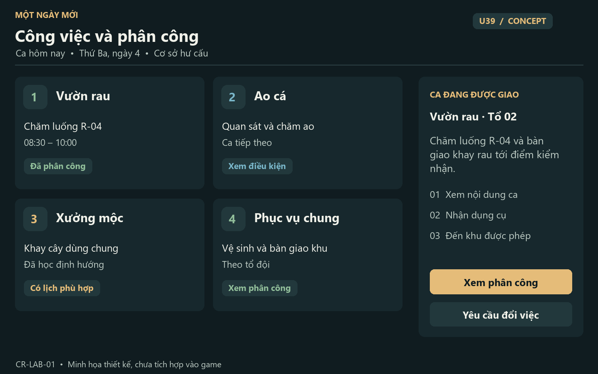
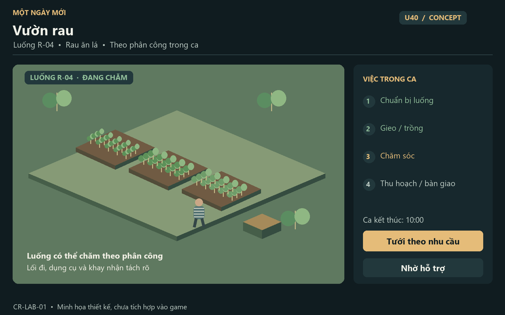
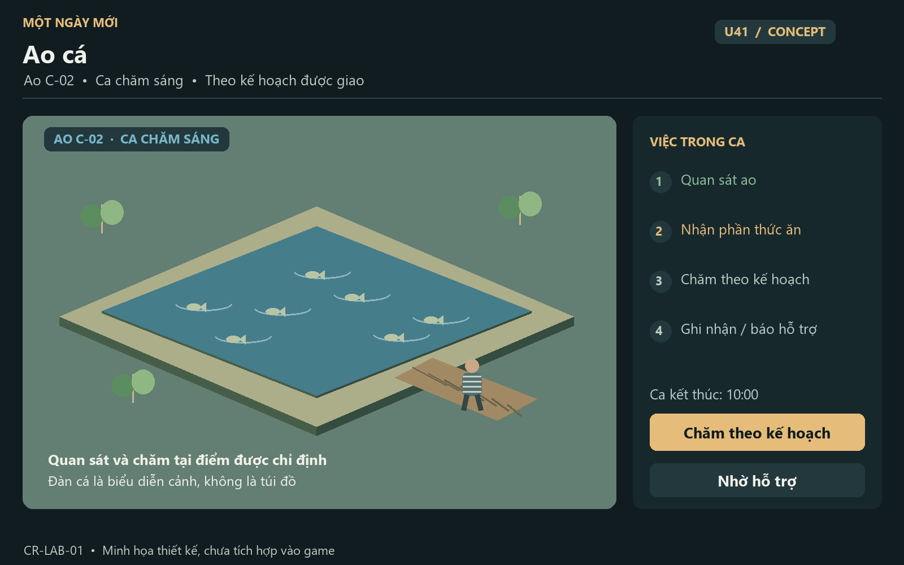
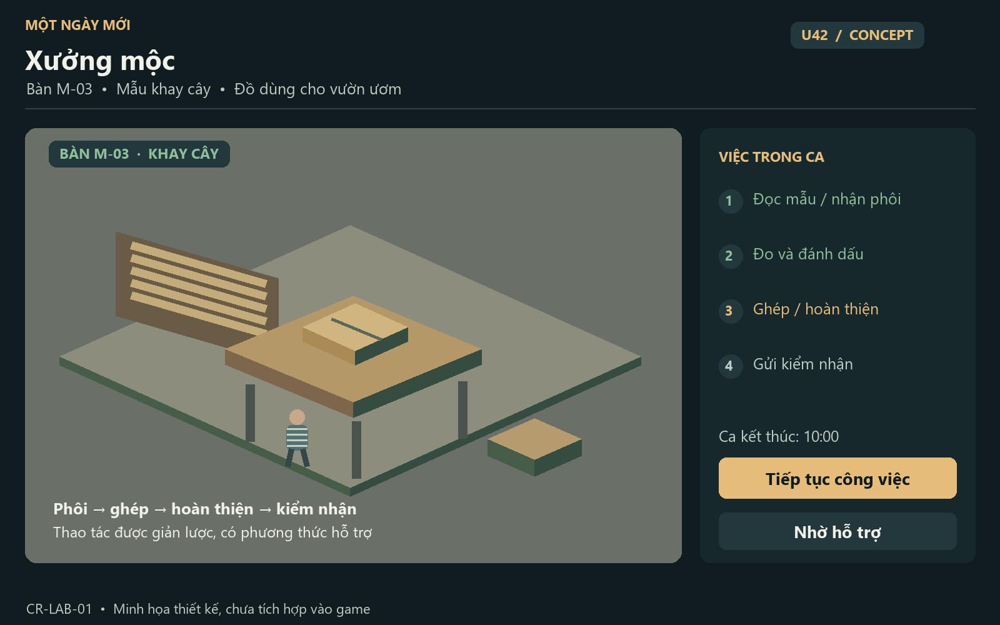
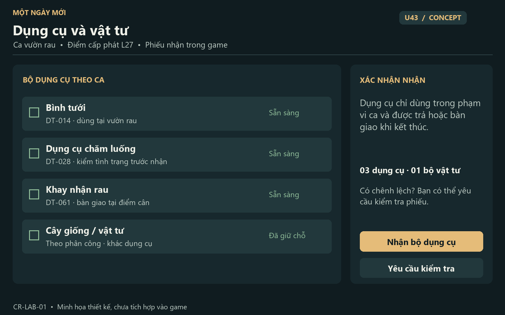
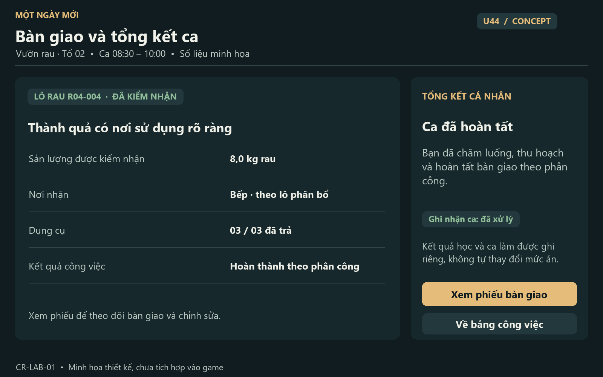

# 19 — UI và đồ họa khu lao động: art direction, mockup và screen contracts

CR-LAB-01 · Baseline thiết kế 1.3 · 02/11/2026 · **Concept thiết kế, chưa là UI hoặc asset đã tích hợp vào game.** Đọc cùng [18 — BA/domain/QA](18-labour-rehabilitation-spec.md). Bản Word gộp đủ hai phần: [Labour-Rehabilitation-BA-1.3.docx](../deliverables/Labour-Rehabilitation-BA-1.3.docx).

## 1. Định hướng hình ảnh

Từ khóa: bình dị, có trật tự, vật liệu có tuổi, ánh sáng ban ngày rõ, lao động có mục đích. Chất lượng chuyên nghiệp nằm ở tỷ lệ không gian, silhouette dụng cụ, animation có trọng lượng, tiến trình nhìn thấy và UI có thông tin đúng. Không chỉ thêm thanh XP, bảng neon hoặc đổi màu xưởng cũ. Không dùng ảnh minh họa dưới làm lời hứa đồ họa runtime.

Môi trường 3D là nhân vật chính; panel chỉ xuất hiện khi cần. Vườn rau có luống/khay/cây nhiều giai đoạn, đất và đường đi khác vật liệu; ao có mặt nước/cảnh ven và sàn tương tác; mộc có bàn/vật tư/WIP/đồ hoàn thiện. Mỗi khu phải đọc được công việc ngay cả khi ẩn HUD. Không dựng bản vẽ cơ sở thật hoặc thêm chi tiết vận hành an ninh.

Phong cách mockup: minh họa không gian isometric bằng hình học + panel sản phẩm, dùng màu/nhãn game tiếng Việt. Các cảnh này là **sơ đồ minh họa hướng bố cục**, không ảnh render PBR, không asset để cắm vào Babylon. Không cần Figma hoặc dịch vụ hình ảnh bên ngoài để đọc hồ sơ. Nếu sản xuất Figma sau này, giữ cùng component IDs, content hierarchy và states.

## 2. Tokens và components

| Token / component | Quy chuẩn thiết kế |
|---|---|
| Canvas/panel | Nền đậm `#101C20`, panel `#17282D`, surface `#22383C`; alpha chỉ dùng nơi đo contrast được |
| Text | Chính `#F0F1E9`, phụ `#BDCBC4`; chữ thông thường 16–18 px, label 14–16, số/giờ 18–24, heading 28–36 |
| Accent | Vàng ấm `#E5BC79` cho CTA; xanh lá `#91BE9A` cho hoàn tất; xanh nước `#79B6C9` cho ao; warning `#E6B67C`, error `#E7A09B` |
| Typography | Font Việt rõ; Segoe UI/system fallback trong mockup. Khi phát hành font phải có license/coverage, không coi font Windows là asset được phép redistribute |
| Spacing | Grid8, gutters24 desktop/16 compact; HUD không chiếm vùng ngắm/joystick; panel text tối đa 65ch |
| Buttons | Primary một action rõ, secondary trợ giúp/hủy, danger chỉ hành động mất dữ liệu thật; minimum target ưu tiên44 px |
| WorkCard | Ảnh/thumbnail nghề, tên, giờ/nơi, phân công/điều kiện, phương thức hỗ trợ; không chỉ icon/màu |
| AssignmentStrip | Tên ca, supervisor role, permitted place, end window, next step; click mở U39/U17 |
| StageStepper | Cây/cá/mộc hiển thị stage bằng icon+text, completed/current/locked với reason |
| StationPrompt | Verb, dụng cụ, thời gian game, prerequisite, cancel/assist; không spinner vô hạn |
| BatchChip | Mã lô ngắn, loại/số lượng/đơn vị, trạng thái kiểm, đích; người chơi thấy chuyển đi đâu |
| ToolReceiptRow | Loại/danh tính tool, tình trạng, số cấp/số trả, pending mismatch và xem phiếu |
| BeforeAfter | Cùng camera anchor/ánh sáng, slider tùy chọn có nút chuyển; không bắt drag |
| Progress | Task progress riêng với ca attendance và mức cây lớn; không một thanh dùng ba ý nghĩa |
| Accessibility | Text200%, contrast đo trên scene, reduced motion, captions, keyboard/touch/gamepad; không giảm credit/quality khi dùng assist |

Tất cả states có text: loading, empty, ready, locked-with-reason, pending, partially completed, interrupted, handed-over, completed, error/retry. Panel SP pause theo convention hiện có; countdown game-time dừng khi panel pause. HUD station đang hành động không tự dừng clock. MP tương lai phải đổi nhãn rõ, chưa mặc định có trong scope.

## 3. Mockup gallery — định nghĩa và giới hạn

Sáu ảnh 1600×1000 là concept, số liệu ví dụ [D]. File ảnh dùng nhúng Word, không phải screenshot chứng minh implementation. Màn cá không giả số liệu hóa học thật; mộc không mô tả thao tác máy cắt; UI không lộ source/schema/API cho người chơi.

### Concept U39 — Bảng phân công và lựa chọn công việc

### Concept U40 — Vườn rau và cảnh quan

### Concept U41 — Ao cá

### Concept U42 — Xưởng mộc

### Concept U43 — Nhận/trả dụng cụ

### Concept U44 — Kiểm nhận, bàn giao và tổng kết ca

## 4. Screen contracts U39–U44

Kế thừa C-UI phần05, không bỏ error/focus/performance vì có mockup. U39/43/44 là panel; U40/41/42 gồm scene station HUD và detail overlay. Các scene không cần renderer riêng cho mỗi panel. Mở menu không tự trao quyền tới station.

### U39 — Công việc và phân công

| Trường | Đặc tả |
|---|---|
| Purpose/hierarchy | Ca hôm nay → phân công đang có → lựa chọn đủ điều kiện → lịch/nhờ hỗ trợ → kết quả gần nhất |
| Layout | Desktop list nghề trái, detail/brief phải; compact một cột, mở detail có Back; tab loại việc không dùng 20 hotkeys |
| Content | Tên/nơi/giờ, kind học nghề/sản xuất/phục vụ chung, prerequisites, supervisor role, mức ghi nhận hư cấu, custody method |
| Actions | Xem terms, nhận/xác nhận phân công, yêu cầu đổi/nhẹ hơn, mở lịch/map tới route hợp lệ |
| States | No assignment, offered, assigned, active, overlap, no slot, not eligible, paused/excused; pending giữ selection |
| Transitions | U32/U17/LifeHub→U39; assignment→U43→station; trở lại không cancel ca đã commit |
| Input/accessibility | Card có accessible name + status; D-pad navigation, radio/select thay drag; aria-live khi xác nhận không đọc cả list mỗi frame |
| Performance/AC | Lazy thumbnail, chỉ active screen; UI39: một ca active, số liệu và reason khớp domain revision, click không bypass quyền |

### U40 — Luống rau / vườn / khay giống

| Trường | Đặc tả |
|---|---|
| Purpose/hierarchy | Scene luống đang chọn → crop/patch identity → stage → việc cần làm → output destination |
| Layout | HUD top nhỏ; panel task bên phải không che luống; contextual action dưới, không che joystick/mobile center |
| Content | Luống/cycle, loại cây mẫu, stage, nhu cầu chăm theo nhãn, thời điểm game tiếp theo; care budget và assignment |
| Actions | Xem brief, nhận task, gieo/chăm/tưới/thu theo stage, xem lịch, báo hỗ trợ; tùy chọn assist cùng effect |
| States | Empty/prepared/seedling/growing/ready/harvested; no seed, no tool, wrong phase, weather hold, pending QA, capacity full |
| Transitions | U39/U43→station; harvest→U44; Back đóng detail nhưng domain stage giữ nguyên |
| Input/accessibility | Luống có focus cycle bằng nút trái/phải, text list tương đương marker3D; không buộc click lá nhỏ hoặc timing |
| Visual/performance/AC | Four staged meshes minimum, instancing và tint vừa phải; UI40: stage nhìn và state giống nhau, retry không hai lô, camera không xuyên luống |

### U41 — Ao và kế hoạch chăm cá

| Trường | Đặc tả |
|---|---|
| Purpose/hierarchy | Ao được giao → kế hoạch trong ca → quan sát → thức ăn đã cấp → lịch thu/bàn giao |
| Layout | Scene/mặt nước trung tâm; task panel phải; nhãn không rải trên mỗi con cá |
| Content | Pond/cohort, stage, lần chăm đã ghi nhận, quan sát theo mức dễ hiểu, feed portion còn lại, người nhận báo vấn đề |
| Actions | Quan sát, cho ăn lượng được phân, ghi nhật ký, báo hỗ trợ, hỗ trợ thu khi order hợp lệ |
| States | Preparation/stocked/growing/harvest_ready; no portion, already cared, under observation, harvest pending, no authorization |
| Transitions | U39→U43→U41; observation→U30/service case; harvest→U44 |
| Input/accessibility | Fish motion cosmetic, không phải target cần bắt; có static marker và reduced-motion; sound có captions |
| Visual/performance/AC | Mặt nước dùng shader giới hạn; không dynamic reflection bắt buộc; UI41: không farm feed/XP hoặc xuống nước do assist, phase/stock giữ khi reload |

### U42 — Bàn mộc và work order

| Trường | Đặc tả |
|---|---|
| Purpose/hierarchy | Mẫu đang làm → vật tư/kit → stage → checklist chất lượng → nơi dùng |
| Layout | Scene bàn/WIP trái, stage panel phải; thumbnail mẫu có xoay bằng nút, không bắt drag |
| Content | Order ID, mẫu/ảnh mục tiêu, input reservations, số chi tiết, stage/điều kiện, QC reasons |
| Actions | Đọc mẫu, đánh dấu/ghép/hoàn thiện theo lựa chọn game, pause/help, gửi kiểm/nhận hướng dẫn làm lại |
| States | Not trained, no materials, in progress, station busy, interrupted, waiting inspection, rework, accepted/delivered |
| Transitions | U32 học prerequisites→U39/43→U42→U44; receipt giữ history nếu cần rework |
| Input/accessibility | Không mouse precision/QTE; lựa chọn button/socket có text và auto-complete; không penalties do run ở fps thấp |
| Visual/performance/AC | WIP thay mesh theo stage, woodgrain đúng hướng/scale; UI42: thành phẩm và quality có source, không duplicate input/output, assist outcomes tương đương |

### U43 — Dụng cụ và vật tư ca

| Trường | Đặc tả |
|---|---|
| Purpose/hierarchy | Ca/station → kit phải nhận → condition và số lượng → confirm receipt → pending return |
| Layout | List bên trái, receipt summary phải; compact stacked; sticky confirm không che hàng cuối |
| Content | Tool type/ID ngắn, cấp/trả, condition, custodian, scope, batch vật tư khác tool, mismatch reason |
| Actions | Xem kit, nhận, trả, báo hỏng/chênh lệch, nhờ kiểm, handover; không drop vào personal bag |
| States | Reserved/issued/returned/damaged/review; partial/atomic failure; empty kit allowed với task không dùng tool |
| Transitions | U39→U43→station; kết ca→U43 return→U44; Back không rollback receipt đã commit |
| Input/accessibility | Checkbox/quantity rõ, select all khi hợp lệ, không kéo icon; status không chỉ đỏ/xanh |
| Performance/AC | Icon atlas, paginate history; UI43: double submit một receipt, fail giữ kit đúng owner, thiếu tool không tự ghi người chơi có tội |

### U44 — Kiểm nhận, bàn giao và tổng kết

| Trường | Đặc tả |
|---|---|
| Purpose/hierarchy | Ca/lô → inspection → accepted/rework/held → destination → tool return → credit/XP recap |
| Layout | Hai phần Batch và Ca, tránh trộn kg rau với phút công; compact step rõ; receipt đọc offline |
| Content | Input/output quantities, quality reason, receiver role, công cá nhân vs tổ đội/NPC, settlement source và next action bằng text sản phẩm |
| Actions | Bàn giao lô, xem phiếu, xin kiểm lại, trả dụng cụ, kết ca; không cho tự approve quyền supervisor bằng nút player |
| States | Pending/accepted/held/rework/allocated/delivered/settled; capacity full hoặc write failed còn dữ liệu |
| Transitions | Station→U44→U43 hoặc U39/U32; receipt→U27/account; ending/release chỉ sau workflow riêng |
| Input/accessibility | Confirm có preview mất/giao gì; text không màu-only; progress không auto-focus lại khi quantity cập nhật |
| Performance/AC | Không renderer mới hoặc live stock toàn cơ sở; UI44: không settlement hai lần, output destination rõ, rework có hướng sửa |

## 5. Delta các UI hiện có

| UI hiện có | Delta lao động |
|---|---|
| U03/U36 setup | Không ép chọn nghề suốt đời; có sở thích nghề tùy chọn sau tiếp nhận, không tăng án/khả năng vì ngoại hình |
| U06 HUD / mobile HUD | Chip ca + next step; tool prompt/stage; không thêm 20 resource bars |
| U08 inventory/U27 receipts | Tool và institutional stock không vào bag; xem receipt cấp/trả ở đúng scope |
| U09/11/19 hồ sơ/kỹ năng/thành tựu | Ghi học nghề/ca đã hoàn tất; không gọi chứng chỉ thật hoặc thưởng làm quá sức |
| U12 nhiệm vụ | Work objective có phương án hỗ trợ/handover và system-blocked reason |
| U13 map/U17 schedule | Đích/lịch theo grant và eligibility; không vẽ tuyến ngoài cơ sở thật |
| U14 help/U15 dialogue/U18 notice | Hướng dẫn thao tác, safety orientation ngắn, notice nghỉ/thu hoạch/phân công; không spam cây lớn mỗi phút |
| U20/U25 saves/recovery | Metadata ca và active station, restore panel selection, labour version negotiation |
| U23 settings | Assist/reduced motion/input giữ outcomes tương đương; không setting nào mở khóa custody |
| U28 store/account | Points/credits hư cấu đúng owner; không bán output cơ sở như đồ cá nhân |
| U30/31 requests/care | Đổi việc/báo dụng cụ/sự cố và nghỉ có lý do; nguyên nhân riêng tư không public |
| U32 programs | Entry tới U39; prerequisite course và task production riêng, không ghi công ca bằng attendance lớp |
| U33 incidents | Sự cố lao động có fact/provenance/review; không chuyển receipt lỗi thẳng thành kỷ luật |
| U34/35 transfer/release | Tool/material/WIP handover, credit một lần; không cản release do incomplete goal |
| U37/38 custody | Xem việc được phép/đang hold và học lý thuyết tại buồng nếu có policy; không cho remote harvest |

Các màn còn lại giữ baseline; U24 vẫn chưa là multiplayer lao động. Player onboarding chọn nghề không cần nhập sức khỏe thật hoặc trích luật trong gameplay.

## 6. Không gian L23–L28 và nâng cấp L10

Tất cả bố cục là game blockout hư cấu. Kích thước chỉ chốt sau thử camera/clearance/animation. Không xây toàn bộ khu để trưng bày nếu chưa có task.

| ID | Art/level purpose | Props/slots/tương tác | Nav/camera/readiness |
|---|---|---|---|
| L23 | Vườn rau có luống, giàn thấp, lối công tác | Bed stages, khay, giỏ, vòi/điểm nước, bảng ca, điểm cân tạm; W01/02/04 | Luống không walkable, path đủ NPC/player, station approach và return anchor; scene update theo cycle |
| L24 | Ao cá và sàn chăm | Pond surface, bank plants, feed station, nhật ký, receiving point; W05 | Nước non-walkable, collider bờ/sàn và camera; fish cosmetic LOD, không physics cho từng con |
| L25 | Vườn ươm/cảnh quan | Tray stages, bàn thấp, mẫu patch hoa, thùng gom, shade mesh; W03/06/07 | Socket không chắn route; phương thức ngồi/assist; shadow và foliage có tier |
| L26 | Variant chăn nuôi nhỏ P2 | Chuồng/khu sạch, điểm cho ăn/nước, task board; W19 | Chưa có specialist content thì không playable; animal animation bounded, privacy/cleanliness và service anchors |
| L27 | Kho, dụng cụ và điểm kiểm nhận | Các phòng/điểm riêng: kit/tool, input stock, cân/QC, output và clean receiving | Không trộn tool bẩn với thực phẩm trên cùng quầy; queue slot/capacity/hygiene visual rõ |
| L28 | Sân phục vụ chung/bảo trì nhẹ | Cleaning zone, phân loại, patch trước/sau, vật tư sinh hoạt; W09/15/16/20 | Dynamic before/after không chặn exit; scope reservation, có route thay khi đóng task |
| L10 delta | Xưởng mộc có thứ tự công việc | Brief board → material rack → bench → assembly → finish → QC; W08/09/10 | Workstation slots riêng, props không vô tình thành lối đi trái quyền; camera trong xưởng không clip |

Các khu L06/L13/L07/L14/L17 tái sử dụng để phục vụ W11–14/18/20. Tổ đội không gộp mọi cohort chung station trái policy. NPC giám sát có visible task/animation, không biết toàn bộ hồ sơ riêng hoặc teleport sau lưng chỉ để giả hoạt động.

## 7. Asset brief và animation

| Nhóm | Yêu cầu sản xuất tối thiểu | Acceptance art |
|---|---|---|
| Rau/cây | 4–5 staged meshes/crop family, soil bed, seed tray, produce basket; 2 crop families cho P1 | Silhouette khác stage, scale hợp người, không một mesh phóng to; không cây xuyên người/đường |
| Nước/cá | Mặt nước tier thấp/cao, fish cluster LOD, feed effect ngắn, pond bank/sàn | Không shimmer/flicker; tắt reflection vẫn đọc stage; cá không biến mất thành inventory cosmetic |
| Mộc | Material rack, bench, phôi/WIP/finished mesh cho ít nhất khay cây và ghế thấp | Woodgrain đúng scale, màu material thống nhất, WIP chuyển đúng commit, không đồ trôi tay |
| Vườn/công ích | Flower patch before/after, tray, waste bins, cleaning kit, stacked textiles | Before/after cùng camera có thể kiểm; icon phân loại đi kèm text |
| Người | Walk with permitted carried prop, prepare bed, water, inspect, plant/harvest, feed, seated craft, assembly, clean, handover | Clip/pose có start/loop/end/cancel, feet/hand contacts kiểm, không animation nguy hiểm chi tiết |
| UI assets | Nghề thumbnails, 12–20 pictograms, stage icons, tool/lot states, receipt template | Một hệ stroke/material, readable small, no emoji làm icon chính, nội dung Việt đủ dấu |

Các số asset là target sản xuất, không phải file hiện có. Animated skeletal/IK phải review pipeline thực; mô hình ghép khối hiện tại không tự thành rig production vì tài liệu yêu cầu. Giữ fallback static/abstract khi animation chưa sẵn, nhãn progress vẫn chính xác.

## 8. Performance, responsive và visual QA

Không tăng tổng budget đã duyệt chỉ vì thêm ao/vườn. Medium ưu tiên một nghề gần đang render, các khu khác LOD/stream; shadow cây nhỏ/cluster theo tier, vật thể tĩnh merge/instance. Plant stage đổi theo event, không mỗi frame; không mỗi lá/cá một reducer database row. Chưa benchmark nên không ghi FPS, CCU hoặc lượng NPC “đảm bảo”.

Capture route: từ ca U39 → tool L27 → station → thao tác/tua → QC → về buồng. Kiểm day/night/rain, low/high, zoom/camera sát, busy NPC, empty/error/pending, U39–44 và scene trái quyền. Cùng build/seed/time/settings/camera để so sánh golden; mockup PNG không phải golden runtime.

Desktop 1280×720, compact 390×844 và 844×390 là fixture UI. Ảnh minh họa 1600×1000 không thay fixture. Focus order, text200%, keyboard, touch handedness, gamepad và trợ năng cần E2E; screenshot đơn không chứng minh dùng được. Khi responsive thu panel thành sheet phải để thấy task/current room và action, không phủ nút hủy/hỗ trợ.

## 9. Checklist review mockup và handoff

- Mỗi mockup có screen ID, task/context, hierarchy và CTA đúng contract; ví dụ số lượng là dữ liệu minh họa.
- Nguồn thực tế và giới hạn ở 18; luật không được biến thành tooltip kỹ thuật dày trong flow sản phẩm.
- Mỗi scene cho thấy nghề khác nhau; hub, tool và recap cũng có trạng thái lỗi/empty để viết content.
- UI đang nhìn thấy “được làm” phải khớp domain capability; ảnh không thể thay acceptance enforcement.
- Bản DOCX có mục lục tĩnh, heading, table header lặp, hình/caption, nguồn link và trang; kiểm container XML, số hình, sequence IDs và encoding Việt trước bàn giao.
- Chưa có Word/PDF renderer trong môi trường thì ghi rõ chưa kiểm pagination bằng Word; không tự nhận đã mở kiểm toàn bộ trang.
